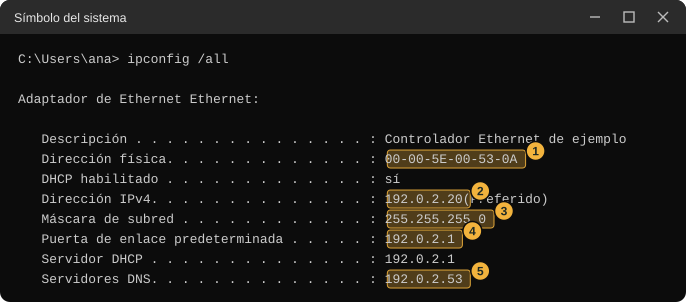
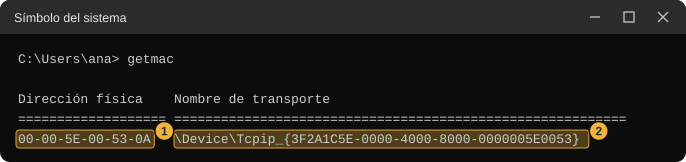
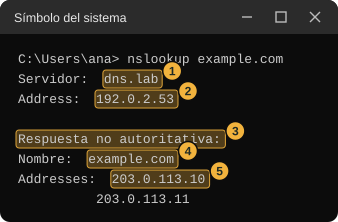
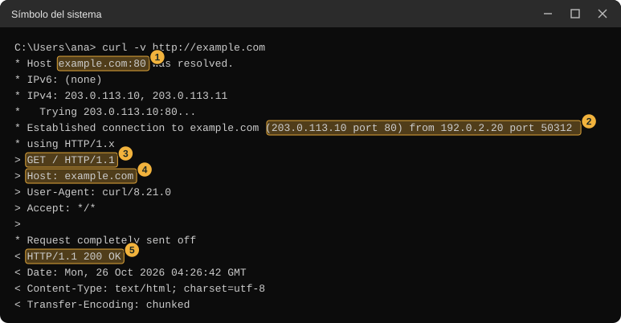
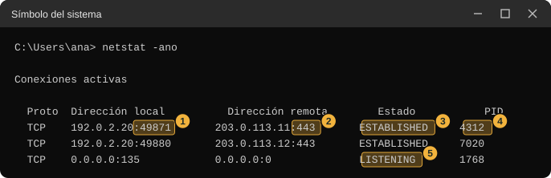
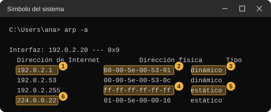

::: {.ficha}
|        |                                                                       |
|--------|-----------------------------------------------------------------------|
| Unidad | Unidad 2. Modelo OSI y arquitectura TCP/IP                             |
| Temas  | Práctica de los Temas 2 y 3, TCP/IP y capa de acceso con Ethernet       |
:::

Esta guía te lleva de la mano por la práctica de la Unidad 2. Con seis comandos de Windows vas a leer, en tu propio computador, los datos que cada capa de TCP/IP usa cuando abres una página: tu dirección MAC y tu dirección IP, el servidor DNS que traduce nombres, la conexión TCP con sus puertos, el mensaje HTTP y la tabla de vecinos de tu red local. Cada comando tiene su sección, con lo que significa, cómo se escribe, una imagen de lo que debes ver y una tabla que explica cada dato de la salida. Al final armas con tus datos la trama completa que sale de tu computador.

La guía de estudio de esta unidad explica la teoría de cada concepto. Aquí solo se repite lo necesario para entender lo que muestra cada comando, y se enlazan los temas cuando hace falta ir más a fondo.

## Antes de empezar

### Qué necesitas

- Un computador con Windows 10 u 11, conectado a una red por cable o por Wi-Fi.
- Una consola, que puede ser el Símbolo del sistema (`cmd`) o PowerShell. Las dos vienen con Windows.
- Un navegador, para abrir una página mientras practicas.
- Un lugar donde copiar la tabla de registro que aparece más abajo y anotar tus datos.

No necesitas permisos de administrador. Los comandos de esta guía no cambian la configuración de tu equipo.

### Cómo abrir la consola

Hay dos consolas y sirven igual para esta práctica.

El Símbolo del sistema ejecuta `cmd.exe`, que según Microsoft es el intérprete de comandos de Windows. Para abrirlo, abre el menú Inicio, escribe `cmd` y elige Símbolo del sistema. La línea donde escribes se llama prompt y empieza con la carpeta actual, por ejemplo `C:\Users\ana>`.

PowerShell es una consola más moderna. Según la documentación de Microsoft, la abres desde el menú Inicio escribiendo Windows PowerShell y eligiendo esa opción, o escribiendo `PowerShell` dentro de una consola ya abierta. Su prompt empieza con `PS`, por ejemplo `PS C:\Users\ana>`.

Si no estás seguro de cuál tienes abierta, mira el prompt. Una diferencia que importa en esta práctica es el comando `curl`, que se explica en el Paso 3.

### Qué es un comando y qué es una opción

Un comando es el nombre de un programa que escribes para que el computador haga algo. Una opción, que también se llama parámetro o *flag*, es una palabra que va después del comando y cambia lo que hace. En `ipconfig /all`, `ipconfig` es el comando y `/all` es la opción que pide la configuración completa. Escribes el comando, pulsas Enter y la consola imprime el resultado, que se llama salida.

Los comandos de esta guía se escriben tal cual aparecen en los bloques de código. Para copiarlos, usa el botón de copiar que aparece sobre cada bloque, o escríbelos tú.

### Cómo leer las imágenes

Las imágenes de esta guía reproducen la salida de cada comando en un Windows en español. Sus valores son de ejemplo y pertenecen a rangos que los estándares reservan para documentación, así que ninguno corresponde a un equipo real. La estructura, los nombres de las líneas y el orden son los que imprime Windows, y se comprobaron ejecutando cada comando. Los nombres `ana`, `dns.lab` y `sensores.lab` también son inventados. Tu salida tendrá otras direcciones, otro nombre de adaptador y, quizá, más líneas.

Cada imagen marca con un recuadro amarillo y un número los datos que debes mirar. La tabla que sigue a la imagen explica cada número.

### Dos reglas de seguridad

Usa solo los comandos y opciones de esta guía. Hay opciones de los mismos comandos que sí cambian la configuración de tu equipo o piden permisos que quizá no tengas. Según la documentación de Microsoft, `ipconfig /release` y `ipconfig /renew` sueltan y renuevan la configuración que recibió tu equipo, `arp -s` y `arp -d` agregan y borran entradas de la tabla de vecinos, y `netstat -b` falla si no tienes permisos suficientes.

Tu dirección MAC identifica la tarjeta de red de tu computador. Si compartes tus datos con otras personas, puedes tapar los tres últimos pares de la MAC sin que la práctica deje de funcionar.

### Mapa de la práctica

El siguiente diagrama muestra qué capa de TCP/IP lee cada comando. Algunos comandos tocan más de una capa porque una misma salida mezcla datos de distintos niveles.

::: {.diagrama}

<svg viewBox="0 0 760 330" xmlns="http://www.w3.org/2000/svg" role="img" aria-label="Mapa de los seis comandos y las capas que leen: en la capa de aplicación nslookup, que muestra el servidor DNS y las direcciones de un nombre, y curl -v, que muestra el mensaje HTTP; en la capa de transporte curl -v, que muestra los puertos de la conexión, y netstat -ano, que lista las conexiones TCP con sus puertos; en la capa de Internet ipconfig /all, que muestra la IP, la máscara, la puerta de enlace y el servidor DNS; en la capa de enlace getmac, que muestra la MAC, ipconfig /all, que también muestra la MAC, y arp -a, que muestra las MAC de los vecinos" font-family="Segoe UI, Inter, system-ui, sans-serif">
<text x="380" y="18" font-size="14" font-weight="700" fill="#12324f" text-anchor="middle">Qué capa lee cada comando</text>
<g font-size="13" font-weight="700" fill="#12324f" text-anchor="middle">
<rect x="20" y="34" width="170" height="40" rx="8" fill="#ece6fa" stroke="#bfb0e8"/><text x="105" y="59">Aplicación</text>
<rect x="200" y="34" width="170" height="40" rx="8" fill="#fdf0cf" stroke="#ebc866"/><text x="285" y="59">Transporte</text>
<rect x="380" y="34" width="170" height="40" rx="8" fill="#dcebf9" stroke="#9fc2e6"/><text x="465" y="59">Internet</text>
<rect x="560" y="34" width="180" height="40" rx="8" fill="#dff1e6" stroke="#9bcfb0"/><text x="650" y="59">Enlace</text>
</g>
<g font-size="12.5" fill="#12324f">
<rect x="20" y="88" width="170" height="64" rx="8" fill="#ffffff" stroke="#cfd8e3"/><text x="32" y="109" font-weight="700">nslookup</text><text x="32" y="127" fill="#5b6876">servidor DNS y direcciones</text><text x="32" y="143" fill="#5b6876">de un nombre</text>
<rect x="20" y="164" width="170" height="64" rx="8" fill="#ffffff" stroke="#cfd8e3"/><text x="32" y="185" font-weight="700">curl -v</text><text x="32" y="203" fill="#5b6876">el mensaje HTTP, petición</text><text x="32" y="219" fill="#5b6876">y respuesta</text>
<rect x="200" y="88" width="170" height="64" rx="8" fill="#ffffff" stroke="#cfd8e3"/><text x="212" y="109" font-weight="700">curl -v</text><text x="212" y="127" fill="#5b6876">los puertos de origen y de</text><text x="212" y="143" fill="#5b6876">destino de la conexión</text>
<rect x="200" y="164" width="170" height="64" rx="8" fill="#ffffff" stroke="#cfd8e3"/><text x="212" y="185" font-weight="700">netstat -ano</text><text x="212" y="203" fill="#5b6876">tus conexiones TCP con</text><text x="212" y="219" fill="#5b6876">sus puertos</text>
<rect x="380" y="88" width="170" height="64" rx="8" fill="#ffffff" stroke="#cfd8e3"/><text x="392" y="109" font-weight="700">ipconfig /all</text><text x="392" y="127" fill="#5b6876">tu IP, la máscara, la puerta</text><text x="392" y="143" fill="#5b6876">de enlace y el servidor DNS</text>
<rect x="560" y="88" width="180" height="64" rx="8" fill="#ffffff" stroke="#cfd8e3"/><text x="572" y="109" font-weight="700">getmac</text><text x="572" y="127" fill="#5b6876">la MAC de cada tarjeta</text><text x="572" y="143" fill="#5b6876">de red</text>
<rect x="560" y="164" width="180" height="64" rx="8" fill="#ffffff" stroke="#cfd8e3"/><text x="572" y="185" font-weight="700">arp -a</text><text x="572" y="203" fill="#5b6876">las MAC de tus vecinos y</text><text x="572" y="219" fill="#5b6876">de la puerta de enlace</text>
</g>
<text x="380" y="262" font-size="12" fill="#5b6876" text-anchor="middle">ipconfig /all también muestra tu MAC, que pertenece a la capa de enlace.</text>
<text x="380" y="282" font-size="12" fill="#5b6876" text-anchor="middle">Los comandos de cada columna muestran datos de esa capa, no el tráfico completo.</text>
</svg>

:::

### Tu tabla de registro

Copia esta tabla donde prefieras. Irás llenando las dos últimas columnas a medida que avances por los pasos, y con ella armas la trama en el Paso 6.

::: {.tabla-ancha}

| Dato | Se obtiene con | Tu valor | Capa de TCP/IP |
|---|---|---|---|
| Dirección física (MAC) | `ipconfig /all` y `getmac` | | |
| Dirección IPv4 | `ipconfig /all` | | |
| Máscara de subred | `ipconfig /all` | | |
| Puerta de enlace predeterminada | `ipconfig /all` | | |
| Servidor DNS | `ipconfig /all` y `nslookup` | | |
| IP del servidor de example.com | `nslookup` | | |
| Tu puerto de origen | `curl -v` | | |
| Puerto de destino | `curl -v` | | |
| Línea de petición HTTP | `curl -v` | | |
| MAC de la puerta de enlace | `arp -a` | | |

:::

## Paso 1. Tu configuración de red

Empiezas por averiguar quién eres en la red: qué dirección MAC tiene tu tarjeta, qué dirección IP recibiste y a quién le pides ayuda para salir de la red local y para traducir nombres. Usas dos comandos, `ipconfig` y `getmac`.

### ipconfig /all

*Qué es.* `ipconfig` es un comando de Windows que muestra la configuración de red de tu equipo. Sin opciones, según la documentación de Microsoft, muestra las direcciones IPv4 e IPv6, la máscara de subred y la puerta de enlace de cada adaptador. Con la opción `/all` muestra la configuración completa de todos los adaptadores, y un adaptador puede ser una tarjeta física o una conexión lógica.

*Escríbelo.*

```text
ipconfig /all
```

*Qué verás.* Una lista de adaptadores, cada uno con su bloque de líneas. La imagen muestra el bloque de un adaptador de cable, con las líneas que usarás en la práctica.

::: {.tabla-ancha}

<figure class="figure"><figcaption class="figure-caption">Salida de ipconfig /all con cinco datos marcados: la dirección física, la dirección IPv4, la máscara de subred, la puerta de enlace predeterminada y los servidores DNS.</figcaption></figure>

:::

*Qué es cada cosa.*

::: {.tabla-ancha}

| N | Línea de la salida | Qué es | Capa | Para qué la usas |
|---|---|---|---|---|
| | Adaptador de Ethernet Ethernet | El nombre del adaptador de red al que pertenecen las líneas siguientes. Una conexión Wi-Fi aparece como Adaptador de LAN inalámbrica. | | Elegir el bloque correcto |
| | Descripción | El modelo de la tarjeta de red. | | Reconocer el adaptador |
| 1 | Dirección física | La dirección MAC, un número de 48 bits asignado a la tarjeta de red, escrito con seis pares de dígitos hexadecimales. En un adaptador virtual o con dirección aleatoria puede no ser la de fábrica. | Enlace | Es el origen de tu trama (Paso 6) |
| | DHCP habilitado | Indica que tu equipo recibe su configuración de un servidor DHCP, un servicio que según el RFC 2131 entrega parámetros de configuración a los equipos de la red, entre ellos la dirección IP. | | Entender de dónde sale tu IP |
| 2 | Dirección IPv4 | La dirección IP de tu equipo en esta red, de 32 bits, escrita con cuatro números separados por puntos. | Internet | Es el origen de tu datagrama |
| 3 | Máscara de subred | Indica qué parte de la dirección IP identifica la red y cuál identifica al equipo. Según el RFC 950, es una máscara de bits cuyos bits en uno corresponden al número de red y al de subred. | Internet | Saber qué equipos están en tu red local |
| 4 | Puerta de enlace predeterminada | La dirección IP del equipo al que tu computador entrega lo que va hacia otras redes. El RFC 1122 la llama gateway predeterminado. | Internet | Es el destino de tu trama cuando visitas una página de otra red (Paso 5 y Paso 6) |
| | Servidor DHCP | El equipo que te entregó la configuración. | | Solo informativo |
| 5 | Servidores DNS | La dirección del servidor al que tu computador le pregunta qué dirección IP corresponde a un nombre. Puede ser una dirección IPv6, más larga y con letras. | Aplicación | Compararlo con el servidor del Paso 2 |

:::

*Qué anotar.* En tu tabla de registro: la dirección física, la dirección IPv4, la máscara de subred, la puerta de enlace predeterminada y el servidor DNS. Asigna a cada dato su capa de TCP/IP con ayuda de la columna Capa de la tabla.

*Si tu salida es distinta.*

- Hay varios bloques de adaptadores, incluso virtuales y desconectados. La documentación de Microsoft indica que `/all` muestra todos. Usa el bloque que tenga una dirección IPv4 y una puerta de enlace predeterminada, que es el adaptador por el que sales a la red.
- El servidor DNS aparece como una dirección IPv6, larga y con letras. Anota la primera dirección IPv4 de la lista, si hay una, o la dirección IPv6 completa.
- Aparece más de una línea de dirección IPv6. IPv6 es otra versión del protocolo IP que esta práctica no usa, así que puedes ignorar esas líneas.
- Tu dirección IPv4 empieza con `169.254`. El RFC 3927 define ese bloque para direcciones de enlace local, que un equipo se asigna solo cuando no consigue otra, y que sirven únicamente para hablar con equipos del mismo segmento. Si te ocurre, tu equipo no obtuvo configuración del servidor DHCP y no podrás completar los pasos que salen de tu red.
- Tu equipo usa Wi-Fi. Los datos se leen igual. La dirección física será la de la tarjeta inalámbrica.

### getmac

*Qué es.* `getmac` es un comando de Windows que, según la documentación de Microsoft, devuelve la dirección MAC de cada tarjeta de red del equipo y la lista de protocolos de red asociados a cada una. Sirve para comprobar la MAC que viste en `ipconfig /all` y para saber cuántas tarjetas tiene tu equipo.

*Escríbelo.*

```text
getmac
```

Si tu equipo tiene varias tarjetas y quieres saber a cuál corresponde cada dirección, usa la opción `/v`, que según Microsoft muestra información detallada, con el nombre de la conexión y del adaptador.

```text
getmac /v
```

*Qué verás.*

::: {.tabla-ancha}

<figure class="figure"><figcaption class="figure-caption">Salida de getmac con la dirección física marcada con el número uno y el nombre de transporte marcado con el número dos.</figcaption></figure>

:::

*Qué es cada cosa.*

| N | Parte de la salida | Qué es |
|---|---|---|
| 1 | Dirección física | La misma MAC que viste en `ipconfig /all`. Debe coincidir. |
| 2 | Nombre de transporte | Un identificador que Windows asocia a la tarjeta. No lo necesitas en esta práctica. |

La documentación de Microsoft indica que `getmac` admite los formatos `table`, `list` y `csv` con la opción `/fo`, y que el formato por defecto es la tabla. En algunos equipos la opción `/fo list` imprime una tabla, así que esta guía usa la salida por defecto.

*Qué anotar.* Comprueba que la MAC coincide con la que anotaste en el paso anterior. Si tienes varias, elige la de la tarjeta que usas para conectarte.

*Si tu salida es distinta.* Un adaptador sin conexión, como una tarjeta Bluetooth, puede mostrar en lugar del nombre de transporte el texto Medios desconectados. Ignóralo.

## Paso 2. Cómo se resuelve un nombre

Tu computador necesita una dirección IP para hablar con un servidor, pero tú escribes nombres. Aquí le preguntas directamente al servidor DNS qué dirección corresponde a `example.com`, un dominio que el RFC 2606 reserva para ejemplos y documentación.

*Qué es.* `nslookup` es una herramienta de Windows que, según su documentación, muestra información para diagnosticar la infraestructura DNS. En el modo que usarás, el primer parámetro es el nombre que quieres buscar. Si no indicas un segundo parámetro, usa el servidor DNS que tu equipo tiene configurado.

*Escríbelo.*

```text
nslookup example.com
```

*Qué verás.*

::: {.tabla-ancha}

<figure class="figure"><figcaption class="figure-caption">Salida de nslookup example.com con cinco datos marcados: el nombre del servidor DNS, su dirección, el aviso de respuesta no autoritativa, el nombre consultado y las direcciones obtenidas.</figcaption></figure>

:::

*Qué es cada cosa.*

::: {.tabla-ancha}

| N | Línea de la salida | Qué es |
|---|---|---|
| 1 | Servidor | El nombre del servidor DNS al que preguntó tu equipo. Si ese servidor no tiene un nombre registrado, Windows imprime `UnKnown`. |
| 2 | Address, bajo Servidor | La dirección IP de ese servidor DNS. Debe coincidir con la que anotaste en `ipconfig /all`. |
| 3 | Respuesta no autoritativa | Un aviso que puede aparecer entre los datos del servidor y la respuesta. Según el RFC 1035, una respuesta autoritativa viene de un servidor que es autoridad para ese nombre. Este aviso indica que el servidor que respondió no lo es, algo normal cuando contesta desde su memoria. |
| 4 | Nombre | El nombre que preguntaste. |
| 5 | Addresses | Las direcciones IP que corresponden al nombre. Pueden ser varias, y pueden incluir direcciones IPv6, más largas y con letras. |

:::

*Qué anotar.* El servidor DNS que respondió y la primera dirección IPv4 de `example.com`.

*Si tu salida es distinta.* La documentación de Microsoft describe los mensajes de error de `nslookup`. Un mensaje `timed out` significa que el servidor no respondió en el tiempo previsto. `No response from server` indica que no hay un servidor DNS funcionando en esa dirección. `Non-existent domain` indica que el nombre no existe, y la documentación de Microsoft lo escribe `Nonexistent domain`. Si ves alguno, comprueba que tienes conexión y repite el comando. Estos mensajes pueden aparecer en inglés aunque el resto de la salida esté en español, como el `Non-existent domain` que imprimió `nslookup` en una prueba en Windows en español.

## Paso 3. La petición HTTP

Ahora pides la página de `example.com` y observas lo que tu computador envía y lo que recibe. Para eso usas `curl` con la opción `-v`.

*Qué es.* `curl` es una herramienta de línea de comandos para transferir datos hacia y desde un servidor. Según Microsoft, viene incluida con Windows. La opción `-v`, de *verbose* (detallado), hace que curl imprima lo que envía y lo que recibe. Según la documentación de curl, las líneas que empiezan con `>` son cabeceras que envía curl, las que empiezan con `<` son cabeceras que recibe, y las que empiezan con `*` son información adicional sobre lo que curl hace.

*Una advertencia sobre PowerShell.* Según Microsoft, en Windows PowerShell 5.1 la palabra `curl` es un alias de otro comando, `Invoke-WebRequest`, que acepta otros parámetros y no hace lo mismo. Si usas esa versión, escribe `curl.exe`. En el Símbolo del sistema basta con `curl`.

*Escríbelo.*

```text
curl -v http://example.com
```

Si usas PowerShell 5.1:

```text
curl.exe -v http://example.com
```

*Qué verás.* Una lista larga de líneas, que termina con el contenido de la página. La imagen muestra el comienzo, que es lo que necesitas.

::: {.tabla-ancha}

<figure class="figure"><figcaption class="figure-caption">Salida de curl -v con cinco puntos marcados: la resolución del nombre, la conexión establecida con los puertos, la línea de petición GET, la cabecera Host y la línea de estado de la respuesta.</figcaption></figure>

:::

*Qué es cada cosa.*

::: {.tabla-ancha}

| N | Línea de la salida | Qué es | Capa |
|---|---|---|---|
| 1 | Host example.com:80 was resolved | curl obtuvo la dirección IP del nombre, con una consulta DNS como la del Paso 2, y usará el puerto 80, el que se usa por defecto para HTTP. | Aplicación |
| | IPv4 | Las direcciones IPv4 que obtuvo para el nombre. Si ves una línea IPv6 con `(none)`, curl no obtuvo una dirección IPv6 para usar en esta conexión, aunque `nslookup` muestre direcciones IPv6. | Aplicación |
| | Trying | curl intenta abrir una conexión TCP con esa dirección y ese puerto. | Transporte |
| 2 | Established connection to ... from ... | La conexión TCP quedó abierta. Muestra la IP y el puerto de destino y, después de la palabra from, tu IP y tu puerto de origen. | Transporte e Internet |
| | using HTTP/1.x | La versión del protocolo HTTP que usa curl. | Aplicación |
| 3 | GET / HTTP/1.1 | La línea de petición: el método GET pide un recurso, la barra indica el recurso (la raíz del sitio) y HTTP/1.1 la versión. | Aplicación |
| 4 | Host: example.com | Una cabecera que dice a qué nombre va dirigida la petición. El RFC 9110 define esta cabecera. | Aplicación |
| | User-Agent y Accept | Cabeceras que identifican a curl y dicen qué tipos de contenido acepta. | Aplicación |
| | Request completely sent off | curl avisa que terminó de enviar la petición. | Aplicación |
| 5 | HTTP/1.1 200 OK | La línea de estado de la respuesta. El código 200 significa que el servidor entregó el recurso. | Aplicación |
| | Date, Content-Type y Transfer-Encoding | Cabeceras de la respuesta, con la fecha, el tipo de contenido y la forma en que viene el cuerpo. | Aplicación |

:::

*Qué anotar.* Tu puerto de origen y el puerto de destino, la IP de destino, la línea de petición y la línea de estado.

*Si tu salida es distinta.*

- Las versiones antiguas de curl escriben la línea 2 como `Connected to ...`, sin los datos de origen, y no tienen las líneas `Host ... was resolved` ni `IPv4`. Si tu línea de conexión no trae tu puerto de origen, lo obtienes en el Paso 4.
- La línea de estado puede ser distinta de 200, por ejemplo una redirección con un código 301 o 302. El ejercicio sigue valiendo.
- Si curl no consigue resolver el nombre, vuelve al Paso 2 y comprueba que `nslookup` responde.

## Paso 4. Los puertos de tus conexiones

`curl` ya te mostró un puerto de origen y uno de destino. Con `netstat` puedes ver los de todas las conexiones TCP que tiene abiertas tu computador en este momento.

*Qué es.* `netstat` muestra, según Microsoft, las conexiones TCP activas y los puertos en los que el equipo escucha. Sus opciones cambian lo que muestra: `-a` incluye todas las conexiones y los puertos en escucha, `-n` escribe las direcciones y los puertos como números en vez de nombres, y `-o` agrega el identificador del proceso que abrió cada conexión. Con `-ano` las tres juntas.

*Escríbelo.* Antes, abre una página en tu navegador y déjala abierta, para que exista una conexión que mirar.

```text
netstat -ano
```

*Qué verás.* Una lista que puede ser larga. La imagen muestra tres filas.

::: {.tabla-ancha}

<figure class="figure"><figcaption class="figure-caption">Salida de netstat -ano con tres conexiones y cinco datos marcados: el puerto local, el puerto remoto, el estado ESTABLISHED, el identificador de proceso y el estado LISTENING.</figcaption></figure>

:::

*Qué es cada cosa.*

::: {.tabla-ancha}

| N | Columna o valor | Qué es |
|---|---|---|
| | Proto | El protocolo de transporte de la fila. Verás sobre todo TCP. `netstat -ano` también lista filas UDP, que no tienen estado. |
| 1 | Dirección local, número tras los dos puntos | Tu puerto de origen. Lo elige tu computador para cada conexión. Microsoft documenta que Windows usa por defecto los puertos 49152 a 65535 para las conexiones salientes. |
| 2 | Dirección remota, número tras los dos puntos | El puerto de destino, el del servicio al que te conectaste. El 80 es el de HTTP y el 443 el de HTTPS, según el registro de IANA. |
| 3 | Estado ESTABLISHED | La conexión TCP está abierta y puede intercambiar datos. |
| 4 | PID | El identificador del proceso, el programa de tu equipo, que abrió la conexión. Puedes buscarlo en el Administrador de tareas. |
| 5 | Estado LISTENING | Tu equipo espera conexiones entrantes en ese puerto. En esa fila la dirección remota aparece con ceros porque todavía no hay nadie conectado. |

:::

*Qué anotar.* Elige una fila con estado ESTABLISHED y anota el puerto local y el puerto remoto. Comprueba que el puerto local está entre 49152 y 65535, y que el remoto es el de un servicio conocido, casi siempre 80 o 443. La conexión que abrió `curl` ya terminó, así que su puerto no aparece aquí. Lo que ves es la conexión de tu navegador, y sirve para comprobar cómo es un puerto de origen.

*Si tu salida es distinta.*

- Muchas filas con direcciones que no reconoces. Tu computador mantiene conexiones de otros programas, además del navegador. Elige la que corresponda a un puerto remoto 443 o 80.
- Ninguna fila ESTABLISHED. Abre una página en el navegador y repite el comando.
- Las columnas no se alinean con los títulos. Windows imprime así el encabezado, no es un error tuyo.

## Paso 5. Los vecinos de tu red local

Tu computador no habla con otros equipos usando solo direcciones IP. En la red local necesita la dirección MAC de cada uno, y la aprende con un protocolo llamado ARP. `arp -a` te muestra lo que ya aprendió.

*Qué es.* `arp` muestra y modifica, según Microsoft, las entradas de la caché ARP, la tabla donde tu equipo guarda qué dirección MAC corresponde a cada dirección IP. Con la opción `-a` solo muestra las entradas actuales, una tabla por cada adaptador.

*Escríbelo.* Abre antes una página en el navegador para que tu equipo haya hablado con su puerta de enlace.

```text
arp -a
```

*Qué verás.*

::: {.tabla-ancha}

<figure class="figure"><figcaption class="figure-caption">Salida de arp -a con cuatro filas y seis datos marcados: la IP y la MAC de la puerta de enlace, el tipo dinámico, la dirección de difusión, el tipo estático y una dirección de multidifusión.</figcaption></figure>

:::

*Qué es cada cosa.*

::: {.tabla-ancha}

| N | Dato | Qué es |
|---|---|---|
| | Interfaz | La dirección IP de tu adaptador, el que tiene esta tabla. |
| 1 | Dirección de Internet, la IP de tu puerta de enlace | La IP que anotaste en el Paso 1 como puerta de enlace predeterminada. |
| 2 | Dirección física de esa fila | La MAC de tu puerta de enlace. Es el dato que necesitas para armar la trama. |
| 3 | Tipo dinámico | La entrada se aprendió con ARP. |
| 4 | ff-ff-ff-ff-ff-ff | La dirección MAC de difusión: una trama enviada ahí la reciben todos los equipos de la red local. |
| 5 | Tipo estático | Una entrada fija que no se aprendió con ARP, como la de difusión. |
| 6 | Direcciones que empiezan por 224 | Direcciones IP de multidifusión, un tipo de dirección de grupo que el RFC 1112 ubica entre 224.0.0.0 y 239.255.255.255. Su MAC empieza por 01-00-5e. Puedes ignorarlas. |

:::

*Qué anotar.* La MAC de tu puerta de enlace, en la fila cuya IP anotaste en el Paso 1.

*Si tu salida es distinta.*

- Tu puerta de enlace no aparece. La tabla solo guarda equipos con los que tu computador habló hace poco. Abre una página en el navegador y repite el comando.
- Hay varias interfaces. Busca la tabla cuya Interfaz coincide con tu dirección IPv4.
- Tu salida tiene muchas filas. Busca solo la de tu puerta de enlace y la de difusión.

## Paso 6. Arma la trama con tus datos

Con la tabla de registro completa ya tienes los datos para armar la trama que sale de tu computador cuando pides `http://example.com`. Una trama Ethernet envuelve un datagrama IP, que envuelve un segmento TCP, que envuelve la petición HTTP, y cada capa aporta sus campos.

El siguiente ejemplo resuelto usa los datos de Ana y marca de qué comando sale cada campo. Observa que la dirección MAC de destino es la de la puerta de enlace y no la del servidor de `example.com`, porque ese servidor está en otra red. El RFC 1122 establece que, cuando el destino no está en una red conectada directamente, el equipo debe elegir un gateway de su lista de gateways predeterminados y entregarle el datagrama. Por eso la trama sale hacia la MAC del gateway, mientras que el datagrama conserva la IP del servidor lejano.

::: {.diagrama}

<svg viewBox="0 0 760 360" xmlns="http://www.w3.org/2000/svg" role="img" aria-label="Ejemplo resuelto de la trama que sale del portátil de Ana al pedir example.com. Trama Ethernet con MAC destino 00-00-5E-00-53-01 que es la puerta de enlace y sale de arp -a, MAC origen 00-00-5E-00-53-0A que sale de getmac y EtherType 0x0800. Datagrama IP con IP origen 192.0.2.20 que sale de ipconfig, IP destino 203.0.113.10 que sale de nslookup y protocolo 6. Segmento TCP con puerto origen 50312 y puerto destino 80 que salen de curl o netstat. Petición HTTP con línea GET barra HTTP/1.1 y cabecera Host example.com que salen de curl" font-family="Segoe UI, Inter, system-ui, sans-serif">
<text x="380" y="18" font-size="14" font-weight="700" fill="#12324f" text-anchor="middle">Ejemplo resuelto: la trama de Ana hacia example.com</text>
<rect x="20" y="30" width="720" height="320" rx="12" fill="#f5f7fa" stroke="#cfd8e3"/>
<g fill="#12324f"><text x="38" y="54" font-size="13" font-weight="700">Trama Ethernet (enlace)</text><text x="38" y="74" font-size="12" fill="#5b6876">MAC destino: 00-00-5E-00-53-01 (arp -a, la puerta de enlace)</text><text x="38" y="92" font-size="12" fill="#5b6876">MAC origen: 00-00-5E-00-53-0A (getmac), EtherType: 0x0800 (IPv4)</text></g>
<rect x="60" y="104" width="640" height="236" rx="10" fill="#eef4fa" stroke="#c7d6e6"/>
<g fill="#12324f"><text x="78" y="128" font-size="13" font-weight="700">Datagrama IP (Internet)</text><text x="78" y="148" font-size="12" fill="#5b6876">IP origen: 192.0.2.20 (ipconfig /all), IP destino: 203.0.113.10 (nslookup)</text><text x="78" y="166" font-size="12" fill="#5b6876">Protocolo: 6, que corresponde a TCP</text></g>
<rect x="100" y="178" width="560" height="150" rx="8" fill="#e4f2f1" stroke="#8fc9c5"/>
<g fill="#12324f"><text x="118" y="202" font-size="13" font-weight="700" fill="#0e6f6c">Segmento TCP (transporte)</text><text x="118" y="222" font-size="12" fill="#5b6876">Puerto origen: 50312 (curl -v), Puerto destino: 80 (curl -v)</text></g>
<rect x="140" y="234" width="480" height="82" rx="6" fill="#ffffff" stroke="#8fc9c5"/>
<g fill="#12324f"><text x="158" y="258" font-size="13" font-weight="700">Petición HTTP (aplicación)</text><text x="158" y="278" font-size="12" fill="#5b6876">Línea de petición: GET / HTTP/1.1 (curl -v)</text><text x="158" y="296" font-size="12" fill="#5b6876">Cabecera Host: example.com (curl -v)</text></g>
</svg>

:::

Ahora hazlo con tus datos. Arma las cuatro cajas anidadas y completa cada campo con los valores de tu tabla de registro. Para cada campo, anota entre paréntesis el comando de donde lo sacaste. Después marca con un color qué campos lee cada uno de estos tres equipos: el switch de tu red, tu puerta de enlace y el servidor de destino. El switch solo lee la capa de enlace. La puerta de enlace llega hasta la capa de Internet y reenvía el datagrama en una trama nueva, con otras direcciones MAC. El servidor de destino recibe esa trama nueva y lee todas las capas.

## Glosario de la práctica

::: {.tabla-ancha}

| Término | Qué es |
|---|---|
| Adaptador de red | La tarjeta, física o lógica, por la que tu equipo se conecta a una red. |
| ARP | Protocolo que averigua qué dirección MAC corresponde a una dirección IP dentro de la red local (RFC 826). |
| Caché ARP | La tabla donde tu equipo guarda las direcciones MAC que ya aprendió. Es lo que muestra `arp -a`. |
| Comando | El nombre de un programa que escribes en la consola. |
| DHCP | Servicio que entrega a los equipos su configuración de red, incluida la dirección IP (RFC 2131). |
| Difusión (broadcast) | Envío dirigido a todos los equipos de la red local. Su MAC es ff-ff-ff-ff-ff-ff. |
| DNS | Servicio que traduce nombres en direcciones IP (RFC 1034 y RFC 1035). |
| Dirección IP | El número de 32 bits, en IPv4, que identifica a tu equipo en una red y sirve para llevar datagramas entre redes. |
| Dirección MAC | El número de 48 bits asignado a una tarjeta de red, que sirve para entregar tramas dentro de la red local. |
| ESTABLISHED | Estado de una conexión TCP abierta y lista para intercambiar datos. |
| HTTP | Protocolo de la capa de aplicación con el que un navegador pide y recibe páginas (RFC 9110 y RFC 9112). |
| Máscara de subred | Indica qué parte de una dirección IP identifica la red y cuál identifica al equipo (RFC 950). |
| Opción | Una palabra que va tras el comando y cambia lo que hace. |
| PID | El identificador numérico de un proceso en tu equipo. |
| Prompt | La línea de la consola donde escribes, que muestra la carpeta actual. |
| Puerta de enlace predeterminada | El equipo al que entregas lo que va hacia otras redes (RFC 1122). |
| Puerto | Un número que identifica el servicio o el programa dentro de un equipo, en la capa de transporte. |
| Salida | El texto que imprime un comando después de ejecutarse. |
| TCP | Protocolo de transporte que abre una conexión confiable entre dos puertos. |

:::

## Recursos

- Microsoft. Referencia de comandos de Windows Server: [cmd](https://learn.microsoft.com/en-us/windows-server/administration/windows-commands/cmd), [ipconfig](https://learn.microsoft.com/en-us/windows-server/administration/windows-commands/ipconfig), [getmac](https://learn.microsoft.com/en-us/windows-server/administration/windows-commands/getmac), [nslookup](https://learn.microsoft.com/en-us/windows-server/administration/windows-commands/nslookup), [netstat](https://learn.microsoft.com/en-us/windows-server/administration/windows-commands/netstat) y [arp](https://learn.microsoft.com/en-us/windows-server/administration/windows-commands/arp). Microsoft Learn.
- Microsoft. "Starting Windows PowerShell". Microsoft Learn. [learn.microsoft.com, starting-windows-powershell](https://learn.microsoft.com/en-us/powershell/scripting/windows-powershell/starting-windows-powershell)
- Microsoft. "curl on Windows". Microsoft Learn. [learn.microsoft.com, windows/curl](https://learn.microsoft.com/en-us/windows/curl/)
- Microsoft. "The default dynamic port range for TCP/IP has changed in Windows Vista and in Windows Server 2008" (KB 929851). Microsoft Learn. [learn.microsoft.com, default-dynamic-port-range-tcpip-chang](https://learn.microsoft.com/en-us/troubleshoot/windows-server/networking/default-dynamic-port-range-tcpip-chang)
- Microsoft. "Essential Network Settings and Tasks in Windows", antes titulada "Find your IP address in Windows". Soporte de Microsoft. [support.microsoft.com, find your IP address](https://support.microsoft.com/en-us/windows/find-your-ip-address-in-windows-f21a9bbc-c582-55cd-35e0-73431160a1b9)
- Microsoft. "Network features reference", herramientas de desarrollo de Microsoft Edge. Microsoft Learn. [learn.microsoft.com, microsoft-edge/devtools/network/reference](https://learn.microsoft.com/en-us/microsoft-edge/devtools/network/reference)
- curl. Opción `--verbose`, documentación del repositorio oficial. [github.com, curl/curl, verbose.md](https://github.com/curl/curl/blob/master/docs/cmdline-opts/verbose.md)
- Internet Engineering Task Force (IETF). RFC 826, "An Ethernet Address Resolution Protocol". Noviembre de 1982. [rfc-editor.org, rfc826](https://www.rfc-editor.org/rfc/rfc826)
- Internet Engineering Task Force (IETF). RFC 950, "Internet Standard Subnetting Procedure". Agosto de 1985. [rfc-editor.org, rfc950](https://www.rfc-editor.org/rfc/rfc950)
- Internet Engineering Task Force (IETF). RFC 1034, "Domain Names, Concepts and Facilities". Noviembre de 1987. [rfc-editor.org, rfc1034](https://www.rfc-editor.org/rfc/rfc1034)
- Internet Engineering Task Force (IETF). RFC 1035, "Domain Names, Implementation and Specification". Noviembre de 1987. [rfc-editor.org, rfc1035](https://www.rfc-editor.org/rfc/rfc1035)
- Internet Engineering Task Force (IETF). RFC 1112, "Host Extensions for IP Multicasting". Agosto de 1989. [rfc-editor.org, rfc1112](https://www.rfc-editor.org/rfc/rfc1112)
- Internet Engineering Task Force (IETF). RFC 1122, "Requirements for Internet Hosts, Communication Layers". Octubre de 1989, secciones 3.3.1.1 y 3.3.1.2. [rfc-editor.org, rfc1122](https://www.rfc-editor.org/rfc/rfc1122)
- Internet Engineering Task Force (IETF). RFC 2131, "Dynamic Host Configuration Protocol". Marzo de 1997. [rfc-editor.org, rfc2131](https://www.rfc-editor.org/rfc/rfc2131)
- Internet Engineering Task Force (IETF). RFC 2606, "Reserved Top Level DNS Names". Junio de 1999. [rfc-editor.org, rfc2606](https://www.rfc-editor.org/rfc/rfc2606)
- Internet Engineering Task Force (IETF). RFC 3927, "Dynamic Configuration of IPv4 Link-Local Addresses". Mayo de 2005. [rfc-editor.org, rfc3927](https://www.rfc-editor.org/rfc/rfc3927)
- Internet Engineering Task Force (IETF). RFC 5737, "IPv4 Address Blocks Reserved for Documentation". Enero de 2010. [rfc-editor.org, rfc5737](https://www.rfc-editor.org/rfc/rfc5737)
- Internet Engineering Task Force (IETF). RFC 9293, "Transmission Control Protocol (TCP)". Agosto de 2022. [rfc-editor.org, rfc9293](https://www.rfc-editor.org/rfc/rfc9293)
- Internet Engineering Task Force (IETF). RFC 9110, "HTTP Semantics" y RFC 9112, "HTTP/1.1". [rfc-editor.org, rfc9110](https://www.rfc-editor.org/rfc/rfc9110) y [rfc-editor.org, rfc9112](https://www.rfc-editor.org/rfc/rfc9112)
- Internet Assigned Numbers Authority (IANA). Service Name and Transport Protocol Port Number Registry. [iana.org, service-names-port-numbers](https://www.iana.org/assignments/service-names-port-numbers/service-names-port-numbers.xhtml)

::: {.pie-doc}
Telemática para IoT (TPI01). Fundación Universitaria María Cano. Facultad de Ingeniería. Semestre 2026-02.

**Transparencia.** La redacción de esta guía contó con el apoyo de inteligencia artificial, usando modelos Claude de Anthropic. Los datos y las fuentes se contrastaron con documentos primarios, y todo el contenido fue revisado y validado. Las imágenes reproducen la estructura real de la salida de cada comando en Windows en español, con las direcciones sustituidas por valores reservados para documentación.
:::
