::: {.ficha}
|        |                                                                       |
|--------|-----------------------------------------------------------------------|
| Unidad | Unidad 3. Diseño de una red local (LAN)                                |
| Tema   | Práctica previa a la teoría, versión sin Python, solo con Windows 11   |
:::

Esta práctica se hace antes de que el docente explique la teoría de la unidad. No trae definiciones: trae siete estaciones en las que tú predices, ejecutas algo real en tu computador, anotas lo que viste y lo comparas con lo que esperabas. Al final de cada estación queda una pregunta abierta que se responde en clase, con tus propias anotaciones como punto de partida.

Usa solo lo que trae Windows 11: la consola PowerShell y unos pocos programas pequeños que tú mismo guardas en archivos. No necesitas instalar nada. Existe una versión hermana de esta guía que hace lo mismo con Python, con las mismas estaciones, en el mismo orden y con los mismos datos. Usa solo una de las dos.

## Antes de empezar

### Cómo está organizada cada estación

Cada estación tiene dos partes.

- La parte 1, en tu equipo, se completa sola. Tu computador hace de cliente y de servidor a la vez, usando la dirección `127.0.0.1`, que siempre significa "este mismo equipo". No depende de la red de la sala, ni del firewall, ni de que tu pareja esté lista.
- La parte 2, con tu pareja, repite lo mismo entre dos computadores, usando la dirección del compañero. Esta parte nunca te detiene: si no funciona, anotas qué viste, repasas la lista de posibles causas y sigues con la estación siguiente. Un resultado que falla es un dato igual de valioso que uno que funciona.

Si no tienes pareja, la parte 1 basta para completar toda la práctica.

### El ciclo de cada estación

Todas las estaciones siguen el mismo ciclo. Primero escribes tu predicción en la tabla de registro, sin ejecutar nada. Después haces lo que pide la estación. Anotas lo que viste, con tus palabras y con los números exactos. Por último observas si tu predicción acertó y qué te llamó la atención. Una predicción equivocada no se corrige: se deja escrita y se compara.

::: {.diagrama}

<svg viewBox="0 0 760 170" xmlns="http://www.w3.org/2000/svg" role="img" aria-label="Ciclo de cada estación en cuatro pasos encadenados con flechas: predice, haz, anota y observa. Una flecha de regreso va de observa a predice para la estación siguiente" font-family="Segoe UI, Inter, system-ui, sans-serif">
<defs><marker id="pw1" viewBox="0 0 10 10" refX="10" refY="5" markerWidth="8" markerHeight="8" orient="auto"><path d="M0,0 L10,5 L0,10 z" fill="#5b6876"/></marker></defs>
<text x="380" y="22" font-size="14" font-weight="700" fill="#12324f" text-anchor="middle">Ciclo de cada estación</text>
<g fill="#eef4fa" stroke="#c7d6e6"><rect x="20" y="40" width="135" height="74" rx="8"/><rect x="215" y="40" width="135" height="74" rx="8"/><rect x="410" y="40" width="135" height="74" rx="8"/><rect x="605" y="40" width="135" height="74" rx="8"/></g>
<g font-size="14" font-weight="700" fill="#12324f" text-anchor="middle"><text x="87.5" y="68">1. Predice</text><text x="282.5" y="68">2. Haz</text><text x="477.5" y="68">3. Anota</text><text x="672.5" y="68">4. Observa</text></g>
<g font-size="12" fill="#5b6876" text-anchor="middle"><text x="87.5" y="88">Escribe qué crees</text><text x="87.5" y="104">que va a pasar</text><text x="282.5" y="88">Ejecuta algo real</text><text x="282.5" y="104">en tu equipo</text><text x="477.5" y="88">Copia lo que viste</text><text x="477.5" y="104">en la tabla</text><text x="672.5" y="88">Compara con tu</text><text x="672.5" y="104">predicción</text></g>
<g stroke="#5b6876" stroke-width="1.6" fill="none"><path d="M155,77 H215" marker-end="url(#pw1)"/><path d="M350,77 H410" marker-end="url(#pw1)"/><path d="M545,77 H605" marker-end="url(#pw1)"/><path d="M672.5,114 V138 H87.5 V114" marker-end="url(#pw1)"/></g>
<text x="380" y="158" font-size="12" fill="#5b6876" text-anchor="middle">La pregunta que queda se responde en clase</text>
</svg>

:::

### Qué necesitas

- Un computador con Windows 11 conectado a la red del laboratorio por cable.
- La consola Windows PowerShell, versión 5.1, que ya viene instalada. Más abajo se comprueba la versión.
- Un navegador.
- El Bloc de notas, que también viene con Windows.
- Lápiz y papel, para las estaciones 3, 4 y 7.
- Una pareja, para las partes 2. Uno se llama estudiante A y el otro estudiante B, y se turnan los roles.

No necesitas permisos de administrador y nada de lo que hace esta guía cambia la configuración de tu equipo. No uses celulares: todo se hace en los computadores del laboratorio.

### Dos reglas de seguridad

La primera regla: usa solo los comandos de esta guía. Hay opciones de los mismos comandos que sí cambian la configuración de red o piden permisos de administrador. En particular, no uses `ipconfig /release` ni `ipconfig /renew`, que sueltan y renuevan la dirección de tu equipo y pueden dejarte sin conexión.

La segunda regla: un programa que espera conexiones se abre solo mientras dura la estación y se cierra siempre con Ctrl+C. Si al abrir uno aparece un aviso del firewall de Windows, se acepta solo para redes privadas. Si el aviso pide una contraseña de administrador, pulsa Cancelar y anota el mensaje exacto en tu tabla. Ese mensaje es un dato del experimento, no un error tuyo.

### Prepara tu consola

Esto se hace una sola vez al comienzo de la sesión. Los pasos que siguen asumen que ya terminaste los pasos A a E.

**Paso A. Abre PowerShell.** Pulsa la tecla Windows, escribe `PowerShell` y elige "Windows PowerShell" (no "Windows PowerShell ISE" ni "PowerShell 7"). Se abre una ventana de línea de comandos. En ella escribes los comandos. La línea donde escribes se llama prompt y empieza con `PS`, seguido de la carpeta actual, por ejemplo `PS C:\Users\estudiante-a>`. Escribe un comando, pulsa Enter y la consola imprime el resultado, que se llama salida. A esta ventana la llamaremos consola 1.

**Paso B. Comprueba la versión.** Escribe este comando y pulsa Enter.

```powershell
$PSVersionTable.PSVersion
```

La imagen muestra la estructura de la salida. Debes ver el número 5 en la columna Major. Si ves 7 u otro número, cierra la ventana y abre la que se llama "Windows PowerShell".

::: {.tabla-ancha}

<figure class="figure">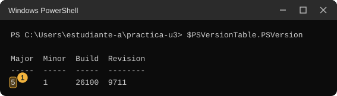<figcaption class="figure-caption">Versión de PowerShell. El número 1 marca la versión mayor, que debe ser 5.</figcaption></figure>

:::

**Paso C. Crea tu carpeta de práctica y tres archivos de ejemplo.** Escribe estas cinco líneas, una por una, pulsando Enter después de cada una. Esta carpeta guarda tus archivos de ejemplo y, más adelante, los programas que guardes. El servidor de la estación 1 muestra los nombres de todos los archivos de la carpeta.

```powershell
mkdir $HOME\practica-u3
cd $HOME\practica-u3
Set-Content lecturas.txt "temperatura=24.5"
Set-Content notas.txt "sensor del pasillo"
Set-Content sensores.csv "id,lugar"
```

Cada comando se parte así.

::: {.tabla-ancha}

| Pieza | Qué hace |
|---|---|
| `mkdir` | Crea una carpeta nueva. |
| `$HOME` | Es tu carpeta personal, por ejemplo `C:\Users\estudiante-a`. PowerShell la reemplaza por su valor. |
| `cd` | Cambia la carpeta donde estás parado. Después de este comando, todo lo que hagas ocurre dentro de `practica-u3`. |
| `Set-Content lecturas.txt "temperatura=24.5"` | Crea el archivo `lecturas.txt` y escribe ese texto dentro. Se repite con otros dos archivos. |

:::

Para comprobar que salió bien, escribe `dir`. Debes ver los tres archivos. Si `mkdir` dice que la carpeta ya existe, no pasa nada: sigue con `cd`.

::: {.tabla-ancha}

<figure class="figure">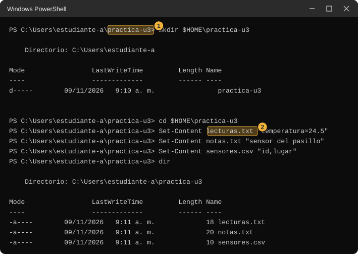<figcaption class="figure-caption">Carpeta de práctica. El número 1 marca la carpeta creada y el número 2 uno de los tres archivos. Tus fechas, tu nombre de usuario y las horas serán distintos.</figcaption></figure>

:::

**Paso D. Permite ejecutar los programas de esta guía en esta consola.** Windows trae una protección que, por defecto, impide ejecutar programas de PowerShell guardados en archivos. Escribe este comando.

```powershell
powershell -ExecutionPolicy Bypass
```

Cada pieza hace una cosa.

::: {.tabla-ancha}

| Pieza | Qué hace |
|---|---|
| `powershell` | Abre una PowerShell nueva dentro de la que ya tienes. |
| `-ExecutionPolicy Bypass` | Le dice a esa PowerShell nueva que no bloquee los programas guardados en archivos. Según la documentación de Microsoft, esta opción fija la política solo para esa sesión y no cambia la que está guardada en el registro de Windows. |

:::

Aparecen otra vez las líneas de bienvenida "Windows PowerShell" y "Copyright", y después el prompt `PS ...>`. Eso indica que funcionó. Para volver a la PowerShell original escribirías `exit`, pero no hace falta: al cerrar la ventana el permiso desaparece solo. Cada ventana nueva de PowerShell que abras durante la práctica necesita repetir el paso D.

**Paso E. Cómo se guarda un programa de esta guía.** La guía te dará varios programas pequeños en bloques de código. Para guardar uno, haz lo siguiente.

1. Escribe en la consola el comando `notepad nombre.ps1`, con el nombre que indique la guía. Por ejemplo, `notepad servidor-web.ps1`.
2. El Bloc de notas pregunta si quieres crear un archivo nuevo. Pulsa Sí.
3. Copia el bloque de código de la guía con el botón de copiar que aparece sobre él.
4. Pega en el Bloc de notas con Ctrl+V y guarda con Ctrl+S. Cierra el Bloc de notas.
5. Comprueba con `dir *.ps1` que el archivo existe con el nombre exacto. Si aparece como `servidor-web.ps1.txt`, cámbiale el nombre con `Rename-Item servidor-web.ps1.txt servidor-web.ps1`.

Los programas de esta guía no llevan tildes en sus mensajes. Es a propósito: Windows PowerShell 5.1 puede leer mal las tildes de un archivo guardado desde el Bloc de notas y mostrar símbolos extraños.

Para ejecutar un programa guardado escribes un punto, una barra invertida y su nombre, seguido de los datos que pida. Por ejemplo, `.\bits.ps1 192.168.10.20`. El `.\` le dice a PowerShell que el programa está en la carpeta actual.

**Si algo falla.** Cuando aparece un mensaje en letras rojas, PowerShell te dice qué salió mal: lee la primera línea, que casi siempre nombra el problema, y revisa que copiaste el comando sin cambiar nada. Un mensaje rojo no daña el computador ni deshace lo anterior. Corrige y repite.

- "No se puede cargar el archivo ... porque la ejecución de scripts está deshabilitada en este sistema". Esta ventana no tiene el permiso del paso D. Escribe `powershell -ExecutionPolicy Bypass` y repite el comando.
- "El término '.\bits.ps1' no se reconoce como nombre de un cmdlet, función, archivo de script o programa ejecutable" (con el nombre de tu programa en lugar de `bits.ps1`). Estás en otra carpeta o el archivo se llama distinto. Escribe `cd $HOME\practica-u3` y luego `dir *.ps1`.
- Plan B si el paso D no basta. Abre el archivo con `notepad nombre.ps1`, selecciona todo, copia y pega en la consola. Windows puede avisar de que pegarás varias líneas: acepta. Pulsa Enter una vez más al final. Antes de pegar, escribe estas líneas según el programa. Con `servidor-web.ps1` y `servidor-tcp.ps1` no escribas nada (usan el 8000 y el 5000); para el número 8001 escribe `$puerto = 8001`; para abrir a la red (parte 2) escribe `$todas = $true`. Con `bits.ps1` escribe `$a = "192.168.10.20"` y, si comparas dos, `$b = "192.168.10.45"`. Con `verificar-plan.ps1` escribe `$plan = @("sensores,60,64","administracion,25,64","servidores,10,64","enlace,2,64")`. Con `cliente-tcp.ps1` y `cliente-udp.ps1` escribe `$ip = "127.0.0.1"` y `$puerto = 5000`. Las variables quedan guardadas en esa ventana: antes de cambiar de caso, escribe `Remove-Variable todas, a, b, plan, ip, puerto -ErrorAction SilentlyContinue`.

**Abre una segunda consola cuando una estación lo pida.** Varias estaciones dejan un programa esperando en una consola, así que necesitas una segunda ventana para seguir escribiendo. Repite el paso A en una ventana nueva, luego escribe `cd $HOME\practica-u3` y después `powershell -ExecutionPolicy Bypass`. A esa ventana la llamaremos consola 2.

### Cómo leer las imágenes

Las imágenes reproducen la salida de cada comando o programa en Windows 11 en español. Su estructura, los nombres de las líneas y el orden se comprobaron ejecutando cada cosa. Los valores son de ejemplo y pertenecen al laboratorio del caso de la unidad (`192.168.10.0`) o a rangos reservados para documentación, así que tus direcciones, horas y tiempos serán otros. Cada imagen marca con un recuadro amarillo y un número los datos que debes mirar, y la tabla o la lista que sigue a la imagen explica cada número.

### Mapa de la práctica

::: {.diagrama}

<svg viewBox="0 0 760 392" xmlns="http://www.w3.org/2000/svg" role="img" aria-label="Mapa de las siete estaciones con su herramienta, lo que se hace en la parte 1 en tu equipo y lo que se hace en la parte 2 con tu pareja. 1 servidor propio. 2 las direcciones como números. 3 quién es vecino de quién. 4 repartir 256 direcciones. 5 por dónde salgo. 6 dos programas hablando. 7 mi plan, opcional" font-family="Segoe UI, Inter, system-ui, sans-serif">
<g font-size="13" font-weight="700" fill="#12324f"><text x="20" y="26">Estación y herramienta</text><text x="285" y="26">Parte 1, en tu equipo</text><text x="525" y="26">Parte 2, con tu pareja</text></g>
<g fill="#f5f7fa" stroke="#cfd8e3"><rect x="20" y="38" width="250" height="42" rx="8"/><rect x="20" y="86" width="250" height="42" rx="8"/><rect x="20" y="134" width="250" height="42" rx="8"/><rect x="20" y="182" width="250" height="42" rx="8"/><rect x="20" y="230" width="250" height="42" rx="8"/><rect x="20" y="278" width="250" height="42" rx="8"/><rect x="20" y="326" width="250" height="42" rx="8"/></g>
<g fill="#dff1e6" stroke="#9bcfb0"><rect x="285" y="38" width="225" height="42" rx="8"/><rect x="285" y="86" width="225" height="42" rx="8"/><rect x="285" y="134" width="225" height="42" rx="8"/><rect x="285" y="182" width="225" height="42" rx="8"/><rect x="285" y="230" width="225" height="42" rx="8"/><rect x="285" y="278" width="225" height="42" rx="8"/><rect x="285" y="326" width="225" height="42" rx="8"/></g>
<g fill="#eef4fa" stroke="#c7d6e6"><rect x="525" y="38" width="215" height="42" rx="8"/><rect x="525" y="86" width="215" height="42" rx="8"/><rect x="525" y="134" width="215" height="42" rx="8"/><rect x="525" y="182" width="215" height="42" rx="8"/><rect x="525" y="230" width="215" height="42" rx="8"/><rect x="525" y="278" width="215" height="42" rx="8"/><rect x="525" y="326" width="215" height="42" rx="8"/></g>
<g font-size="13" font-weight="700" fill="#12324f"><text x="30" y="56">1. Servidor propio</text><text x="30" y="104">2. Las direcciones como números</text><text x="30" y="152">3. ¿Quién es vecino de quién?</text><text x="30" y="200">4. Repartir 256 direcciones</text><text x="30" y="248">5. Por dónde salgo</text><text x="30" y="296">6. Dos programas hablando</text><text x="30" y="344">7. Mi plan (opcional)</text></g>
<g font-size="11.5" fill="#5b6876"><text x="30" y="72">servidor-web.ps1 y navegador</text><text x="30" y="120">bits.ps1</text><text x="30" y="168">bits.ps1, ping y arp -a</text><text x="30" y="216">verificar-plan.ps1</text><text x="30" y="264">route print -4 y tracert</text><text x="30" y="312">programas TCP y UDP, Test-NetConnection</text><text x="30" y="360">verificar-plan.ps1</text></g>
<g font-size="12" fill="#12324f"><text x="295" y="56">Tu navegador abre tu servidor</text><text x="295" y="72">en 127.0.0.1</text><text x="295" y="104">Tu dirección, y la misma con</text><text x="295" y="120">un número cambiado</text><text x="295" y="152">Ocho pares de ejemplo y tu</text><text x="295" y="168">propio equipo</text><text x="295" y="200">Papel, y el verificador con</text><text x="295" y="216">cuatro grupos</text><text x="295" y="248">Hacia 8.8.8.8 y la tabla</text><text x="295" y="264">de tu equipo</text><text x="295" y="296">Cliente y servidor en tu</text><text x="295" y="312">equipo</text><text x="295" y="344">Tu plan para el laboratorio,</text><text x="295" y="360">comprobado</text></g>
<g font-size="12" fill="#12324f"><text x="535" y="56">El navegador de tu pareja abre</text><text x="535" y="72">tu servidor, y al revés</text><text x="535" y="104">Tu dirección contra la de tu</text><text x="535" y="120">pareja</text><text x="535" y="152">¿Se ven directo? ping y</text><text x="535" y="168">arp -a</text><text x="535" y="200">Verificas el reparto de tu</text><text x="535" y="216">pareja</text><text x="535" y="248">Hacia tu pareja, y comparar</text><text x="535" y="264">el primer salto</text><text x="535" y="296">Cliente contra el servidor</text><text x="535" y="312">de tu pareja</text><text x="535" y="344">El plan de tu pareja, y</text><text x="535" y="360">comparar los dos</text></g>
</svg>

:::

### Tu tabla de registro

Copia esta tabla en una hoja o en un documento y llénala a medida que avanzas. Las columnas "Mi predicción" se llenan antes de ejecutar nada en cada estación. Cada estación te dirá qué anotar en cada celda.

::: {.tabla-ancha}

| Estación | Mi predicción | Parte 1 (mi equipo) | Parte 2 (con mi pareja) | Qué me llamó la atención |
|---|---|---|---|---|
| 1. Servidor propio | | | | |
| 2. Las direcciones como números | | | | |
| 3. ¿Quién es vecino de quién? | | | | |
| 4. Repartir 256 direcciones | | | | |
| 5. Por dónde salgo | | | | |
| 6. Dos programas hablando | | | | |
| 7. Mi plan (opcional) | | | | |

:::

### Hoja de pareja

Los dos de la pareja llenan esta hoja al comienzo. Los datos salen del comando `ipconfig`, que ya usaste en la unidad anterior. Escríbelo en tu consola y mira el bloque del adaptador de cable, el que se llama "Adaptador de Ethernet" y tiene una dirección IPv4 y una puerta de enlace predeterminada. Ignora por ahora las demás líneas.

::: {.tabla-ancha}

<figure class="figure">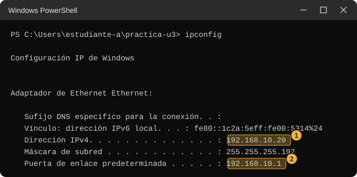<figcaption class="figure-caption">Salida de ipconfig. El número 1 marca la dirección IPv4 de tu equipo y el número 2 la puerta de enlace predeterminada.</figcaption></figure>

:::

Si hay varios bloques, usa el que tenga una línea "Puerta de enlace predeterminada" con números. Ignora los que dicen VMware, VirtualBox, vEthernet o WSL y los que dicen "medios desconectados". Si tu dirección empieza por `169.254`, tu equipo no recibió una dirección de la red del laboratorio: anótala igual, pero avisa al docente.

::: {.tabla-ancha}

| Dato | Estudiante A | Estudiante B |
|---|---|---|
| Dirección IPv4 | | |
| Puerta de enlace predeterminada | | |
| Máscara de subred, copiada tal cual la muestra `ipconfig` | | |

:::

Intercambien la hoja: cada uno debe tener escrita la dirección del otro, porque la usarán en todas las partes 2. En clase se explica qué significan la puerta de enlace y la última fila.

## Estación 1. Un servidor propio

En esta estación vas a abrir en tu computador un programa que espera a que alguien le pida algo, y vas a pedírselo desde el navegador. El programa que armas muestra los nombres de los archivos de una carpeta. Verás qué línea aparece en su consola cada vez que alguien lo consulta.

**Predice.** En la fila 1 de tu tabla, columna "Mi predicción", escribe dos cosas. Primera: cuando el navegador abre una dirección, ¿quién empieza la conversación, el navegador o el programa que muestra la página? Segunda: ¿qué crees que aparece en la consola del programa cuando alguien lo consulta?

### Parte 1. En tu equipo

**Paso 1.1. Guarda el programa.** En tu consola 1, escribe `notepad servidor-web.ps1`, y sigue el paso E. Pega este código y guarda.

```powershell
# Servidor web minimo: responde con la lista de archivos de la carpeta actual.
# Uso: powershell -ExecutionPolicy Bypass -File servidor-web.ps1 8000          (solo este equipo)
#      powershell -ExecutionPolicy Bypass -File servidor-web.ps1 8000 todas    (se abre a la red)
if ($args[0]) { $puerto = [int]$args[0] } elseif (-not $puerto) { $puerto = 8000 }
if ($args[1] -eq 'todas') { $todas = $true }
$direccion = if ($todas) { [System.Net.IPAddress]::Any } else { [System.Net.IPAddress]::Loopback }
$escucha = New-Object System.Net.Sockets.TcpListener($direccion, $puerto)
try { $escucha.Start() } catch { Write-Host "No se pudo abrir el numero $puerto. Otro programa lo esta usando, quiza un servidor tuyo que sigue abierto en otra consola."; return }
Write-Host "Servidor listo en el puerto $puerto ($(if ($todas) { 'abierto a la red' } else { 'solo este equipo' })). Carpeta: $((Get-Location).Path)"
Write-Host "Ctrl+C para cerrarlo."
try {
    while ($true) {
        if (-not $escucha.Pending()) { Start-Sleep -Milliseconds 100; continue }
        $cliente = $escucha.AcceptTcpClient()
        try {
            $cliente.ReceiveTimeout = 2000
            $flujo = $cliente.GetStream()
            $lector = New-Object System.IO.StreamReader($flujo)
            $peticion = $lector.ReadLine()
            while (($linea = $lector.ReadLine()) -ne '' -and $linea -ne $null) { }
            $ruta = ($peticion -split ' ')[1]
            if ($ruta -eq '/') {
                $nombres = Get-ChildItem -File | ForEach-Object { '<li>' + [System.Net.WebUtility]::HtmlEncode($_.Name) + '</li>' }
                $cuerpo = '<html><body><h1>Archivos de la carpeta</h1><ul>' + ($nombres -join '') + '</ul></body></html>'
                $estado = '200 OK'
            } else {
                $cuerpo = '<html><body><h1>No hay nada en esta direccion</h1></body></html>'
                $estado = '404 Not Found'
            }
            $bytes = [System.Text.Encoding]::UTF8.GetBytes($cuerpo)
            $cabecera = "HTTP/1.1 $estado`r`nContent-Type: text/html; charset=utf-8`r`nContent-Length: $($bytes.Length)`r`nConnection: close`r`n`r`n"
            $cab = [System.Text.Encoding]::ASCII.GetBytes($cabecera)
            $flujo.Write($cab, 0, $cab.Length)
            $flujo.Write($bytes, 0, $bytes.Length)
            $origen = $cliente.Client.RemoteEndPoint.Address
            Write-Host "$(Get-Date -Format HH:mm:ss) $origen `"$peticion`" $($estado.Substring(0,3))"
        } catch {
            Write-Host "$(Get-Date -Format HH:mm:ss) conexion sin peticion, se ignora"
        } finally {
            $cliente.Close()
        }
    }
} finally {
    $escucha.Stop()
    Write-Host "Servidor cerrado."
}
```

Antes de ejecutarlo, lee las líneas que importan. No tienes que entender cada símbolo, pero sí qué hace cada bloque.

::: {.tabla-ancha}

| Línea del programa | Qué hace |
|---|---|
| `if ($args[0]) { $puerto = ... } elseif (-not $puerto) { $puerto = 8000 }` | Toma el número que escribas después del nombre del programa. Si no escribes ninguno, usa 8000. Ese número acompaña a la dirección y señala a cuál programa del equipo llegas. |
| `if ($args[1] -eq 'todas') { $todas = $true }` | Si escribes la palabra `todas`, el programa se abre a toda la red. Sin esa palabra, solo atiende a tu propio equipo. |
| `$direccion = if ($todas) { ...Any } else { ...Loopback }` | Elige en qué direcciones espera. `Loopback` es `127.0.0.1`, la que siempre significa este mismo equipo. `Any` quiere decir cualquier dirección que tenga tu equipo. |
| `$escucha.Start()` | Empieza a esperar conexiones. |
| `if (-not $escucha.Pending()) { Start-Sleep ...; continue }` | Mira si alguien está llamando. Si no, descansa una décima de segundo y vuelve a mirar. Así puedes cerrar el programa con Ctrl+C. |
| `$escucha.AcceptTcpClient()` | Atiende a quien llamó. |
| `$peticion = $lector.ReadLine()` | Lee la primera línea de lo que el visitante envió: qué está pidiendo. |
| `Get-ChildItem -File` | Lista los archivos de la carpeta actual. |
| `Write-Host "$(Get-Date ...) $origen ..."` | Escribe en la consola una línea de registro: la hora, quién llamó, qué pidió y un número de resultado. |

:::

**Paso 1.2. Ejecuta el programa.** En la consola 1 escribe esto y pulsa Enter.

```powershell
.\servidor-web.ps1 8000
```

::: {.tabla-ancha}

| Pieza | Qué hace |
|---|---|
| `.\servidor-web.ps1` | Ejecuta el programa guardado en la carpeta actual. |
| `8000` | El número que acompaña a la dirección. El navegador lo tendrá que escribir igual. |

:::

La consola muestra dos líneas y no vuelve a mostrar el prompt. Eso es lo esperado: el programa está esperando. La consola 1 queda ocupada hasta que la cierres con Ctrl+C.

**Paso 1.3. Abre el navegador.** En la barra de direcciones escribe exactamente `http://127.0.0.1:8000` y pulsa Enter. Debes ver una página con el título "Archivos de la carpeta" y una lista con los nombres de los archivos, entre ellos lecturas.txt, notas.txt, sensores.csv y servidor-web.ps1. En las estaciones siguientes la lista tendrá también los otros programas que guardes.

::: {.tabla-ancha}

<figure class="figure">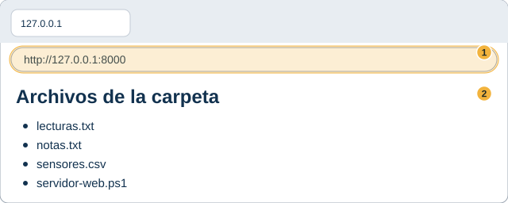<figcaption class="figure-caption">Lo que debe mostrar el navegador. El número 1 marca la dirección que escribiste, con dos puntos y el número 8000 al final. El número 2 marca la lista que el programa construyó. Es un dibujo de ejemplo, no una captura.</figcaption></figure>

:::

**Paso 1.4. Mira la consola 1.** Mientras el navegador cargaba, el programa escribió líneas nuevas.

::: {.tabla-ancha}

<figure class="figure">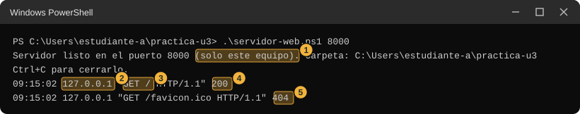<figcaption class="figure-caption">Consola 1 después de abrir la página. Tus horas serán otras.</figcaption></figure>

:::

::: {.tabla-ancha}

| N | Dato | Qué es |
|---|---|---|
| 1 | solo este equipo | El programa avisa que atiende únicamente a tu computador. Por eso el firewall no interviene. |
| 2 | 127.0.0.1 | Quién llamó. Aquí fuiste tú mismo, desde tu navegador. |
| 3 | "GET / HTTP/1.1" | Lo que pidió el navegador: la palabra GET significa "dame", la barra significa "la página principal". |
| 4 | 200 | El resultado. El 200 significa que el programa pudo entregar la página. |
| 5 | /favicon.ico y 404 | El navegador también pidió el ícono de la pestaña, que este programa no tiene. El 404 significa "aquí no hay nada con ese nombre". Es normal. |
| 6 | conexion sin peticion, se ignora | Normal. El navegador abre conexiones de reserva y no envía nada. El programa espera 2 segundos, las descarta y sigue atendiendo. Por eso la página a veces tarda un par de segundos. |

:::

**Paso 1.5. Haz la misma consulta sin navegador (opcional).** Abre la consola 2 (con el permiso del paso D) y escribe `curl.exe -i http://127.0.0.1:8000`. La palabra `curl.exe` lleva la terminación `.exe` porque en PowerShell 5.1 `curl` a secas es un alias de otro comando. La opción `-i` pide que muestre también las líneas que acompañan la respuesta.

::: {.tabla-ancha}

<figure class="figure">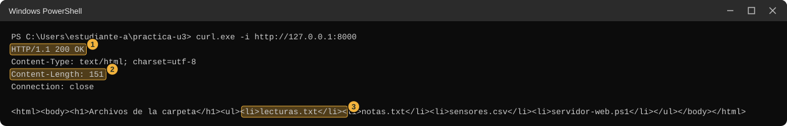<figcaption class="figure-caption">Respuesta completa del programa. El número 1 marca la línea de resultado, el 2 el largo del contenido en caracteres y el 3 el contenido, que es la lista de archivos escrita como página web.</figcaption></figure>

:::

**Paso 1.6. Ciérralo y mira qué pasa.** Haz clic en la consola 1 y pulsa Ctrl+C. Debe aparecer "Servidor cerrado." y volver el prompt. Si Ctrl+C no responde, cierra la ventana con la X: el programa se apaga igual. Luego vuelve al navegador y pulsa F5 para recargar. Debe mostrar un aviso de que no se pudo conectar. El texto exacto depende del navegador.

**Anota.** En la fila 1, columna "Parte 1": qué mostró el navegador, qué líneas aparecieron en la consola, y qué mostró el navegador cuando el programa estaba cerrado.

### Parte 2. Con tu pareja

Esta parte necesita que el programa atienda a otros computadores, no solo al tuyo. Estudiante A empieza como servidor y estudiante B como visitante.

**Paso 1.7. Comprueben las direcciones.** Mira tu hoja de pareja: B debe tener escrita la dirección IPv4 de A.

**Paso 1.8. A abre el programa a toda la red.** En la consola 1 de A:

```powershell
.\servidor-web.ps1 8000 todas
```

La palabra `todas` es la pieza nueva: hace que el programa espere en cualquier dirección de tu equipo. La consola dirá "abierto a la red".

**Paso 1.9. Si aparece un aviso del firewall.** Windows puede mostrar una ventana con el nombre del firewall que pregunta si permite que ese programa se comunique. El texto exacto puede variar. Si aparece, marca solo la casilla de redes privadas y pulsa el botón de permitir. Si pide una contraseña de administrador, pulsa Cancelar y anota el mensaje en tu tabla. Si no aparece nada, tampoco pasa nada: sigue.

**Paso 1.10. B abre la página de A.** En el navegador de B se escribe `http://` seguido de la dirección de A, dos puntos y 8000. Por ejemplo, si la dirección de A es `192.168.10.20`, B escribe `http://192.168.10.20:8000`.

**Paso 1.11. A mira su consola.** Debe aparecer una línea nueva cuya dirección de origen es la de B, no `127.0.0.1`.

::: {.tabla-ancha}

<figure class="figure">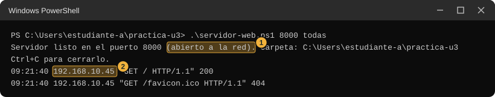<figcaption class="figure-caption">Consola de A cuando B abre la página. El número 1 marca que el programa quedó abierto a la red y el 2 la dirección de B.</figcaption></figure>

:::

**Paso 1.12. A lo cierra y B recarga.** A pulsa Ctrl+C en su consola. B pulsa F5 en el navegador. Anoten qué mostró el navegador.

**Paso 1.13. Cambien de roles.** B abre el programa con `todas`, y A usa el navegador con la dirección de B.

**Anota.** En la fila 1, columna "Parte 2": qué vio B en el navegador de A, qué dirección apareció en la consola de A, y qué pasó al cerrar. Si no funcionó, anota el mensaje que mostró el navegador.

**Si no te sale en la parte 2.** No afirmes cuál es la causa; anota las que podrían aplicar.

- Un firewall en el computador de A puede estar bloqueando las conexiones que llegan a su programa.
- Los dos computadores pueden estar en redes distintas que no se comunican directamente.
- La dirección de A puede estar mal copiada o ser de otro adaptador.
- El programa de A puede haberse abierto sin la palabra `todas`.
- Una regla de la red de la sala puede descartar este tipo de tráfico.

**Observa.** Compara con lo que predijiste. Fíjate en cuántas cosas tuvo que saber B para llegar al programa de A.

**La pregunta que queda para la clase.** ¿Qué dos datos necesitó B para llegar al programa de A, y por qué hacía falta el segundo?

::: {.callout-note title="En clase"}
Se explicará la arquitectura cliente-servidor, la petición y la respuesta, y el número que acompaña a la dirección (el puerto).
:::

::: {.diagrama}

<svg viewBox="0 0 760 200" xmlns="http://www.w3.org/2000/svg" role="img" aria-label="Dos equipos unidos por dos flechas. El equipo de B, a la izquierda, tiene el navegador y envía la petición GET hacia el equipo de A, a la derecha, donde el programa servidor-web espera en el número 8000. El equipo de A devuelve la respuesta con la lista de archivos. En la parte uno, A y B son el mismo equipo" font-family="Segoe UI, Inter, system-ui, sans-serif">
<defs><marker id="pw2" viewBox="0 0 10 10" refX="10" refY="5" markerWidth="8" markerHeight="8" orient="auto"><path d="M0,0 L10,5 L0,10 z" fill="#5b6876"/></marker></defs>
<g fill="#ece6fa" stroke="#bfb0e8"><rect x="20" y="40" width="250" height="110" rx="10"/><rect x="490" y="40" width="250" height="110" rx="10"/></g>
<g fill="#12324f"><text x="36" y="66" font-size="14" font-weight="700">Equipo de B</text><text x="36" y="90" font-size="12.5">El navegador pide</text><text x="36" y="114" font-size="12.5" font-family="Consolas, monospace">http://IP-de-A:8000</text><text x="506" y="66" font-size="14" font-weight="700">Equipo de A</text><text x="506" y="90" font-size="12.5">servidor-web.ps1 espera</text><text x="506" y="114" font-size="12.5">en el número 8000</text></g>
<g stroke="#5b6876" stroke-width="1.6" fill="none"><path d="M270,82 H490" marker-end="url(#pw2)"/><path d="M490,122 H270" marker-end="url(#pw2)"/></g>
<g font-size="12.5" fill="#12324f" text-anchor="middle"><text x="380" y="74">1. Petición: GET /</text><text x="380" y="142">2. Respuesta: lista de archivos</text></g>
<text x="380" y="182" font-size="12" fill="#5b6876" text-anchor="middle">En la parte 1, A y B son el mismo equipo y la dirección es 127.0.0.1.</text>
</svg>

:::

## Estación 2. Las direcciones como números

Cada computador de la red tiene una dirección escrita con cuatro números separados por puntos. En esta estación vas a ver esos números como un solo número grande y como ceros y unos, y a descubrir qué cambia cuando cambias un número.

**Predice.** En la fila 2 de tu tabla escribe: ¿entre qué valores crees que puede ir cada uno de los cuatro números de una dirección? Y si cambias el último número de tu dirección de 20 a 21, ¿cuántos de los ceros y unos crees que cambian: casi todos, la mitad o muy pocos?

### Parte 1. En tu equipo

**Paso 2.1. Guarda el programa.** En la consola 1, escribe `notepad bits.ps1`, sigue el paso E y pega este código.

```powershell
# Muestra una direccion como numero y como bits. Con dos direcciones, las compara.
# Uso: powershell -ExecutionPolicy Bypass -File bits.ps1 192.168.10.20
#      powershell -ExecutionPolicy Bypass -File bits.ps1 192.168.10.20 192.168.10.45
function Bits($ip) {
    $valida = $null
    $trozos = $ip -split '\.'
    if ($trozos.Count -ne 4 -or ($trozos | Where-Object { $_ -notmatch '^(0|[1-9][0-9]{0,2})$' }) -or -not [System.Net.IPAddress]::TryParse($ip, [ref]$valida)) {
        throw "No entiendo '$ip'. Escribe cuatro numeros de 0 a 255 separados por puntos y sin ceros a la izquierda, por ejemplo 192.168.10.20"
    }
    $partes = [System.Net.IPAddress]::Parse($ip).GetAddressBytes()
    ($partes | ForEach-Object { [Convert]::ToString($_, 2).PadLeft(8, '0') }) -join '.'
}
function Numero($ip) {
    $p = [System.Net.IPAddress]::Parse($ip).GetAddressBytes()
    [uint64]$p[0] * 16777216 + [uint64]$p[1] * 65536 + [uint64]$p[2] * 256 + [uint64]$p[3]
}
if ($args[0]) { $a = $args[0] }
if ($args[1]) { $b = $args[1] }
$bitsA = Bits $a
Write-Host ("{0,-15} numero {1,-10} bits {2}" -f $a, (Numero $a), $bitsA)
if ($b) {
    $bitsB = Bits $b
    Write-Host ("{0,-15} numero {1,-10} bits {2}" -f $b, (Numero $b), $bitsB)
    $marca = ''
    for ($i = 0; $i -lt $bitsA.Length; $i++) {
        if ($bitsA[$i] -eq '.') { $marca += '.'; continue }
        if ($bitsA[$i] -eq $bitsB[$i]) { $marca += '=' } else { $marca += 'x' }
    }
    Write-Host ("{0,-15} {1,-17} {2}" -f '', '', ('     ' + $marca))
    $x = (Numero $a) -bxor (Numero $b)
    $iguales = 32
    while ($x -ne 0) { $iguales--; $x = $x -shr 1 }
    Write-Host "Iguales desde la izquierda: $iguales"
}
```

Qué hace, en pocas palabras. `[System.Net.IPAddress]::Parse` convierte el texto de una dirección en sus cuatro números. `[Convert]::ToString(n, 2)` escribe un número en ceros y unos, y `.PadLeft(8, '0')` lo completa con ceros a la izquierda hasta tener 8 símbolos. El programa pega esos cuatro grupos de 8 con puntos. La función `Numero` junta los cuatro números en un solo número grande. En la parte donde compara dos direcciones, la línea de marcas pone un signo igual cuando los dos bits son iguales y una equis cuando difieren, y la última línea, `Iguales desde la izquierda`, dice cuántos bits seguidos, empezando por la izquierda, son iguales antes del primero distinto.

**Paso 2.2. Mira tu propia dirección.** Copia tu dirección IPv4 de la hoja de pareja y ejecútala. Si tu dirección es `192.168.10.20`, escribes esto. Usa la tuya, no la del ejemplo.

```powershell
.\bits.ps1 192.168.10.20
```

::: {.tabla-ancha}

| Pieza | Qué hace |
|---|---|
| `.\bits.ps1` | Ejecuta el programa guardado. |
| `192.168.10.20` | La dirección que quieres mirar. Va con los cuatro números y los tres puntos. |

:::

::: {.tabla-ancha}

<figure class="figure">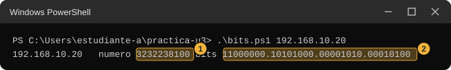<figcaption class="figure-caption">Salida de bits.ps1 con una dirección. El número 1 marca la dirección vista como un solo número y el número 2 la misma dirección en ceros y unos.</figcaption></figure>

:::

Cada uno de los cuatro números de la dirección aparece como un grupo de 8 ceros y unos. Cuenta los símbolos: son 32 en total. Escribe en tu tabla cuántos grupos hay y cuántos símbolos tiene cada uno.

**Paso 2.3. Cambia un número y compara.** Ejecuta `.\bits.ps1 192.168.10.20` y después esa misma dirección con el último número cambiado a 21, 24, 28, 84 y 148. Compara siempre contra la de 192.168.10.20, no contra la ejecución anterior. Fíjate en qué posiciones cambió el cero o el uno y anota cuáles cambios movieron un solo símbolo y cuáles movieron más.

Para ver las diferencias de una vez usa la forma con dos direcciones, por ejemplo `.\bits.ps1 192.168.10.20 192.168.10.24`. Anota el número de la línea `Iguales desde la izquierda`. No cuentes los puntos. La imagen muestra la comparación de 192.168.10.20 con 192.168.10.45.

```powershell
.\bits.ps1 192.168.10.20 192.168.10.45
```

::: {.tabla-ancha}

<figure class="figure">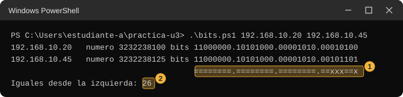<figcaption class="figure-caption">Comparación de dos direcciones. El número 1 marca la línea de comparación: un signo igual donde los dos bits coinciden y una equis donde difieren. El número 2 marca la línea Iguales desde la izquierda.</figcaption></figure>

:::

**Anota.** En la fila 2, columna "Parte 1": tu dirección en ceros y unos, el número grande, y qué bits cambiaron al pasar de 20 a 21, 24, 28, 84 y 148.

**Si no te sale.** Si el programa responde "No entiendo" y repite tu dirección, revisa que escribiste cuatro números separados por tres puntos y que ninguno pasa de 255.

### Parte 2. Con tu pareja

**Paso 2.4. Comparen sus direcciones.** Cada uno ejecuta el programa con dos direcciones: la propia primero y la del compañero después.

```powershell
.\bits.ps1 TU-DIRECCION DIRECCION-DEL-COMPAÑERO
```

Reemplaza las dos palabras por las direcciones de la hoja de pareja, con sus puntos. Esta estación no usa la red: el programa solo convierte números, así que funciona aunque el firewall o el ping estén bloqueados.

**Anota.** En la fila 2, columna "Parte 2": las dos direcciones, la línea de marcas y el número de la línea `Iguales desde la izquierda`. No cuentes los puntos. Compara con tu pareja: ¿dio el mismo número en los dos computadores?

**Observa.** ¿Los primeros bits de tu dirección y los de tu pareja son iguales? ¿Hasta dónde? Compara con tu predicción.

Si no tienes la dirección o el reparto de tu pareja, salta esta parte. La estación termina con la parte 1.

**La pregunta que queda para la clase.** ¿Por qué crees que dos computadores del mismo laboratorio comparten tantos de los primeros bits de su dirección?

::: {.callout-note title="En clase"}
Se explicará la dirección IPv4 por dentro: bits, octetos y cuántas direcciones caben en 32 bits.
:::

## Estación 3. ¿Quién es vecino de quién?

Dos computadores conectados por cable no siempre se hablan directamente. En esta estación vas a deducir, con una tabla, una regla que dice cuándo sí, y a probarla con tu pareja.

**Predice.** En la fila 3 de tu tabla, antes de mirar nada, escribe con tus palabras cuándo crees que dos computadores de un laboratorio se ven directamente. Después, mira la tabla del paso 3.1 y revisa si tu idea se sostiene.

### Parte 1. En tu equipo

**Paso 3.1. Deduce la regla en papel.** La tabla muestra ocho pares de computadores de un laboratorio de ejemplo (datos dibujados, no medidos en tu sala) y si lograron comunicarse directamente.

::: {.tabla-ancha}

| Par | Equipo 1 | Equipo 2 | ¿Se comunican directamente? |
|---|---|---|---|
| 1 | 192.168.10.20 | 192.168.10.45 | Sí |
| 2 | 192.168.10.20 | 192.168.10.62 | Sí |
| 3 | 192.168.10.62 | 192.168.10.65 | No |
| 4 | 192.168.10.70 | 192.168.10.71 | Sí |
| 5 | 192.168.10.65 | 192.168.10.94 | Sí |
| 6 | 192.168.10.94 | 192.168.10.97 | No |
| 7 | 192.168.10.97 | 192.168.10.110 | Sí |
| 8 | 192.168.10.110 | 192.168.10.113 | No |

:::

Mira la tabla con lápiz y papel, sin ejecutar nada. Busca qué tienen en común los pares que sí se comunican y qué les pasa a los que no. Fíjate en los pares 3, 6 y 8: sus dos números están casi pegados y aun así no se comunican. Escribe tu regla con tus propias palabras.

**Paso 3.2. Pon a prueba tu regla con la herramienta de la estación 2.** Ejecuta `.\bits.ps1` con los ocho pares de la tabla, uno por uno. En cada uno, anota el número de la línea `Iguales desde la izquierda`. No cuentes los puntos. Después mira tus ocho números junto al Sí o No de la tabla: ¿un mismo número significa siempre lo mismo? Ajusta tu regla si hace falta.

```powershell
.\bits.ps1 192.168.10.20 192.168.10.45
.\bits.ps1 192.168.10.20 192.168.10.62
.\bits.ps1 192.168.10.62 192.168.10.65
.\bits.ps1 192.168.10.70 192.168.10.71
.\bits.ps1 192.168.10.65 192.168.10.94
.\bits.ps1 192.168.10.94 192.168.10.97
.\bits.ps1 192.168.10.97 192.168.10.110
.\bits.ps1 192.168.10.110 192.168.10.113
```

Escribe: ¿tu regla acierta en los ocho pares?

::: {.callout-note title="Solución del paso 3.1" collapse="true"}
Los equipos que se comunican directamente son los que caen dentro del mismo tramo del último número: de 0 a 63, de 64 a 95, de 96 a 111 y de 112 en adelante. Los pares 3, 6 y 8 cruzan un corte. Con estos ocho pares no se fija el lugar exacto de cada corte, porque hay un hueco entre 62 y 65, entre 94 y 97 y entre 110 y 113; la estación 4 muestra de dónde salen 64, 96 y 112. Los números de la línea `Iguales desde la izquierda` de los ocho pares son 26, 26, 25, 31, 27, 26, 28 y 27. El 26 aparece en pares que se comunican (1 y 2) y en uno que no (6), así que contar bits iguales no basta sin saber dónde están los cortes.
:::

**Paso 3.3. Escribe a tu propio equipo.** El comando `ping` envía un mensaje corto a una dirección y espera respuesta. Escribe esto en la consola 1.

```powershell
ping -n 2 127.0.0.1
```

::: {.tabla-ancha}

| Pieza | Qué hace |
|---|---|
| `ping` | Envía un mensaje corto a una dirección y espera que le respondan. |
| `-n 2` | Envía 2 mensajes en vez de los 4 habituales. |
| `127.0.0.1` | La dirección de tu propio equipo. |

:::

Debes ver "Respuesta desde 127.0.0.1" dos veces y, abajo, "perdidos = 0". Así se ve cuando el mensaje llega y alguien responde.

**Paso 3.4. Mira a quién conoce tu equipo.** El comando `arp -a` muestra la lista de equipos cercanos con los que tu computador habló hace poco, junto con una dirección física de cada uno.

```powershell
arp -a
```

Busca el bloque cuyo "Interfaz" es la dirección IPv4 de tu hoja de pareja. En ese bloque, la fila de la puerta de enlace predeterminada de tu hoja es un vecino directo que tu equipo conoce. Anota su dirección física (los seis pares de dígitos con guiones). Si la fila de tu puerta de enlace no aparece, es porque tu equipo no ha hablado con ella hace poco: abre cualquier página en el navegador y repite el comando. Si después de eso la fila sigue sin aparecer, anota "no apareció" y sigue. Este paso depende de la red de la sala y no impide continuar.

::: {.tabla-ancha}

<figure class="figure">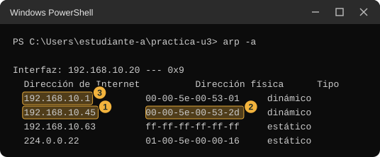<figcaption class="figure-caption">Salida de arp -a de ejemplo. El número 1 marca la dirección de un vecino, el 2 su dirección física, y el 3 la fila de la puerta de enlace predeterminada de la hoja de pareja.</figcaption></figure>

:::

**Anota.** En la fila 3, columna "Parte 1": tu regla escrita, los ocho números de la línea `Iguales desde la izquierda`, y la dirección física de tu puerta de enlace.

### Parte 2. Con tu pareja

**Paso 3.5. Predice antes de probar.** Con tu regla y con el resultado de la estación 2 (la línea `Iguales desde la izquierda` entre tu dirección y la de tu pareja), escribe en tu tabla: ¿crees que tu pareja y tú se ven directamente? ¿Sí, no, o no sé?

**Paso 3.6. Envíale un mensaje a tu pareja.** Escribe el comando con la dirección del compañero.

```powershell
ping -n 2 DIRECCION-DEL-COMPAÑERO
```

::: {.tabla-ancha}

<figure class="figure">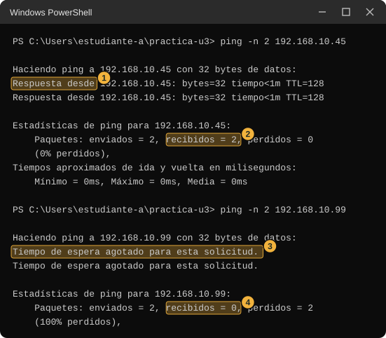<figcaption class="figure-caption">Dos resultados de ping. El número 1 marca una respuesta y el 2 el resumen sin pérdidas. El número 3 marca un intento sin respuesta y el 4 el resumen con todos los mensajes perdidos.</figcaption></figure>

:::

Puedes ver tres resultados: la respuesta del equipo de tu pareja, "Tiempo de espera agotado", o una línea "Respuesta desde (tu propia dirección): Host de destino inaccesible." Esta última no es respuesta de tu pareja: viene de tu equipo y significa que no pudo ubicarla. Anota cuál viste. Es un comportamiento conocido de Windows que no se midió al preparar esta guía, y por eso la imagen siguiente es un dibujo de ejemplo. "Tiempo de espera agotado" no prueba que tu pareja esté fuera de tu alcance: el firewall de Windows puede estar configurado para ignorar los mensajes de ping que llegan de afuera, así que la ausencia de respuesta puede venir de eso.

::: {.tabla-ancha}

<figure class="figure">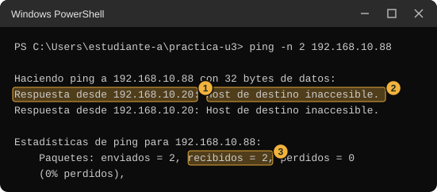<figcaption class="figure-caption">Dibujo de ejemplo, no captura. El número 1 marca que la respuesta viene de tu propia dirección, el 2 el texto Host de destino inaccesible y el 3 que Windows lo cuenta como recibido.</figcaption></figure>

:::

**Paso 3.7. Mira otra vez la lista de equipos cercanos.** Inmediatamente después del ping, escribe `arp -a` y busca la dirección de tu pareja. Si aparece una fila con su dirección física, tu equipo lo reconoce como vecino directo, aunque el ping no haya recibido respuesta. Si no aparece, anótalo.

**Anota.** En la fila 3, columna "Parte 2": tu predicción, si el ping respondió, si apareció la fila de tu pareja en `arp -a`, y la dirección física si apareció.

**Si no te sale en la parte 2.** No afirmes la causa; estas son posibilidades.

- El ping sin respuesta puede deberse a que el computador de tu pareja descarta esos mensajes, y no a que esté lejos.
- Si la fila de tu pareja no aparece en `arp -a`, pueden estar en redes distintas, o el ping pudo salir antes de que Windows aprendiera su dirección: repite el ping y vuelve a mirar.
- La dirección puede estar mal copiada.

**Observa.** Compara el resultado con tu regla. ¿Coincide lo que predijiste con lo que mostraron el ping y `arp -a`?

**La pregunta que queda para la clase.** ¿Cómo sabe tu equipo si otro es vecino directo, sin preguntarle?

::: {.callout-note title="En clase"}
Se explicará la máscara, el prefijo y la operación AND, y cómo un equipo decide entre entregar directo o por la puerta de enlace.
:::

## Estación 4. Repartir 256 direcciones

Un laboratorio dispone de las 256 direcciones que van de `192.168.10.0` a `192.168.10.255`. Debe repartirlas entre cuatro grupos: 60 sensores, 25 equipos de administración, 10 servidores y un enlace que une dos equipos. En total son 97 equipos. En esta estación vas a descubrir cómo se reparte sin desperdiciar de más.

::: {.diagrama}

<svg viewBox="0 0 760 170" xmlns="http://www.w3.org/2000/svg" role="img" aria-label="Tira horizontal que representa las 256 direcciones de 192.168.10.0 a 192.168.10.255, con marcas cada 16 direcciones y números en 0, 64, 128, 192 y 255" font-family="Segoe UI, Inter, system-ui, sans-serif">
<text x="380" y="22" font-size="14" font-weight="700" fill="#12324f" text-anchor="middle">Las 256 direcciones: el último número de la dirección, de 0 a 255</text>
<rect x="60" y="40" width="640" height="44" rx="4" fill="#f5f7fa" stroke="#8fb3d1"/>
<g stroke="#8fb3d1" stroke-width="1.2"><path d="M100,84 V92"/><path d="M140,84 V92"/><path d="M180,84 V92"/><path d="M220,84 V92"/><path d="M260,84 V92"/><path d="M300,84 V92"/><path d="M340,84 V92"/><path d="M380,84 V92"/><path d="M420,84 V92"/><path d="M460,84 V92"/><path d="M500,84 V92"/><path d="M540,84 V92"/><path d="M580,84 V92"/><path d="M620,84 V92"/><path d="M660,84 V92"/></g>
<g stroke="#12324f" stroke-width="1.6"><path d="M60,84 V100"/><path d="M220,84 V100"/><path d="M380,84 V100"/><path d="M540,84 V100"/><path d="M700,84 V100"/></g>
<g font-size="12.5" fill="#12324f" text-anchor="middle"><text x="60" y="118">0</text><text x="220" y="118">64</text><text x="380" y="118">128</text><text x="540" y="118">192</text><text x="700" y="118">255</text></g>
<text x="380" y="148" font-size="12" fill="#5b6876" text-anchor="middle">Cada marca pequeña salta 16 direcciones. Dibuja esta tira en tu hoja para repartirla.</text>
</svg>

:::

**Predice.** En la fila 4 de tu tabla, antes de ejecutar nada, resuelve en papel: si partes las 256 direcciones en cuatro partes iguales, ¿de cuántas direcciones es cada parte? ¿Le alcanza a cada grupo? ¿Cuántas direcciones le sobran a cada grupo, y cuántas en total?

### Parte 1. En tu equipo

**Paso 4.1. Resuelve en papel las partes iguales.** Dibuja la tira de arriba. Divídela en cuatro partes iguales y asigna un grupo a cada una. Escribe lo que sobra en cada parte (restando lo que necesita el grupo de las direcciones de la parte, por ejemplo 64 menos 60) y el total. Después del paso 4.5 vas a recalcularlo con la regla exacta del verificador, y por eso aquí el número sale distinto.

**Paso 4.2. Guarda el verificador.** En la consola 1 escribe `notepad verificar-plan.ps1`, sigue el paso E y pega este código. Este programa no entrega la respuesta: solo dice "cabe" o "no cabe" para lo que tú le propongas.

```powershell
# Revisa un reparto de las 256 direcciones 192.168.10.0 a 192.168.10.255.
# Cada bloque se escribe "nombre,equipos,tamano" o "nombre,equipos,tamano,inicio".
# "inicio" es el ultimo numero de la primera direccion del bloque (0 a 255).
# Uso: powershell -ExecutionPolicy Bypass -File verificar-plan.ps1 "sensores,60,64,0" "enlace,2,4,112"
$lista = if ($args.Count) { $args } else { $plan }
$bloques = @()
foreach ($texto in $lista) {
    $c = $texto -split ','
    $bloques += [pscustomobject]@{
        Nombre  = $c[0]
        Equipos = [int]$c[1]
        Tamano  = [int]$c[2]
        Inicio  = if ($c.Length -gt 3) { [int]$c[3] } else { -1 }
        Veredicto = ''
    }
}
foreach ($b in $bloques) {
    $t = $b.Tamano
    $esPotencia = ($t -ge 1) -and (($t -band ($t - 1)) -eq 0)
    if ($t -lt 4) { $b.Veredicto = 'no cabe: esta herramienta solo acepta bloques de 4 direcciones o mas' }
    elseif (-not $esPotencia -or $t -gt 256) { $b.Veredicto = 'no cabe: ese tamano no se puede usar' }
    elseif ($b.Equipos + 2 -gt $t) { $b.Veredicto = 'no cabe: faltan lugares' }
    elseif ($b.Inicio -ge 0 -and ($b.Inicio -band ($t - 1)) -ne 0) { $b.Veredicto = 'no cabe: ese inicio no se puede usar' }
    elseif ($b.Inicio -ge 0 -and $b.Inicio + $t -gt 256) { $b.Veredicto = 'no cabe: se sale de las 256 direcciones' }
    else { $b.Veredicto = 'cabe' }
}
$antes = @($bloques | ForEach-Object { $_.Veredicto })
for ($i = 0; $i -lt $bloques.Count; $i++) {
    for ($j = 0; $j -lt $bloques.Count; $j++) {
        $x = $bloques[$i]; $y = $bloques[$j]
        if ($i -ne $j -and $antes[$i] -eq 'cabe' -and $antes[$j] -eq 'cabe' -and $x.Inicio -ge 0 -and $y.Inicio -ge 0 `
            -and $x.Inicio -lt $y.Inicio + $y.Tamano -and $y.Inicio -lt $x.Inicio + $x.Tamano) {
            $x.Veredicto = "no cabe: se pisa con $($y.Nombre)"
        }
    }
}
$usadas = 0
foreach ($b in $bloques) {
    if ($b.Veredicto -eq 'cabe') { $usadas += $b.Tamano }
    $desde = if ($b.Inicio -ge 0) { $b.Inicio } else { '-' }
    Write-Host ("{0,-15} necesita {1,3}   bloque {2,3}   desde {3,-3}   {4}" -f $b.Nombre, $b.Equipos, $b.Tamano, $desde, $b.Veredicto)
}
Write-Host "Direcciones en bloques que caben: $usadas de 256"
if ($usadas -gt 256) { Write-Host 'Los bloques suman mas de 256 direcciones.' }
```

Cada grupo se escribe entre comillas como `"nombre,equipos,tamaño"`, con coma y sin espacios. El tamaño es cuántas direcciones le das al grupo. En esta estación aún no usas el cuarto dato, el inicio.

**Paso 4.3. Comprueba las partes iguales.** Escribe esto en una sola línea.

```powershell
.\verificar-plan.ps1 "sensores,60,64" "administracion,25,64" "servidores,10,64" "enlace,2,64"
```

::: {.tabla-ancha}

| Pieza | Qué hace |
|---|---|
| `.\verificar-plan.ps1` | Ejecuta el verificador. |
| `"sensores,60,64"` | Un grupo: se llama sensores, necesita 60 equipos y le das un bloque de 64 direcciones. |
| Las otras tres cadenas entre comillas | Los otros tres grupos, separados por un espacio. |

:::

::: {.tabla-ancha}

<figure class="figure">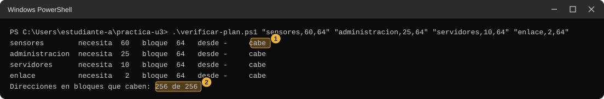<figcaption class="figure-caption">Cuatro bloques de 64. El número 1 marca el veredicto de un grupo y el 2 el total de direcciones usadas por bloques que caben.</figcaption></figure>

:::

Los cuatro caben y se usan las 256. Compara con lo que sobra según tu papel.

**Paso 4.4. Prueba otros tamaños.** Repite el comando cambiando solo el tamaño de uno de los grupos. Haz estas pruebas y anota el veredicto de cada una.

- Sensores con tamaño 32.
- Sensores con tamaño 60.
- Sensores con tamaño 62.
- Sensores con tamaño 128.
- Enlace con tamaño 2.
- Enlace con tamaño 4.

::: {.tabla-ancha}

<figure class="figure">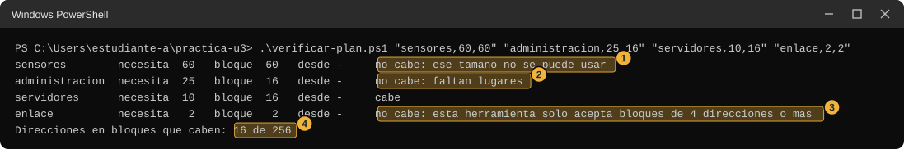<figcaption class="figure-caption">Veredictos distintos. El número 1 marca un tamaño que el verificador no acepta, el 2 un bloque donde faltan lugares, el 3 un bloque de menos de 4 direcciones y el 4 el total.</figcaption></figure>

:::

**Paso 4.5. Descubre los tamaños aceptados.** Sigue probando tamaños para uno de los grupos hasta poder escribir una lista de todos los tamaños que el verificador acepta, entre 1 y 256. Escribe esa lista y la regla que la explica. Después escribe cuál es el tamaño más pequeño que le alcanza a cada uno de los cuatro grupos. Los tamaños 1 y 2 salen como "no cabe" porque este verificador solo acepta bloques de 4 direcciones o más. Para contar lugares usa esta regla del verificador: en cada bloque caben 2 equipos menos que direcciones. Lugares que sobran = tamaño - 2 - equipos que necesita. En clase se explica por qué.

**Paso 4.6. Arma el reparto con tamaños distintos.** Con los tamaños mínimos que encontraste, ejecuta el verificador con los cuatro grupos. Anota el total de direcciones usadas, cuántas quedan sin repartir, y cuántas sobran dentro de cada bloque. Compara con las partes iguales del paso 4.1, y con la regla del paso 4.5 vuelve a calcular los lugares que sobran con partes iguales y con tamaños distintos.

::: {.callout-note title="Qué deberías haber visto" collapse="true"}
Con cuatro partes de 64 caben los cuatro grupos, pero se pierden 151 lugares de equipo (248 caben contra 97 que se necesitan) y no queda nada libre. Con tamaños distintos (64, 32, 16 y 4) se usan 116 de 256 direcciones, quedan 140 libres (de la 116 a la 255) y sobran 11 lugares de equipo (2 + 5 + 4 + 0).
:::

**Anota.** En la fila 4, columna "Parte 1": los tamaños aceptados, el tamaño de cada grupo, lo que sobra con partes iguales y lo que sobra con tamaños distintos.

**Si no te sale.** Revisa que cada grupo vaya entre comillas, con comas y sin espacios dentro, y que dejes un espacio entre un grupo y el siguiente.

### Parte 2. Con tu pareja

**Paso 4.7. Intercambien repartos.** Cada uno escribe su reparto en la forma `"nombre,equipos,tamaño"`. El compañero lo ejecuta en su verificador. Esta parte no usa la red.

**Anota.** En la fila 4, columna "Parte 2": si el reparto de tu pareja cabe, cuánto sobra en el suyo, y si coincide con el tuyo.

**Observa.** Compara con tu predicción de las partes iguales. ¿Se desperdició más o menos de lo que pensabas?

Si no tienes la dirección o el reparto de tu pareja, salta esta parte. La estación termina con la parte 1.

**La pregunta que queda para la clase.** ¿Por qué los tamaños que aceptó el verificador son esos y no otros?

::: {.callout-note title="En clase"}
Se explicará la partición en subredes de tamaño fijo y el reparto con máscaras de longitud variable (VLSM), con el cálculo del desperdicio.
:::

## Estación 5. Por dónde salgo

Cuando le envías un mensaje a otro computador, tu equipo debe decidir por dónde sale. En esta estación vas a leer la tabla que usa para decidir y a seguir el camino de un mensaje, salto a salto.

**Predice.** En la fila 5 de tu tabla, marca cuántos saltos (equipos intermedios) crees que hay entre tu computador y el servidor `8.8.8.8`, un servidor público de Google.

- <label><input type="checkbox"> 1 o 2</label>
- <label><input type="checkbox"> 3 a 5</label>
- <label><input type="checkbox"> 6 a 8</label>
- <label><input type="checkbox"> No llega en 8 saltos</label>

Escribe también: ¿cuál crees que será la primera dirección que aparezca en el recorrido?

### Parte 1. En tu equipo

**Paso 5.1. Mira la tabla de tu equipo.** Escribe este comando en la consola 1.

```powershell
route print -4
```

::: {.tabla-ancha}

| Pieza | Qué hace |
|---|---|
| `route` | Programa de Windows que muestra y modifica una tabla de caminos del equipo. |
| `print` | Le pide que solo la muestre. Esta guía nunca usa `add`, `delete` ni `change`, que sí la modifican. |
| `-4` | Muestra solo la parte de direcciones IPv4. Esta opción no figura en la página de Microsoft del comando, pero se comprobó que funciona en Windows 11. |

:::

Imprime mucho. Primero una lista de interfaces y luego, bajo "IPv4 Tabla de enrutamiento", las rutas activas. Busca la fila cuyo primer y segundo número son `0.0.0.0` y `0.0.0.0`.

::: {.tabla-ancha}

<figure class="figure">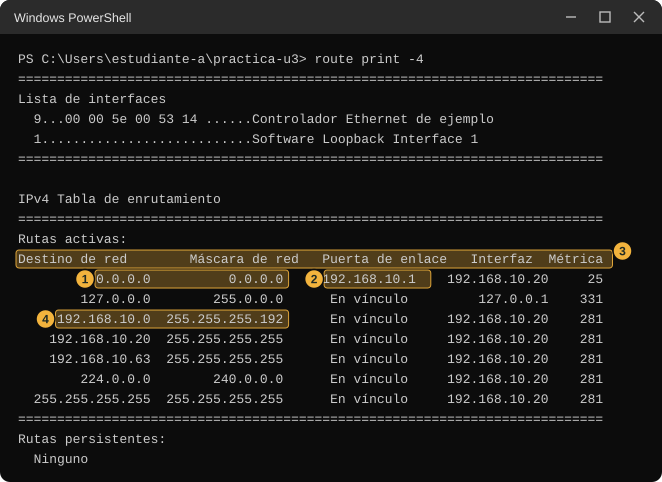<figcaption class="figure-caption">Salida de route print -4. El número 1 marca la fila que empieza con 0.0.0.0 en las dos primeras columnas. El número 2 marca la dirección de la tercera columna de esa fila. El número 3 marca los títulos de las columnas y el 4 una fila de ejemplo con otro destino. Tu lista de interfaces será más larga y tendrá más filas.</figcaption></figure>

:::

Compara el número de la tercera columna de esa fila con la "Puerta de enlace predeterminada" de tu hoja de pareja. Deben ser iguales. Si hay más de una fila con `0.0.0.0`, la documentación de Microsoft indica que se elige la de menor métrica. Anota qué otras filas ves y cuál es la columna "Métrica" de la fila que empieza por `0.0.0.0`.

**Paso 5.2. Sigue un mensaje hacia 8.8.8.8.** El comando `tracert` envía mensajes con una vida corta para descubrir cada equipo intermedio.

```powershell
tracert -d -h 8 -w 1000 8.8.8.8
```

::: {.tabla-ancha}

| Pieza | Qué hace |
|---|---|
| `tracert` | Muestra el camino que sigue un mensaje hasta una dirección. |
| `-d` | No intenta averiguar los nombres de los equipos intermedios, solo muestra sus direcciones. Así termina antes. |
| `-h 8` | Limita el recorrido a 8 saltos como máximo (el valor por omisión es 30). |
| `-w 1000` | Espera como máximo 1000 milisegundos, un segundo, por cada respuesta. |
| `8.8.8.8` | El destino. |

:::

::: {.tabla-ancha}

<figure class="figure">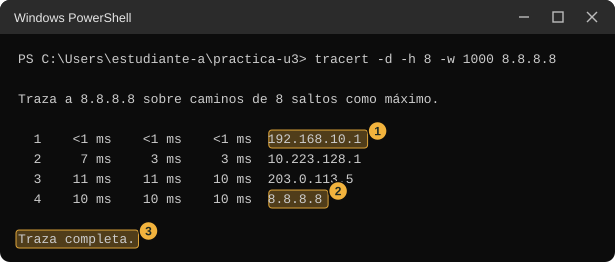<figcaption class="figure-caption">Recorrido de ejemplo hacia 8.8.8.8. El número 1 marca la primera línea, que corresponde al primer equipo por el que sale el mensaje. El número 2 marca la línea donde llega el destino. El número 3 marca la frase final. Tus direcciones y tiempos serán otros.</figcaption></figure>

:::

Cada línea es un salto: el número a la izquierda, tres tiempos en milisegundos y la dirección del equipo que respondió. Compara la primera dirección con la puerta de enlace de tu hoja de pareja y con la fila de `route print`. Anota cuántos saltos hubo hasta llegar a `8.8.8.8`, o hasta dónde llegó el recorrido. Este paso usa la red de la sala. Si no sale a Internet, anota hasta dónde llegó y sigue.

**Si no te sale.**

- Una línea con tres asteriscos y "Tiempo de espera agotado para esta solicitud" significa que ese equipo no contestó los mensajes. Puede ser que los bloquee. No significa que el camino esté cortado.
- Si el recorrido nunca llega a `8.8.8.8` y termina con asteriscos, puede que la red de la sala impida salir a Internet o descarte estos mensajes. Anótalo y sigue.

**Anota.** En la fila 5, columna "Parte 1": la fila de `0.0.0.0` de tu tabla, la primera dirección del recorrido, cuántos saltos hubo, y si tu predicción acertó.

### Parte 2. Con tu pareja

**Paso 5.3. Sigue un mensaje hacia tu pareja.** Predice primero cuántos saltos habrá. Luego escribe el comando con la dirección del compañero.

```powershell
tracert -d -h 8 -w 1000 DIRECCION-DEL-COMPAÑERO
```

Si tu pareja y tú están en la misma red de la sala, el recorrido debe tener un solo salto, con la dirección de tu pareja. Si están en redes distintas, la primera línea será la puerta de enlace de tu hoja.

::: {.tabla-ancha}

<figure class="figure">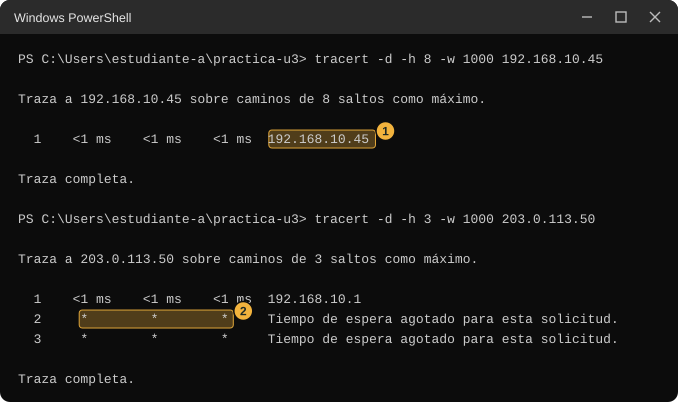<figcaption class="figure-caption">Dos recorridos de ejemplo. El número 1 marca un solo salto cuya dirección es la del compañero. El número 2 marca una fila de asteriscos.</figcaption></figure>

:::

**Paso 5.4. Comparen la primera línea.** Cada uno lee en voz alta la primera dirección de su recorrido hacia `8.8.8.8` (paso 5.2). ¿Coinciden?

**Anota.** En la fila 5, columna "Parte 2": cuántos saltos hubo hacia tu pareja, si coinciden las primeras direcciones de los dos recorridos hacia `8.8.8.8`, y cuál era tu predicción.

**Si no te sale en la parte 2.** Posibilidades, sin afirmar cuál es.

- El computador de tu pareja puede descartar los mensajes de `tracert`, y por eso el recorrido termina en asteriscos.
- La dirección puede estar mal copiada.
- La red de la sala puede no permitir que estos mensajes lleguen a tu pareja.

**La pregunta que queda para la clase.** ¿Cómo decide tu equipo por dónde sale cada mensaje?

::: {.callout-note title="En clase"}
Se explicará la tabla de rutas, la ruta por defecto, la métrica y por qué dos redes distintas necesitan un router.
:::

## Estación 6. Dos programas hablando

Hasta ahora usaste programas que ya existían. Aquí vas a armar dos programas pequeños que hablan entre sí por la red, en dos modalidades. La primera avisa si no hay nadie al otro lado y la segunda no. Vas a medir cuánto tarda cada fallo.

**Predice.** En la fila 6 de tu tabla escribe qué crees que ocurre en cada caso, y marca las opciones.

Primero, un programa llama a otro y nadie está esperando en ese equipo (primera modalidad). ¿Cuánto tarda en enterarse?

- <label><input type="checkbox"> Al instante, menos de medio segundo</label>
- <label><input type="checkbox"> Unos pocos segundos</label>
- <label><input type="checkbox"> Casi medio minuto</label>

Segundo, el mismo caso con la segunda modalidad, que no abre una conexión antes de enviar. ¿Avisa el sistema o el mensaje se pierde en silencio?

Tercero, el programa llama a una dirección donde ningún equipo contesta. ¿Cuánto tarda en rendirse?

### Parte 1. En tu equipo

**Paso 6.1. Guarda el programa que espera, de la primera modalidad (TCP).** En la consola 1 escribe `notepad servidor-tcp.ps1`, sigue el paso E y pega este código.

```powershell
# Programa que espera una conexion TCP, lee un mensaje y lo devuelve igual.
# Uso: powershell -ExecutionPolicy Bypass -File servidor-tcp.ps1 5000          (solo este equipo)
#      powershell -ExecutionPolicy Bypass -File servidor-tcp.ps1 5000 todas    (se abre a la red)
if ($args[0]) { $puerto = [int]$args[0] } elseif (-not $puerto) { $puerto = 5000 }
if ($args[1] -eq 'todas') { $todas = $true }
$direccion = if ($todas) { [System.Net.IPAddress]::Any } else { [System.Net.IPAddress]::Loopback }
$escucha = New-Object System.Net.Sockets.TcpListener($direccion, $puerto)
try { $escucha.Start() } catch { Write-Host "No se pudo abrir el numero $puerto. Otro programa lo esta usando, quiza un servidor tuyo que sigue abierto en otra consola."; return }
Write-Host "Escuchando TCP en el puerto $puerto ($(if ($todas) { 'abierto a la red' } else { 'solo este equipo' })). Ctrl+C para cerrar."
try {
    while ($true) {
        if (-not $escucha.Pending()) { Start-Sleep -Milliseconds 100; continue }
        $cliente = $escucha.AcceptTcpClient()
        try {
            $cliente.ReceiveTimeout = 5000
            $flujo = $cliente.GetStream()
            $buffer = New-Object byte[] 1024
            $n = $flujo.Read($buffer, 0, $buffer.Length)
            Write-Host "Conecto $($cliente.Client.RemoteEndPoint) y envio: $([System.Text.Encoding]::UTF8.GetString($buffer, 0, $n))"
            $flujo.Write($buffer, 0, $n)
        } catch {
            Write-Host "Conexion sin mensaje: $($_.Exception.Message)"
        } finally {
            $cliente.Close()
        }
    }
} finally {
    $escucha.Stop()
    Write-Host "Cerrado."
}
```

**Paso 6.2. Guarda el programa que llama, de la primera modalidad.** En la consola 1 escribe `notepad cliente-tcp.ps1`, sigue el paso E y pega este código.

```powershell
# Se conecta por TCP, envia una lectura y muestra la respuesta y cuanto tardo.
# Uso: powershell -ExecutionPolicy Bypass -File cliente-tcp.ps1 192.168.10.100 5000
if ($args[0]) { $ip = $args[0] }
if ($args[1]) { $puerto = [int]$args[1] } elseif (-not $puerto) { $puerto = 5000 }
if (-not $ip) { throw 'Falta la direccion. Ejemplo: .\cliente-tcp.ps1 127.0.0.1 5000' }
$reloj = [System.Diagnostics.Stopwatch]::StartNew()
$cliente = New-Object System.Net.Sockets.TcpClient
try {
    $cliente.Connect($ip, $puerto)
    $flujo = $cliente.GetStream()
    $flujo.ReadTimeout = 5000
    $mensaje = [System.Text.Encoding]::UTF8.GetBytes('temperatura=24.5')
    $flujo.Write($mensaje, 0, $mensaje.Length)
    $buffer = New-Object byte[] 1024
    $n = $flujo.Read($buffer, 0, $buffer.Length)
    Write-Host "Respuesta: $([System.Text.Encoding]::UTF8.GetString($buffer, 0, $n))"
} catch {
    Write-Host "Fallo: $($_.Exception.InnerException.Message)"
} finally {
    $cliente.Close()
    Write-Host ("Tardo {0:N1} segundos" -f $reloj.Elapsed.TotalSeconds)
}
```

Lee las piezas de los dos programas. El servidor abre una puerta con un número (`TcpListener`), espera (`Pending`), atiende a quien llama (`AcceptTcpClient`), lee un mensaje (`Read`), lo devuelve igual (`Write`) y cierra. El cliente se conecta a una dirección y un número (`Connect`), envía `temperatura=24.5` (`Write`), lee la respuesta (`Read`) y mide el tiempo con un cronómetro (`Stopwatch`).

**Paso 6.3. Haz que uno espere y el otro llame.** Abre la consola 2. En la consola 1 ejecuta:

```powershell
.\servidor-tcp.ps1 5000
```

La consola 1 queda esperando. En la consola 2 ejecuta:

```powershell
.\cliente-tcp.ps1 127.0.0.1 5000
```

::: {.tabla-ancha}

| Pieza | Qué hace |
|---|---|
| `.\cliente-tcp.ps1` | Ejecuta el programa que llama. |
| `127.0.0.1` | La dirección a la que llama: tu propio equipo. |
| `5000` | El número que acompaña a la dirección. Debe ser el mismo que usó el programa que espera. |

:::

::: {.tabla-ancha}

<figure class="figure">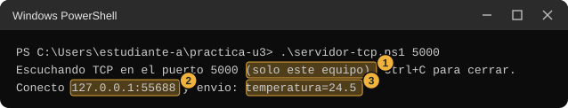<figcaption class="figure-caption">Consola 1. El número 1 marca que el programa atiende solo a este equipo, el 2 quién llamó (dirección y un número elegido por el sistema) y el 3 el mensaje recibido.</figcaption></figure>

:::

::: {.tabla-ancha}

<figure class="figure">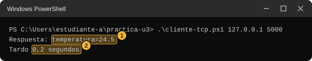<figcaption class="figure-caption">Consola 2. El número 1 marca la respuesta, que es el mismo mensaje, y el 2 el tiempo que tardó. Tus tiempos serán otros.</figcaption></figure>

:::

**Paso 6.4. Ciérralo y repite la llamada.** En la consola 1 pulsa Ctrl+C. Luego, en la consola 2, repite el mismo comando del cliente. Esta vez nadie espera en ese número.

::: {.tabla-ancha}

<figure class="figure">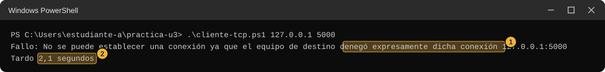<figcaption class="figure-caption">Llamada sin nadie al otro lado. El número 1 marca el mensaje del sistema y el 2 cuánto tardó. En una medición el tiempo fue de unos 2 segundos. En tu equipo puede variar.</figcaption></figure>

:::

**Paso 6.5. Llama a una dirección que no contesta.** La dirección `192.0.2.99` pertenece a un bloque que los estándares reservan para ejemplos, así que ningún equipo real debería responder. Ejecuta este comando y espera. Puede tardar casi medio minuto: no lo interrumpas. Si el resultado es muy distinto (por ejemplo, un mensaje casi inmediato), anótalo con su tiempo. Es un dato igual de útil.

```powershell
.\cliente-tcp.ps1 192.0.2.99 5000
```

::: {.tabla-ancha}

<figure class="figure">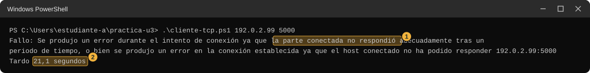<figcaption class="figure-caption">Llamada a una dirección que no contesta. El número 1 marca el mensaje y el 2 el tiempo. En una medición fue de unos 21 segundos.</figcaption></figure>

:::

**Paso 6.6a. Repite con la segunda modalidad (UDP).** Primero el programa que espera. Escribe `notepad servidor-udp.ps1`, sigue el paso E y pega este código.

```powershell
# Programa que espera mensajes UDP y los devuelve igual.
# Uso: powershell -ExecutionPolicy Bypass -File servidor-udp.ps1 5000          (solo este equipo)
#      powershell -ExecutionPolicy Bypass -File servidor-udp.ps1 5000 todas    (se abre a la red)
if ($args[0]) { $puerto = [int]$args[0] } elseif (-not $puerto) { $puerto = 5000 }
if ($args[1] -eq 'todas') { $todas = $true }
$direccion = if ($todas) { [System.Net.IPAddress]::Any } else { [System.Net.IPAddress]::Loopback }
try { $udp = New-Object System.Net.Sockets.UdpClient((New-Object System.Net.IPEndPoint($direccion, $puerto))) } catch { Write-Host "No se pudo abrir el numero $puerto. Otro programa lo esta usando, quiza un servidor tuyo que sigue abierto en otra consola."; return }
$origen = New-Object System.Net.IPEndPoint([System.Net.IPAddress]::Any, 0)
Write-Host "Escuchando UDP en el puerto $puerto ($(if ($todas) { 'abierto a la red' } else { 'solo este equipo' })). Ctrl+C para cerrar."
try {
    while ($true) {
        if ($udp.Available -eq 0) { Start-Sleep -Milliseconds 100; continue }
        $datos = $udp.Receive([ref]$origen)
        Write-Host "Llego $([System.Text.Encoding]::UTF8.GetString($datos)) desde $origen"
        [void]$udp.Send($datos, $datos.Length, $origen)
    }
} finally {
    $udp.Close()
    Write-Host "Cerrado."
}
```

**Paso 6.6b.** Ahora el programa que llama. Escribe `notepad cliente-udp.ps1`, sigue el paso E y pega este código.

```powershell
# Envia un mensaje UDP y espera 3 segundos la respuesta.
# Uso: powershell -ExecutionPolicy Bypass -File cliente-udp.ps1 192.168.10.100 5000
if ($args[0]) { $ip = $args[0] }
if ($args[1]) { $puerto = [int]$args[1] } elseif (-not $puerto) { $puerto = 5000 }
if (-not $ip) { throw 'Falta la direccion. Ejemplo: .\cliente-udp.ps1 127.0.0.1 5000' }
$reloj = [System.Diagnostics.Stopwatch]::StartNew()
$udp = New-Object System.Net.Sockets.UdpClient
$udp.Client.ReceiveTimeout = 3000
$origen = New-Object System.Net.IPEndPoint([System.Net.IPAddress]::Any, 0)
try {
    $mensaje = [System.Text.Encoding]::UTF8.GetBytes('temperatura=24.5')
    [void]$udp.Send($mensaje, $mensaje.Length, $ip, $puerto)
    $datos = $udp.Receive([ref]$origen)
    Write-Host "Respuesta: $([System.Text.Encoding]::UTF8.GetString($datos))"
} catch {
    $codigo = $_.Exception.InnerException.SocketErrorCode
    if ($codigo -eq 'TimedOut') { Write-Host 'Sin respuesta' }
    else { Write-Host "Aviso del sistema: $codigo - $($_.Exception.InnerException.Message)" }
} finally {
    $udp.Close()
    Write-Host ("Tardo {0:N1} segundos" -f $reloj.Elapsed.TotalSeconds)
}
```

**Paso 6.6c.** Luego haz la misma secuencia de tres pruebas. Primero, con el servidor esperando en la consola 1 (`.\servidor-udp.ps1 5000`), ejecuta en la consola 2 `.\cliente-udp.ps1 127.0.0.1 5000`. Después cierra el servidor con Ctrl+C y repite la llamada. Por último, llama a `192.0.2.99`.

::: {.tabla-ancha}

<figure class="figure">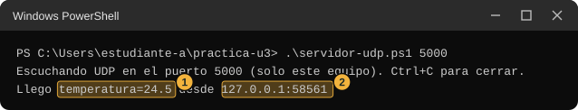<figcaption class="figure-caption">Consola 1 con el servidor de la segunda modalidad. El número 1 marca el mensaje que llegó y el 2 de dónde llegó.</figcaption></figure>

:::

::: {.tabla-ancha}

<figure class="figure">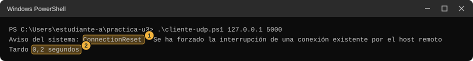<figcaption class="figure-caption">Llamada sin nadie esperando, en el mismo equipo. El número 1 marca el aviso del sistema operativo y el 2 el tiempo, que es muy corto.</figcaption></figure>

:::

Ese aviso no viene del programa que envía ni del que recibe: lo genera el sistema de tu equipo cuando el mensaje no encuentra a nadie. En clase se explica de dónde sale. Con una dirección que no contesta se ve otra cosa.

::: {.tabla-ancha}

<figure class="figure">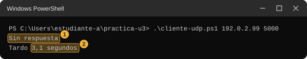<figcaption class="figure-caption">Llamada a una dirección que no contesta. El número 1 marca el texto del programa y el 2 el tiempo, que es el que el programa espera antes de rendirse.</figcaption></figure>

:::

**Paso 6.7. Mide con la herramienta de Windows.** `Test-NetConnection` comprueba si hay alguien esperando en una dirección y un número. Para medir cuánto tarda, esta línea guarda la hora antes y calcula la diferencia después. Primero deja el servidor TCP esperando (`.\servidor-tcp.ps1 5000` en la consola 1) y, en la consola 2, escribe esto en una sola línea.

```powershell
$t = Get-Date; Test-NetConnection 127.0.0.1 -Port 5000; "Tardo {0:N1} segundos" -f ((Get-Date) - $t).TotalSeconds
```

::: {.tabla-ancha}

| Pieza | Qué hace |
|---|---|
| `$t = Get-Date` | Guarda la hora actual con el nombre `t`. |
| `Test-NetConnection 127.0.0.1 -Port 5000` | Intenta conectarse a esa dirección y ese número y muestra el resultado. |
| `"Tardo {0:N1} segundos" -f (...)` | Resta la hora actual menos `t` y escribe el resultado en segundos con un decimal. |

:::

::: {.tabla-ancha}

<figure class="figure">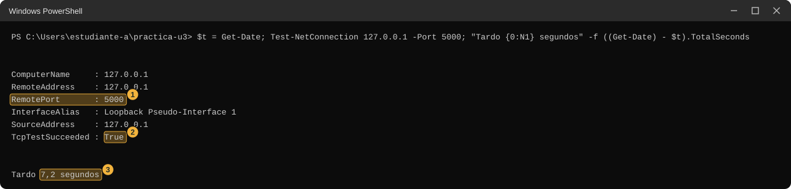<figcaption class="figure-caption">Alguien espera. El número 1 marca el número consultado, el 2 el resultado True y el 3 el tiempo que tardó el comando completo. Test-NetConnection tarda varios segundos aunque todo funcione.</figcaption></figure>

:::

Ahora cierra el servidor (Ctrl+C en la consola 1) y repite la misma línea. Luego repítela una tercera vez con `192.0.2.99` en lugar de `127.0.0.1`. La tercera puede tardar más de medio minuto. Si el resultado es muy distinto (por ejemplo, un mensaje casi inmediato), anótalo con su tiempo. Es un dato igual de útil.

::: {.tabla-ancha}

<figure class="figure">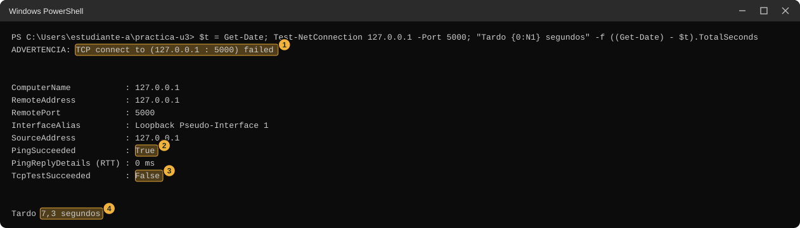<figcaption class="figure-caption">Nadie espera. El número 1 marca la advertencia, que Windows escribe en inglés. El número 2 marca que el equipo sí respondió al mensaje corto, y el 3 que la conexión no se logró. El número 4 es el tiempo.</figcaption></figure>

:::

::: {.tabla-ancha}

<figure class="figure">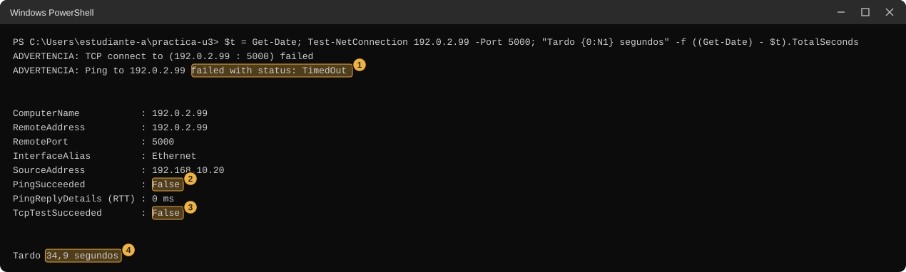<figcaption class="figure-caption">Nadie contesta. El número 1 marca la segunda advertencia, que dice que ni siquiera el mensaje corto tuvo respuesta. Los números 2 y 3 marcan los dos resultados en False y el 4 el tiempo.</figcaption></figure>

:::

**Anota.** En la fila 6, columna "Parte 1": para cada una de las dos modalidades, qué se mostró y cuánto tardó en cuatro casos: alguien espera, nadie espera, dirección que no contesta, y `Test-NetConnection` en los tres casos. Compara con tu predicción.

::: {.diagrama}

<svg viewBox="0 0 760 214" xmlns="http://www.w3.org/2000/svg" role="img" aria-label="Barras de ejemplo del tiempo que tardó un intento de conexión en tres casos medidos en un equipo: un programa espera, 0,2 segundos; nadie espera en el mismo equipo, 2,1 segundos; una dirección que no contesta, 21,1 segundos" font-family="Segoe UI, Inter, system-ui, sans-serif">
<text x="380" y="22" font-size="14" font-weight="700" fill="#12324f" text-anchor="middle">Ejemplo de tres intentos de conexión TCP (tiempos medidos en un equipo)</text>
<g font-size="12.5" fill="#12324f"><text x="20" y="62">Un programa espera</text><text x="20" y="102">Nadie espera, mismo equipo</text><text x="20" y="142">Dirección que no contesta</text></g>
<rect x="260" y="44" width="4" height="26" rx="2" fill="#9bcfb0"/>
<rect x="260" y="84" width="44" height="26" rx="2" fill="#f4b9ad" stroke="#e48a7a"/>
<rect x="260" y="124" width="440" height="26" rx="2" fill="#f4b9ad" stroke="#e48a7a"/>
<g font-size="12.5" fill="#12324f"><text x="272" y="62">0,2 s</text><text x="312" y="102">2,1 s</text><text x="540" y="142">21,1 s</text></g>
<path d="M260,164 H700" stroke="#5b6876" stroke-width="1.4" fill="none"/>
<g stroke="#5b6876" stroke-width="1.4"><path d="M260,164 V170"/><path d="M364,164 V170"/><path d="M468,164 V170"/><path d="M572,164 V170"/><path d="M676,164 V170"/></g>
<g font-size="12" fill="#5b6876" text-anchor="middle"><text x="260" y="186">0</text><text x="364" y="186">5 s</text><text x="468" y="186">10 s</text><text x="572" y="186">15 s</text><text x="676" y="186">20 s</text></g>
</svg>

:::

### Parte 2. Con tu pareja

Estudiante A pone un programa a esperar y estudiante B llama. Después cambian de roles. Como en la estación 1, el programa que espera se abre con la palabra `todas`, para que atienda a otros computadores. Si aparece el aviso del firewall, aplica lo que dice el paso 1.9 de la estación 1.

**Paso 6.8. A abre el servidor TCP a la red.**

```powershell
.\servidor-tcp.ps1 5000 todas
```

**Paso 6.9. B llama a A.** B escribe la dirección de A.

```powershell
.\cliente-tcp.ps1 DIRECCION-DE-A 5000
```

A debe ver en su consola la dirección de B, no `127.0.0.1`.

**Paso 6.10. B mide.** Con el servidor de A todavía abierto, B ejecuta en su consola la línea de `Test-NetConnection` del paso 6.7 con la dirección de A. Luego A cierra su servidor con Ctrl+C y B repite la línea.

**Paso 6.11. Repitan con la segunda modalidad.** A abre `.\servidor-udp.ps1 5000 todas` y B ejecuta `.\cliente-udp.ps1 DIRECCION-DE-A 5000`. Después cierran el servidor y B repite.

**Paso 6.12. Cambien de roles.** B abre el servidor y A llama.

**Anota.** En la fila 6, columna "Parte 2": para cada intento, qué mostró y cuánto tardó, y si el resultado se parece a algún caso de la parte 1.

**Si no te sale en la parte 2.** No afirmes cuál es la causa; estas son posibilidades. Si el cliente tardó mucho y falló con el servidor de tu pareja abierto, puede que el firewall de su equipo descarte lo que llega o que estén en redes que no se alcanzan. Si falló de inmediato, puede que el programa de tu pareja no esté abierto con `todas`, que el número no coincida o que alguien responda "no" desde ese equipo. Con la segunda modalidad, ver "Sin respuesta" no distingue entre un servidor apagado, un firewall que descarta y una red que no llega. Anota el mensaje y el tiempo exactos.

**Observa.** Compara los casos. ¿En cuáles recibes un aviso y en cuáles solo esperas?

**La pregunta que queda para la clase.** ¿Qué diferencia hay entre "nadie espera" y "nadie contesta", y cómo las distingues desde fuera?

::: {.callout-note title="En clase"}
Se explicarán los sockets, los puertos, TCP frente a UDP, y la diferencia entre un puerto cerrado y un firewall que descarta.
:::

## Estación 7. Mi plan (opcional)

Esta estación junta lo que descubriste. Con el laboratorio de la estación 4 (60 sensores, 25 equipos de administración, 10 servidores y un enlace de 2 equipos) vas a escribir un plan que dice en qué dirección empieza cada bloque, y lo vas a comprobar con el verificador.

**Predice.** En la fila 7 de tu tabla escribe, antes de ejecutar nada: ¿en qué número del 0 al 255 crees que debe empezar el bloque de los sensores? ¿Y el de administración, si lo pones después?

### Parte 1. En tu equipo

**Paso 7.1. Escribe tu plan en papel.** Sobre la tira de 256 direcciones de la estación 4, dibuja los cuatro bloques con el tamaño que encontraste. Para cada uno escribe dónde empieza y dónde termina.

**Paso 7.2. Compruébalo.** Ahora usa el cuarto dato de cada grupo, el inicio: `"nombre,equipos,tamaño,inicio"`. Como ejemplo de la forma, y sin que sea la solución, este comando pone los sensores a partir de 128 y el enlace a partir de 0, y los dos caben:

```powershell
.\verificar-plan.ps1 "sensores,60,64,128" "enlace,2,4,0"
```

Completa el comando con los otros dos grupos y con los números de tu plan. El verificador revisa si cada bloque cabe, si su inicio es posible y si algún bloque se pisa con otro.

::: {.tabla-ancha}

<figure class="figure">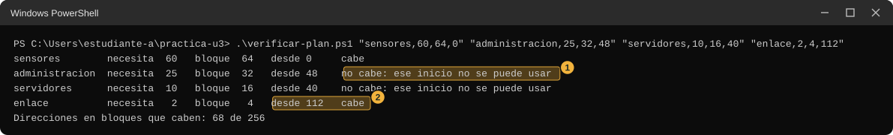<figcaption class="figure-caption">Inicios que el verificador rechaza. El número 1 marca un inicio que no se puede usar y el 2 un bloque que sí cabe.</figcaption></figure>

:::

::: {.tabla-ancha}

<figure class="figure">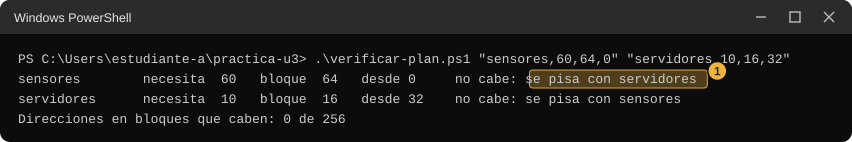<figcaption class="figure-caption">Dos bloques que se pisan. El número 1 marca el aviso, que aparece en los dos.</figcaption></figure>

:::

**Paso 7.3. Itera.** Si el verificador rechaza algún bloque, cambia su inicio y repite. Prueba al menos dos inicios que se rechazan y anota qué tienen en común.

::: {.callout-note title="Un plan posible" collapse="true"}
Los sensores desde 0 (`"sensores,60,64,0"`), administración desde 64 (`"administracion,25,32,64"`), los servidores desde 96 (`"servidores,10,16,96"`) y el enlace desde 112 (`"enlace,2,4,112"`). Ocupan 0 a 63, 64 a 95, 96 a 111 y 112 a 115, y quedan libres 140 direcciones (de la 116 a la 255). No es el único plan que cabe.
:::

**Anota.** En la fila 7, columna "Parte 1": tu plan final (nombre, inicio, último número del bloque), cuántas direcciones quedaron sin repartir, y qué inicios rechazó el verificador.

### Parte 2. Con tu pareja

**Paso 7.4. Intercambien planes.** Cada uno escribe su plan en la forma `"nombre,equipos,tamaño,inicio"` y el compañero lo ejecuta en su verificador. Comparen: ¿hay un único plan que cabe? ¿Cuántas direcciones quedaron libres en cada uno?

**Anota.** En la fila 7, columna "Parte 2": si el plan de tu pareja cabe, en qué se diferencia del tuyo, y cuántas direcciones libres dejó.

Si no tienes la dirección o el reparto de tu pareja, salta esta parte. La estación termina con la parte 1.

**La pregunta que queda para la clase.** ¿Cuál plan deja menos direcciones desperdiciadas, y por qué conviene dejar libres las del final?

::: {.callout-note title="En clase"}
Se explicará el plan de direccionamiento como tabla de diseño y su verificación.
:::

## Si algo no te sale

- "La ejecución de scripts está deshabilitada" o similar. Repite el paso D en esa ventana.
- El prompt no vuelve después de ejecutar un servidor. Es lo esperado: el programa está esperando. Pulsa Ctrl+C.
- Ctrl+C no responde. Cierra la ventana de la consola con la X. El programa se apaga igual.
- Ejecutas un servidor y dice "No se pudo abrir el número". Otro programa usa ese número, probablemente un servidor tuyo que sigue abierto en otra consola. Ciérralo con Ctrl+C o usa otro número, por ejemplo `.\servidor-web.ps1 8001`, y escribe 8001 en la dirección del navegador (o en el cliente).
- Aparece una ventana del firewall. Mira la regla de seguridad de la página inicial y el paso 1.9 de la estación 1.
- El navegador de tu pareja no abre tu servidor. Repasa las posibles causas de la estación 1, parte 2. Puedes seguir con la estación siguiente.
- `Test-NetConnection` tarda mucho. Es normal en los casos donde nadie contesta; no lo interrumpas.
- El Bloc de notas guardó el archivo como `.txt`. Usa `Rename-Item` como indica el paso E.
- No tienes pareja. Completa solo las partes 1.

## Glosario de la práctica

Estas palabras describen las herramientas de la práctica con lenguaje común. Los conceptos de la unidad se definen en clase.

::: {.tabla-ancha}

| Palabra | Qué es en esta práctica |
|---|---|
| Consola | La ventana donde escribes comandos y lees las respuestas. |
| Prompt | La línea de la consola donde escribes. Empieza con `PS` y la carpeta actual. |
| Comando | El nombre de un programa que escribes para que haga algo. |
| Opción | Una palabra que va después del comando y cambia lo que hace, como `-n 2` en `ping`. |
| Salida | El texto que el comando imprime al terminar. |
| Programa guardado | Un archivo con terminación `.ps1` con instrucciones para PowerShell. |
| Ctrl+C | Las teclas que cierran un programa que se quedó esperando en la consola. |
| 127.0.0.1 | Una dirección que siempre significa este mismo equipo. |
| Dirección física | El número de seis pares de dígitos que `arp -a` asocia a cada vecino. |
| Salto | Cada equipo intermedio que aparece como una línea en la salida de `tracert`. |
| Registro | Las líneas que un programa escribe en la consola cada vez que atiende a alguien. |

:::

## Qué cifras no reproduce esta guía

- Los tiempos de 0,2 s, 2,1 s, 3,1 s, 21,1 s y 34,9 s de las imágenes salieron de una medición en un solo equipo. Dependen del equipo y de la red, y no son valores que Microsoft garantice. Tus tiempos serán distintos.
- `Test-NetConnection` completo tarda entre 7 y 13 s, con el puerto abierto o cerrado (7,2 s y 7,3 s en las imágenes). El tiempo incluye trabajo fijo del comando, aparte del intento de conexión.
- Los textos de los avisos de error (por ejemplo, "denegó expresamente dicha conexión") los genera Windows en español y pueden cambiar con la versión o el idioma del sistema.
- El aviso del firewall no se pudo observar al preparar esta guía. La descripción de la estación 1 es una posibilidad, no una captura.
- La documentación de Microsoft del comando `route` no menciona la opción `-4` de `route print`. La opción se comprobó ejecutándola en Windows 11.
- Lo que ocurre en la parte 2 depende de la configuración de la sala, que no se pudo comprobar antes de la clase.

## Recursos

- Microsoft. "about_PowerShell_exe", parámetros `-File` y `-ExecutionPolicy`, Windows PowerShell 5.1. Microsoft Learn. [learn.microsoft.com, about_powershell_exe](https://learn.microsoft.com/en-us/powershell/module/microsoft.powershell.core/about/about_powershell_exe?view=powershell-5.1)
- Microsoft. "Test-NetConnection", módulo NetTCPIP. Microsoft Learn. [learn.microsoft.com, test-netconnection](https://learn.microsoft.com/en-us/powershell/module/nettcpip/test-netconnection?view=windowsserver2022-ps)
- Microsoft. Referencia de comandos de Windows Server: [tracert](https://learn.microsoft.com/en-us/windows-server/administration/windows-commands/tracert), [route](https://learn.microsoft.com/en-us/windows-server/administration/windows-commands/route_ws2008) y [arp](https://learn.microsoft.com/en-us/windows-server/administration/windows-commands/arp). Microsoft Learn.
- Microsoft. "TcpListener Class", "UdpClient Class" e "IPAddress.Loopback Field", espacio de nombres System.Net.Sockets y System.Net, .NET Framework 4.8. Microsoft Learn. [learn.microsoft.com, TcpListener](https://learn.microsoft.com/en-us/dotnet/api/system.net.sockets.tcplistener?view=netframework-4.8.1), [learn.microsoft.com, UdpClient](https://learn.microsoft.com/en-us/dotnet/api/system.net.sockets.udpclient?view=netframework-4.8.1) y [learn.microsoft.com, IPAddress.Loopback](https://learn.microsoft.com/en-us/dotnet/api/system.net.ipaddress.loopback?view=netframework-4.8.1)
- Internet Engineering Task Force (IETF). RFC 5737, "IPv4 Address Blocks Reserved for Documentation". Enero de 2010. [rfc-editor.org, rfc5737](https://www.rfc-editor.org/rfc/rfc5737)

::: {.pie-doc}
Telemática para IoT (TPI01). Fundación Universitaria María Cano. Facultad de Ingeniería. Semestre 2026-02.

**Transparencia.** La redacción de esta guía contó con el apoyo de inteligencia artificial, con el modelo Claude de Anthropic. Los programas y los comandos de la Parte 1 se ejecutaron en un equipo con Windows 11 y PowerShell 5.1 y los datos se contrastaron con documentación primaria de Microsoft. Los pasos de la Parte 2 con pareja, el aviso del firewall y los tiempos hacia direcciones que no contestan no se probaron con dos equipos, y las imágenes de esa parte son dibujos de ejemplo, no capturas.
:::
