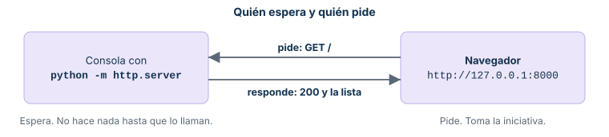
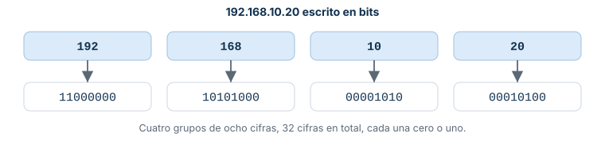
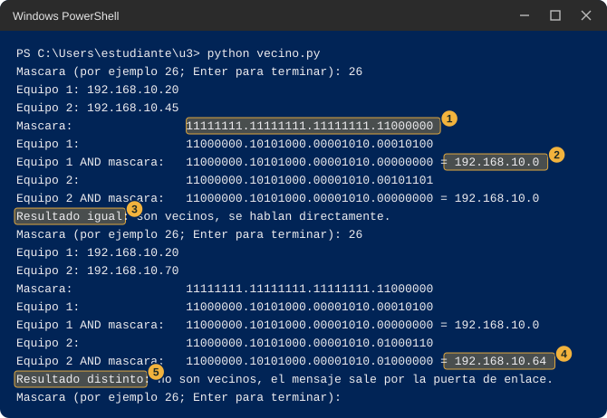
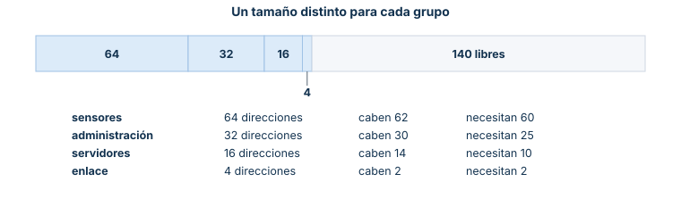
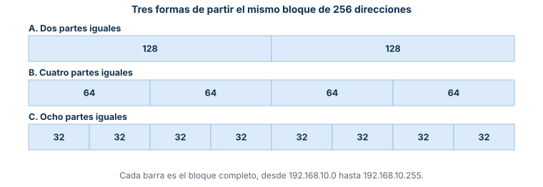
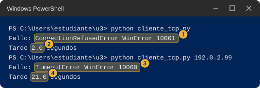
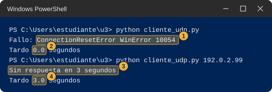

::: {.ficha}
|        |                                                                       |
|--------|-----------------------------------------------------------------------|
| Unidad | Unidad 3. Diseño LAN                                                   |
| Temas  | Práctica individual previa a la teoría, versión con Python             |
:::

Esta guía se hace sola, en tu propio computador, antes de que se explique la teoría de la unidad. Son seis estaciones cortas. En cada una piensas qué va a pasar, ejecutas algo real, lees la salida con ayuda de la guía y contestas unas preguntas para pensar. Todo ocurre dentro de tu equipo, con la dirección `127.0.0.1`, así que no depende de la red de la sala ni del firewall. Al final de cada estación queda una pregunta que la clase va a responder.

## Antes de empezar

Necesitas un computador con Windows 10 u 11, un navegador (Edge o Chrome) y Python 3, que ya está instalado en los equipos de la sala. No necesitas permisos de administrador y ningún comando de esta guía cambia la configuración de tu equipo. Usa solo los comandos que aparecen aquí.

Cada estación tiene cuatro partes. **Qué vas a hacer** dice el objetivo y por qué importa. En **Predice** piensas y anotas en una línea tu respuesta antes de ejecutar nada; no hay respuesta incorrecta, sirven para comparar con lo que veas. En **Haz** sigues pasos numerados, y cada paso tiene **Escribe** (lo que tecleas), **Verás** (la salida) y **Qué significa** (cómo leerla). En **Para pensar** contestas con lo que observaste; la respuesta está en un desplegable cerrado: primero piensa, después míralo.

### Abrir PowerShell, comprobar Python y crear tu carpeta

1. Pulsa la tecla Windows, escribe `PowerShell` y elige Windows PowerShell (no el "ISE" ni el "(x86)"). Se abre una ventana azul. La línea donde escribes se llama prompt y termina en `>`. Cada comando se escribe ahí y se ejecuta con Enter.
2. Escribe `python --version`. Debe aparecer una línea como la de la imagen.
3. Si `python` no se reconoce o se abre la tienda de Microsoft, prueba `py --version`. Si funciona, escribe `py` en lugar de `python` en toda la guía. Si ninguno responde, avisa al docente.
4. Crea tu carpeta de trabajo con los tres comandos siguientes. `cd` cambia de carpeta, `~` es tu carpeta personal y `mkdir` crea una carpeta. El prompt debe terminar en `\u3>`. En una consola nueva, escribe `cd ~\u3` para volver a ella.

```text
cd ~
mkdir u3
cd u3
```

<figure class="figure" style="overflow-x:auto"><figcaption class="figure-caption">Salida de ejemplo de python --version</figcaption></figure>

### Guardar un archivo con código

1. Escribe `notepad nombre.py` (con el nombre que pida la estación). Si el Bloc de notas pregunta si quieres crear el archivo, responde que sí.
2. Copia el código del bloque con el botón de copiar y pégalo. Respeta los espacios del comienzo de las líneas, porque en Python tienen significado.
3. Guarda con Ctrl+S y cierra el Bloc de notas. Si usas Guardar como, elige "Todos los archivos" y la codificación UTF-8, para que no le agregue `.txt`.
4. Escribe `dir` y comprueba que el archivo se llama exactamente como dice la guía. Si aparece `nombre.py.txt`, corrígelo con `Rename-Item nombre.py.txt nombre.py`.
5. Ejecútalo con `python nombre.py`. Si dice `SyntaxError` o `IndentationError`, al pegar se perdieron los espacios del comienzo: abre el archivo otra vez, bórralo todo y pega el bloque completo. Si dice `can't open file`, no estás en la carpeta `u3`: escribe `cd ~\u3`.

### Dos consolas y cómo detener un programa

Algunas estaciones usan dos consolas a la vez. Abre otra ventana de PowerShell como en el paso 1, déjala al lado de la primera y escribe `cd ~\u3`. Lo que ejecutas en una no se ve en la otra.

Un programa que no devuelve el prompt está esperando, y eso es lo normal mientras funciona. Para detenerlo haz clic dentro de su ventana y pulsa Ctrl+C. Si no reacciona, cierra la ventana con la X. Al terminar cada estación no debe quedar ningún programa esperando. Los programas esperan solo a `127.0.0.1`, es decir, a tu propio equipo, así que Windows no debería mostrar el aviso del firewall. Si aparece, pulsa Cancelar y avisa al docente.

### El caso de la práctica

Los ejercicios usan un laboratorio de ejemplo con el bloque `192.168.10.0/24`, repartido en cuatro grupos. Esos números son del caso, para practicar: tu equipo real tiene otras direcciones, y donde la estación las necesita te dice cómo sacarlas con `ipconfig`.

::: {.tabla-ancha}

| Grupo | Bloque | Equipos del ejemplo |
|---|---|---|
| Sensores | `192.168.10.0/26` | sensores `.20` y `.45`; router `.1` |
| Administración | `192.168.10.64/27` | equipos `.70` y `.71`; router `.65` |
| Servidores | `192.168.10.96/28` | servidor `.100`, puerto de servicio 5000; router `.97` |
| Enlace | `192.168.10.112/30` | router `.113` y router de salida `.114` |

:::

## Estación 1. Un servidor propio y los puertos

**Qué vas a hacer.** Vas a encender en tu equipo un programa que muestra por la red una carpeta tuya y a visitarlo con el navegador. Importa porque casi toda la comunicación en una red es esto: un programa espera y otro lo llama.

**Predice.** Piensa cada respuesta y anótala en una línea.

1. Con el programa encendido y el navegador cerrado, ¿qué crees que escribe la consola?
2. Cuando el navegador pida una página, ¿qué crees que aparece en la consola?
3. Si enciendes un segundo programa igual pero con otro número (8001 en vez de 8000), ¿la consola del primero se entera de lo que pidas al segundo?

**Haz.**

**Paso 1. Prepara la carpeta que vas a mostrar.**

**Escribe** en PowerShell, dentro de `u3`:

```text
mkdir sitio
cd sitio
Set-Content saludo.txt "hola desde mi equipo"
```

`mkdir sitio` crea la carpeta, `cd sitio` entra en ella y `Set-Content` crea el archivo `saludo.txt` con el texto que va entre comillas.

**Verás** una pequeña tabla que confirma la carpeta nueva, y el prompt terminado en `\u3\sitio>`. `Set-Content` no imprime nada.

**Qué significa** que ya existe una carpeta con un solo archivo. Es lo único que el programa del paso siguiente va a mostrar; tus documentos quedan fuera.

**Paso 2. Enciende el servidor.**

**Escribe**:

```text
python -m http.server 8000 --bind 127.0.0.1
```

`-m http.server` le pide a Python que ejecute su módulo de servidor web, que muestra los archivos de la carpeta actual. `8000` es el número con el que se le va a llamar. `--bind 127.0.0.1` hace que atienda solo a tu propio equipo.

**Verás** esta línea, y el prompt no vuelve:

```text
Serving HTTP on 127.0.0.1 port 8000 (http://127.0.0.1:8000/) ...
```

**Qué significa** que el programa quedó esperando. `127.0.0.1` es la dirección que todo equipo reserva para hablar consigo mismo (RFC 1122). El número 8000 se llama puerto: la dirección dice a qué equipo se llama, y el puerto dice a cuál programa de ese equipo.

**Paso 3. Llámalo desde el navegador.**

**Escribe** en la barra de direcciones del navegador `http://127.0.0.1:8000` y pulsa Enter. Haz clic en `saludo.txt`. Después escribe `http://127.0.0.1:8000/no-existe.txt` y pulsa Enter. Vuelve a la ventana de la consola, sin cerrar nada.

**Verás** primero la lista de archivos, después el texto "hola desde mi equipo" y después una página de error 404. En la consola, una línea de registro por cada cosa que pidió el navegador.

<figure class="figure" style="overflow-x:auto"><figcaption class="figure-caption">El navegador en 127.0.0.1:8000</figcaption></figure>

<figure class="figure" style="overflow-x:auto"><figcaption class="figure-caption">La consola del servidor, con la fecha y hora de tu equipo</figcaption></figure>

**Qué significa**, línea por línea:

1. `Serving HTTP on ...` aparece una sola vez, al arrancar.
2. `127.0.0.1 - - [fecha y hora] "GET / HTTP/1.1" 200 -` dice quién llamó (127.0.0.1, tú mismo), cuándo, qué pidió y cómo le fue. `GET /` significa "dame la página de inicio". El `200` es el código de "todo bien, aquí está" (RFC 9110).
3. `"GET /saludo.txt ..." 200`: pediste el archivo y existe.
4. `"GET /no-existe.txt ..." 404`: pediste algo que no existe. El `404` es el código de "no encontrado" (RFC 9110), y la línea de arriba, `code 404, message File not found`, lo repite con palabras. Si ves una línea con `favicon.ico`, es el navegador pidiendo por su cuenta el ícono de la pestaña; no pasa nada.

*Si no sale así:* si el navegador dice que no pudo conectarse, mira la consola: debe seguir mostrando `Serving HTTP on` sin prompt, y la dirección del navegador debe ser exactamente `http://127.0.0.1:8000`.

**Paso 4. Enciende un segundo servidor con otro número, y apaga todo.**

**Escribe** en una segunda consola (ver "Dos consolas y cómo detener un programa"), con `cd ~\u3\sitio` primero:

```text
python -m http.server 8001 --bind 127.0.0.1
```

Abre en el navegador `http://127.0.0.1:8001` y mira las dos consolas. Después pulsa Ctrl+C dentro de cada una y F5 en la página del navegador.

**Verás** la misma lista de archivos. La consola nueva escribe su propia línea `Serving HTTP on 127.0.0.1 port 8001` y un `"GET / HTTP/1.1" 200 -`, y la primera consola no escribe nada nuevo. Al final, `Keyboard interrupt received, exiting.` en cada consola, con el prompt de vuelta, y en el navegador una página de error que dice que no pudo conectarse.

**Qué significa** que dos programas conviven en el mismo equipo y con la misma dirección porque cada uno tiene su propio puerto: lo que llega al 8001 solo lo ve el programa del 8001. Y que al apagar un programa ya no hay nadie a quien llamar.

**Para pensar.**

1. ¿Quién tomó la iniciativa, el navegador o la consola? ¿Qué hacía la consola mientras nadie la llamaba?
2. En una línea del registro salió 200 y en otra 404. ¿Qué diferencia había entre lo que pidió el navegador en cada caso?
3. Los dos servidores corrían en el mismo equipo y con la misma dirección. ¿Qué los distinguía? ¿Qué crees que pasaría si intentaras encender dos programas esperando en el mismo número?

::: {.callout-note collapse="true"}
## Respuestas

1. El navegador. La consola esperaba sin hacer nada hasta que la llamaron: ese es el papel del servidor, esperar, y el del cliente, pedir.
2. Pidió cosas distintas: `saludo.txt` existe en la carpeta y `no-existe.txt` no. El servidor contesta 200 cuando tiene lo pedido y 404 cuando no.
3. El número, el puerto. Con el mismo número, en general el segundo programa no puede quedarse esperando; lo comprobarás en la estación 6, paso 4.

<figure class="figure" style="overflow-x:auto"><figcaption class="figure-caption">Quién espera y quién pide</figcaption></figure>
:::

**Pregunta para la clase.** Un solo servidor atiende a muchos equipos a la vez, y cada uno trae su propio navegador. ¿Cómo sabe el servidor a quién le contesta cada respuesta?

## Estación 2. Las direcciones como números

**Qué vas a hacer.** Vas a convertir una dirección como `192.168.10.20` en un solo número y en 32 ceros y unos, y a ver cuáles de esos ceros y unos cambian cuando cambias un número de la dirección. Importa porque el computador compara las direcciones cifra por cifra, y cuántas cifras tienen en común dos direcciones dice mucho sobre ellas.

**Predice.**

1. La dirección `192.168.10.20` convertida en un solo número, ¿será pequeña o enorme?
2. Si cambias el último número (de 20 a 21), ¿cuántos de los 32 ceros y unos crees que cambian? ¿Y si cambias el tercero (de 10 a 11)?
3. Las direcciones `192.168.10.20` y `192.168.10.45`, ¿cuántos ceros y unos crees que comparten, contando desde la izquierda?

**Haz.**

**Paso 1. Crea el programa y compara dos direcciones del caso.**

**Escribe** `notepad bits.py`, pega este código y guárdalo (ver "Guardar un archivo con código"):

```python
import ipaddress


def pedir(mensaje):
    while True:
        texto = input(mensaje).strip()
        if texto == "":
            return None
        try:
            return ipaddress.IPv4Address(texto)
        except ValueError:
            print("Eso no es una direccion de cuatro numeros. Prueba otra vez.")


def en_bits(direccion):
    bits = format(int(direccion), "032b")
    return ".".join(bits[i:i + 8] for i in range(0, 32, 8))


mia = pedir("Tu direccion: ")
if mia is not None:
    print("Como numero:  ", int(mia))
    print("En bits:     ", en_bits(mia))
    while True:
        otra = pedir("Otra direccion (Enter para terminar): ")
        if otra is None:
            break
        print("Como numero:  ", int(otra))
        print("En bits:     ", en_bits(otra))
        print("Cambian:     ", "".join(" " if a == b else "^" for a, b in zip(en_bits(mia), en_bits(otra))))
        print("Iguales desde la izquierda:", 32 - (int(mia) ^ int(otra)).bit_length())
```

Lo nuevo: `ipaddress.IPv4Address(texto)` convierte lo que escribes en una dirección y falla si no son cuatro números entre 0 y 255. `int(direccion)` la ve como un solo número. `format(numero, "032b")` lo escribe en ceros y unos: `b` pide binario y `032` pide 32 cifras, rellenando con ceros a la izquierda. La línea `Cambian` pone `^` debajo de cada cifra que es distinta entre las dos direcciones, y la última cuenta cuántas cifras seguidas son iguales desde la izquierda.

Ejecútalo con `python bits.py`. En `Tu direccion:` escribe `192.168.10.20` y Enter. En `Otra direccion` escribe `192.168.10.45` y Enter. Deja el programa abierto.

**Verás**:

<figure class="figure" style="overflow-x:auto"><figcaption class="figure-caption">bits.py con dos direcciones del caso</figcaption></figure>

**Qué significa**:

1. `Como numero` es la dirección vista como un solo entero: unos 3 200 millones, no un número pequeño. `En bits` (marca 1) son esas 32 cifras partidas en cuatro grupos de 8, y cada grupo es uno de los cuatro números de la dirección: `192` es `11000000`, `168` es `10101000`, `10` es `00001010` y `20` es `00010100`.
2. La fila `Cambian` (marca 2) tiene un `^` bajo cada cifra distinta: cuatro, todas en el último grupo.
3. `Iguales desde la izquierda: 26` (marca 3): las dos direcciones comparten las primeras 26 de sus 32 cifras. Guarda ese 26, porque vuelve a aparecer.

<figure class="figure" style="overflow-x:auto"><figcaption class="figure-caption">192.168.10.20 escrito en bits</figcaption></figure>

**Paso 2. Cambia un número y mira qué se mueve.**

**Escribe**, en el mismo programa y en `Otra direccion`, una por una: `192.168.10.21`, `192.168.11.20` y `192.168.10.256`. Termina con Enter vacío.

**Verás**:

```text
Otra direccion (Enter para terminar): 192.168.10.21
Como numero:   3232238101
En bits:      11000000.10101000.00001010.00010101
Cambian:                                        ^
Iguales desde la izquierda: 31
Otra direccion (Enter para terminar): 192.168.11.20
Como numero:   3232238356
En bits:      11000000.10101000.00001011.00010100
Cambian:                               ^
Iguales desde la izquierda: 23
Otra direccion (Enter para terminar): 192.168.10.256
Eso no es una direccion de cuatro numeros. Prueba otra vez.
```

**Qué significa** que cambiar el último número (20 a 21) movió una sola cifra, la última del último grupo, y quedaron 31 iguales. Cambiar el tercero (10 a 11) movió una cifra del tercer grupo y quedaron 23 iguales. Cuanto más a la izquierda cae el cambio, menos cifras seguidas quedan iguales. `192.168.10.256` no es una dirección: cada número ocupa 8 cifras y con 8 cifras el mayor valor es 255.

**Paso 3. Mira tus propias direcciones.**

**Escribe** `ipconfig` y pulsa Enter. Busca el bloque "Adaptador de Ethernet" (el del cable; ignora los que dicen VMware, VirtualBox, vEthernet o WSL, o "medios desconectados") y anota tu "Dirección IPv4" y tu "Puerta de enlace predeterminada". Después ejecuta `python bits.py`, escribe tu dirección IPv4 y, en `Otra direccion`, tu puerta de enlace.

**Verás** tus números. La imagen es un ejemplo de `ipconfig` con los valores del caso; en tu equipo serán otros. Con los del ejemplo (`192.168.10.20` y la puerta de enlace `192.168.10.1`) `bits.py` escribe al final:

<figure class="figure" style="overflow-x:auto"><figcaption class="figure-caption">Ejemplo de ipconfig con los valores del caso</figcaption></figure>

```text
Cambian:                                    ^ ^ ^
Iguales desde la izquierda: 27
```

**Qué significa** que tu dirección y la de tu puerta de enlace comparten casi todas las cifras: en el ejemplo, 27 de 32. La puerta de enlace es el router al que tu equipo le entrega lo que no puede entregar él mismo. En la estación 3 vas a ver por qué se parecen tanto.

**Para pensar.**

1. ¿Por qué cambiar el último número solo movió cifras del último grupo, y cambiar el tercero movió cifras del tercer grupo?
2. `192.168.10.20` y `192.168.10.45` comparten 26 cifras y se diferencian en las 6 últimas. ¿Cuántas direcciones distintas se pueden escribir cambiando solo esas 6 cifras?
3. Si dos direcciones comparten pocas cifras, ¿esperarías que estén "cerca" o "lejos" en la red? Fíjate en lo que viste con la puerta de enlace.

::: {.callout-note collapse="true"}
## Respuestas

1. Cada número de la dirección ocupa un grupo fijo de 8 cifras. Un cambio en un número solo puede mover las cifras de su grupo.
2. 2 elevado a 6, es decir 64: con 6 cifras que pueden ser 0 o 1 hay 64 combinaciones. Todas las direcciones que comparten esas primeras 26 cifras forman un grupo de 64, de `192.168.10.0` a `192.168.10.63`.
3. Lejos. Compartir muchas cifras seguidas desde la izquierda es lo que tienen en común los equipos de un mismo grupo, como tu equipo y su puerta de enlace.
:::

**Pregunta para la clase.** ¿Cuántas de las 32 cifras sirven para saber si dos equipos están juntos, y quién decide ese número?

## Estación 3. ¿Quién es vecino de quién?

**Qué vas a hacer.** Antes de enviar un mensaje, tu equipo decide si el destino es un vecino, al que se lo entrega directamente, o si debe dárselo al router (la puerta de enlace) para que lo lleve más lejos. Vas a repetir esa decisión con un programa. Para decidir usa la máscara, un patrón de 32 ceros y unos, y una operación llamada AND.

**Predice.**

1. En el caso, los sensores `.20` y `.45` comparten 26 cifras (estación 2). ¿Crees que son vecinos? ¿Y el sensor `.20` con el equipo de administración `.70`?
2. Si por error se le dice a un equipo que su grupo es mucho más grande de lo que es, ¿qué crees que pasará con sus decisiones de "vecino"?

**Haz.**

**Paso 1. Crea el programa y compara equipos de grupos distintos.**

**Escribe** `notepad vecino.py`, pega este código y guárdalo:

```python
import ipaddress


def en_bits(numero):
    bits = format(numero, "032b")
    return ".".join(bits[i:i + 8] for i in range(0, 32, 8))


while True:
    texto = input("Mascara (por ejemplo 26; Enter para terminar): ")
    if texto == "":
        break
    mascara = int(ipaddress.IPv4Network("0.0.0.0/" + texto).netmask)
    uno = int(ipaddress.IPv4Address(input("Equipo 1: ")))
    dos = int(ipaddress.IPv4Address(input("Equipo 2: ")))
    print("Mascara:               ", en_bits(mascara))
    print("Equipo 1:              ", en_bits(uno))
    print("Equipo 1 AND mascara:  ", en_bits(uno & mascara), "=", ipaddress.IPv4Address(uno & mascara))
    print("Equipo 2:              ", en_bits(dos))
    print("Equipo 2 AND mascara:  ", en_bits(dos & mascara), "=", ipaddress.IPv4Address(dos & mascara))
    if uno & mascara == dos & mascara:
        print("Resultado igual: son vecinos, se hablan directamente.")
    else:
        print("Resultado distinto: no son vecinos, el mensaje sale por la puerta de enlace.")
```

Lo nuevo: `IPv4Network("0.0.0.0/" + texto).netmask` convierte el número que escribes, como 26, en la máscara: 26 unos seguidos y 6 ceros. `uno & mascara` es el AND: compara cifra por cifra y deja un 1 solo donde las dos tienen 1. El efecto es borrar las cifras donde la máscara tiene ceros y conservar las demás. Si escribes mal una dirección el programa termina con un error `ValueError`: vuelve a ejecutarlo.

Ejecútalo con `python vecino.py` y responde: máscara `26`, equipo 1 `192.168.10.20`, equipo 2 `192.168.10.45`. Después, sin cerrar: máscara `26`, equipo 1 `192.168.10.20`, equipo 2 `192.168.10.70`. Termina con Enter vacío.

**Verás**:

<figure class="figure" style="overflow-x:auto"><figcaption class="figure-caption">vecino.py con la máscara de 26 unos</figcaption></figure>

**Qué significa**:

1. `Mascara` (marca 1): 26 unos y 6 ceros. Los unos marcan las cifras que se comparan.
2. `Equipo 1 AND mascara` (marca 2): del `.20` solo quedan sus primeras 26 cifras, el resto se borra. Resulta `192.168.10.0`, el nombre del grupo al que pertenece.
3. Con el `.45` sale lo mismo, `192.168.10.0`: `Resultado igual` (marca 3). Son vecinos.
4. Con el `.70` el AND da `192.168.10.64` (marca 4), distinto de `192.168.10.0`: `Resultado distinto` (marca 5). El `.70` cae en otro grupo, así que un mensaje del `.20` al `.70` se le entrega al router.

**Paso 2. Cambia la máscara.**

**Escribe**, uno tras otro: máscara `27` con `192.168.10.70` y `192.168.10.71`; máscara `27` con `192.168.10.70` y `192.168.10.100`; máscara `24` con `192.168.10.70` y `192.168.10.100`.

**Verás**, de cada ronda, solo las líneas que resumen el AND y el resultado:

```text
Equipo 1 AND mascara:   11000000.10101000.00001010.01000000 = 192.168.10.64
Equipo 2 AND mascara:   11000000.10101000.00001010.01000000 = 192.168.10.64
Resultado igual: son vecinos, se hablan directamente.
Equipo 1 AND mascara:   11000000.10101000.00001010.01000000 = 192.168.10.64
Equipo 2 AND mascara:   11000000.10101000.00001010.01100000 = 192.168.10.96
Resultado distinto: no son vecinos, el mensaje sale por la puerta de enlace.
Equipo 1 AND mascara:   11000000.10101000.00001010.00000000 = 192.168.10.0
Equipo 2 AND mascara:   11000000.10101000.00001010.00000000 = 192.168.10.0
Resultado igual: son vecinos, se hablan directamente.
```

**Qué significa** que con 27 unos los grupos son de 32 direcciones: `.64` a `.95` y `.96` a `.127`. El `.70` queda en el primero, junto al `.71` pero no junto al `.100`. Con 24 unos la máscara es tan corta que borra casi todo y el programa dice que el `.70` y el `.100` son vecinos, aunque en el caso están en grupos distintos. Una máscara equivocada produce una decisión equivocada.

**Paso 3. Con tus propios datos.**

**Escribe** `python vecino.py`. Como máscara escribe la "Máscara de subred" de tu `ipconfig` (puede ser el número de cuatro partes, como `255.255.255.0`), como equipo 1 tu dirección IPv4 y como equipo 2 tu puerta de enlace. Repite con `8.8.8.8` como equipo 2.

**Verás** tus números. Con los del caso (máscara `255.255.255.192`, equipo 1 `192.168.10.20`) las líneas finales de cada ronda son estas:

```text
Equipo 2 AND mascara:   11000000.10101000.00001010.00000000 = 192.168.10.0
Resultado igual: son vecinos, se hablan directamente.
Equipo 2 AND mascara:   00001000.00001000.00001000.00000000 = 8.8.8.0
Resultado distinto: no son vecinos, el mensaje sale por la puerta de enlace.
```

**Qué significa** que tu puerta de enlace siempre es vecina tuya, porque tu equipo tiene que poder entregarle el mensaje directamente. Por eso en la estación 2 se parecían tanto sus direcciones. `8.8.8.8` está fuera de tu grupo, así que todo lo que vaya hacia allá sale por la puerta de enlace.

**Para pensar.**

1. Con la máscara de 26 unos, el `.20` y el `.70` no son vecinos. ¿En cuál grupo de 8 cifras y en cuál cifra se diferencian?
2. Si el equipo `.70` estuviera mal configurado con 24 unos, ¿qué intentaría hacer con un mensaje para el `.100`, y por qué no llegaría?
3. ¿Por qué `8.8.8.8` salió "no vecino" mientras que la puerta de enlace salió "vecino"?

::: {.callout-note collapse="true"}
## Respuestas

1. En el último grupo (`00010100` contra `01000110`), en la cifra que vale 64. Esa cifra cae dentro de las 26 que se comparan, y el `.20` la tiene en 0 y el `.70` en 1.
2. Como la máscara de 24 unos dice que el `.100` es vecino, el equipo intentaría entregárselo directamente, sin pasar por el router. Pero el `.100` está en otro grupo, detrás de un router, y el mensaje no llega.
3. Porque para entregarle el mensaje al router hay que poder alcanzarlo directamente, y todo lo que no es vecino se le entrega a él para que lo lleve más lejos.
:::

**Pregunta para la clase.** Para entregar un mensaje a un vecino, el equipo necesita su dirección física, que no es la IP. ¿Cómo la descubre?

## Estación 4. Repartir direcciones

**Qué vas a hacer.** Un laboratorio tiene 256 direcciones, de `192.168.10.0` a `192.168.10.255`, y cuatro grupos que las necesitan: sensores (60), administración (25), servidores (10) y un cable de enlace entre dos routers (2). Vas a ver qué tamaños de bloque existen, cuántos equipos caben en cada uno y cómo se colocan sin pisarse.

**Predice.**

1. Si partes las 256 direcciones en cuatro bloques iguales de 64, ¿cabe cada grupo? ¿Cuántos equipos crees que caben en un bloque de 64 direcciones?
2. ¿Qué tamaño de bloque elegirías para cada grupo?

**Haz.**

**Paso 1. Mira los tamaños posibles.**

**Escribe** `notepad bloques.py`, pega este código y guárdalo:

```python
import ipaddress

while True:
    texto = input("Numero tras la barra, de 24 a 30 (Enter para terminar): ").strip()
    if texto == "":
        break
    if not texto.isdigit() or not 24 <= int(texto) <= 30:
        print("Escribe un numero entero entre 24 y 30.")
        continue
    bloque = ipaddress.ip_network("192.168.10.0/" + texto)
    print("  direcciones del bloque:", bloque.num_addresses)
    print("  primera y ultima:      ", bloque[0], "y", bloque[-1])
    print("  equipos que caben:     ", len(list(bloque.hosts())))
```

Lo nuevo: `ip_network("192.168.10.0/26")` describe el bloque que empieza en `192.168.10.0` y cuyo tamaño fija el número tras la barra. `num_addresses` cuenta todas sus direcciones, `bloque[0]` y `bloque[-1]` son la primera y la última, y `hosts()` es la lista de las que se pueden asignar a un equipo.

Ejecútalo con `python bloques.py` y escribe, uno por uno, `26`, `27`, `28` y `30`. Termina con Enter vacío.

**Verás**:

<figure class="figure" style="overflow-x:auto"><figcaption class="figure-caption">bloques.py con 26, 27, 28 y 30</figcaption></figure>

**Qué significa**: el bloque de 26 (marca 1) tiene 64 direcciones, de la `.0` a la `.63` (marca 2), y en él caben 62 equipos (marca 3). Cada vez que el número sube en 1, el bloque se reduce a la mitad: 64, 32, 16 y 4 (para 30). Y en cada uno caben dos equipos menos que direcciones tiene. El número tras la barra son las cifras que quedan fijas, igual que las 26 cifras iguales de la estación 2: con 26 fijas quedan libres 6, y 2 elevado a 6 es 64.

**Paso 2. Reparte el laboratorio.**

**Escribe** `notepad plan.py`, pega este código, guárdalo y ejecútalo con `python plan.py`:

```python
import ipaddress

GRUPOS = [
    ("sensores", 60, 26),
    ("administracion", 25, 27),
    ("servidores", 10, 28),
    ("enlace", 2, 30),
]
inicio = ipaddress.IPv4Address("192.168.10.0")
repartidas = 0
for nombre, necesita, prefijo in GRUPOS:
    bloque = ipaddress.ip_network(f"{inicio}/{prefijo}")
    rango = f"{bloque[0]} a {bloque[-1]}"
    print(f"{nombre:15} {str(bloque):18} {rango:32} caben {bloque.num_addresses - 2}, necesita {necesita}")
    inicio = bloque[-1] + 1
    repartidas += bloque.num_addresses
print("Direcciones sin repartir:", 256 - repartidas)
```

La lista `GRUPOS` dice, para cada grupo, cuántos equipos necesita y qué número tras la barra le toca: el menor bloque en el que caben, según el paso anterior. El programa coloca los bloques uno tras otro, empezando en `192.168.10.0`.

**Verás**:

```text
sensores        192.168.10.0/26    192.168.10.0 a 192.168.10.63     caben 62, necesita 60
administracion  192.168.10.64/27   192.168.10.64 a 192.168.10.95    caben 30, necesita 25
servidores      192.168.10.96/28   192.168.10.96 a 192.168.10.111   caben 14, necesita 10
enlace          192.168.10.112/30  192.168.10.112 a 192.168.10.115  caben 2, necesita 2
Direcciones sin repartir: 140
```

<figure class="figure" style="overflow-x:auto"><figcaption class="figure-caption">El reparto de plan.py sobre las 256 direcciones</figcaption></figure>

**Qué significa** que cada grupo recibió el bloque más pequeño en el que cabe: 62 para 60, 30 para 25, 14 para 10 y 2 para 2. Los bloques ocupan 64 + 32 + 16 + 4 = 116 direcciones y quedan 140 sin repartir, de la `.116` a la `.255`. Cada router (`.1`, `.65`, `.97`, `.113`) usa una de las direcciones de su propio bloque.

**Paso 3. Pon el enlace de primero.**

**Escribe** `notepad plan.py`, mueve la línea `("enlace", 2, 30),` para que quede primera dentro de `GRUPOS`, guarda y ejecuta otra vez.

**Verás**, al final de un mensaje de error largo, esta línea:

```text
ValueError: 192.168.10.4/26 has host bits set
```

**Qué significa** que el enlace ocupó de la `.0` a la `.3`, y que el siguiente bloque, de 64, quedó en la `.4`. Pero un bloque de 64 solo puede empezar donde su dirección es múltiplo de 64: `.0`, `.64`, `.128` o `.192`. Python lo rechaza (`has host bits set`: la dirección tiene cifras de equipo donde deberían ser ceros). Por eso se coloca primero el bloque más grande. Devuelve la línea a su lugar antes de seguir.

**Para pensar.**

1. Con cuatro bloques iguales de 64 (62 equipos cada uno), todos los grupos caben. ¿Cuántos lugares de equipo se desperdician en total? Compáralo con el reparto de `plan.py`.
2. Si los sensores crecen de 60 a 70 equipos, ¿qué tamaño de bloque necesitan y qué le pasa al plan?
3. ¿Por qué un bloque de 32 direcciones no sirve para los sensores, aunque 32 sea una potencia de 2 como las demás?

::: {.callout-note collapse="true"}
## Respuestas

1. Sobran 2 + 37 + 52 + 60 = 151 lugares, contra 2 + 5 + 4 + 0 = 11 en el reparto de `plan.py`. Repartir en partes iguales desperdicia mucho. (Con dos partes de 128 ni siquiera alcanzan los bloques para cuatro grupos, y con ocho de 32 los sensores no caben en una.)
2. El bloque de 64 solo admite 62; hace falta uno de 128, que admite 126. Ya no cabe donde estaba, porque la `.64` está ocupada, y los demás bloques tendrían que moverse.
3. Porque en un bloque de 32 caben 30 equipos y los sensores son 60. No basta con que el tamaño sea una potencia de 2: tiene que alcanzar para el grupo, restando las dos direcciones que no se asignan a equipos.

<figure class="figure" style="overflow-x:auto"><figcaption class="figure-caption">Tres formas de partir el mismo bloque en partes iguales</figcaption></figure>
:::

**Pregunta para la clase.** ¿Por qué en cada bloque caben siempre dos equipos menos que direcciones, y quién usa esas dos?

## Estación 5. Por dónde salgo

**Qué vas a hacer.** Cuando el destino no es un vecino, tu equipo consulta una lista, la tabla de rutas, para decidir por dónde sale el mensaje. Vas a mirar la de tu equipo, a seguir un mensaje real y a simular la decisión con un programa. Importa porque ahí se ve de dónde sale la puerta de enlace de las estaciones anteriores.

**Predice.**

1. Un mensaje hacia `8.8.8.8`, ¿por cuál dirección crees que sale primero? ¿Coincidirá con la "Puerta de enlace predeterminada" de tu `ipconfig`?
2. Si una fila de la tabla describe "cualquier destino", ¿entonces todo sale por ahí, incluso lo que va hacia un vecino?

**Haz.**

**Paso 1. Lee tu tabla de rutas.**

**Escribe**:

```text
route print -4
```

`route` muestra y administra la tabla de rutas de tu equipo, `print` le pide que solo la muestre (otras palabras, como `add` o `delete`, la modifican y no se usan en esta guía) y `-4` pide solo las direcciones de cuatro números.

**Verás** una salida larga. La imagen es una versión recortada con los valores del caso; en tu equipo habrá otros números y quizá más filas.

<figure class="figure" style="overflow-x:auto"><figcaption class="figure-caption">Ejemplo de route print -4 con los valores del caso</figcaption></figure>

**Qué significa**: busca debajo de `Rutas activas:` la tabla de cinco columnas. `Destino de red` y `Máscara de red` juntos dicen qué direcciones describe cada fila. `Puerta de enlace` dice a quién se le entrega el mensaje: una dirección (un router) o `En vínculo`, que quiere decir "sin intermediario, a un vecino". `Interfaz` es tu propia dirección, por donde sale. `Métrica` es la preferencia: menor es mejor. La fila 1 (`0.0.0.0` con máscara `0.0.0.0`) describe cualquier destino y manda a la puerta de enlace `192.168.10.1`: es la salida por defecto, y su puerta de enlace debe coincidir con la de tu `ipconfig`. La fila 2 describe a los vecinos (`En vínculo`). La fila 3, `127.0.0.0`, es tu propio equipo.

**Paso 2. Sigue un mensaje real.**

**Escribe**:

```text
tracert -d -h 8 -w 1000 8.8.8.8
```

`tracert` sigue el camino del mensaje equipo por equipo. `-d` evita buscar nombres, para ir más rápido. `-h 8` limita a 8 saltos. `-w 1000` espera como máximo 1 segundo por respuesta. `8.8.8.8` es una dirección fuera del laboratorio que sirve de destino de prueba. Puede tardar hasta unos 24 segundos: espera sin tocar nada.

**Verás** una línea por salto. La imagen es un ejemplo del caso con direcciones reservadas para documentación; la salida real de tu equipo tendrá tus direcciones, y depende de si la red de la sala deja salir a Internet.

<figure class="figure" style="overflow-x:auto"><figcaption class="figure-caption">Ejemplo de tracert hacia 8.8.8.8</figcaption></figure>

**Qué significa**: cada línea es un salto, un router por el que pasó el mensaje. Los tres tiempos son tres pruebas en milisegundos y a la derecha está la dirección de quien contestó. La línea 1 (marca 1) es el primer router, y debe ser la misma dirección que la fila `0.0.0.0` de tu tabla: tu puerta de enlace. Una línea con `*` y "Tiempo de espera agotado para esta solicitud." (marca 2) es un router que no contestó dentro del plazo; el mensaje siguió su camino de todos modos. La última (marca 3) es el destino.

*Si no sale así:* si todas las líneas son `*`, la red de la sala puede no dejar salir este tipo de mensajes. Anota si al menos el primer salto contestó y sigue con el paso 3.

**Paso 3. Simula la decisión.**

**Escribe** `notepad ruta.py`, pega este código y guárdalo:

```python
import ipaddress

TABLA = [
    ("192.168.10.0/26", "directo, sin pasar por ningun router"),
    ("0.0.0.0/0", "por la puerta de enlace 192.168.10.1"),
]
while True:
    texto = input("Destino (Enter para terminar): ")
    if texto == "":
        break
    destino = ipaddress.IPv4Address(texto)
    filas = [(ipaddress.ip_network(r), c) for r, c in TABLA if destino in ipaddress.ip_network(r)]
    for red, camino in filas:
        print("  coincide:", str(red).ljust(16), camino)
    ganadora = max(filas, key=lambda fila: fila[0].prefixlen)
    print("  se usa:  ", ganadora[0])
```

`TABLA` es una versión mínima de la tabla de un sensor del caso, con las dos filas que acabas de ver. `destino in ...` pregunta si la dirección cae dentro del bloque de la fila. `max(..., key=prefixlen)` elige, entre las filas que coinciden, la que fija más cifras, es decir, la más específica. `0.0.0.0/0` no fija ninguna cifra y por eso describe cualquier destino.

Ejecútalo con `python ruta.py`. Cuando pida `Destino`, escribe `192.168.10.45`, después `192.168.10.70`, después `8.8.8.8`, y termina con Enter vacío.

**Verás**:

```text
Destino (Enter para terminar): 192.168.10.45
  coincide: 192.168.10.0/26  directo, sin pasar por ningun router
  coincide: 0.0.0.0/0        por la puerta de enlace 192.168.10.1
  se usa:   192.168.10.0/26
Destino (Enter para terminar): 192.168.10.70
  coincide: 0.0.0.0/0        por la puerta de enlace 192.168.10.1
  se usa:   0.0.0.0/0
Destino (Enter para terminar): 8.8.8.8
  coincide: 0.0.0.0/0        por la puerta de enlace 192.168.10.1
  se usa:   0.0.0.0/0
```

**Qué significa** que para el `.45` coinciden las dos filas, porque la de "cualquier destino" también lo describe, pero gana la del grupo, más específica: se entrega directo. Para el `.70` y para `8.8.8.8` solo coincide la fila por defecto: se entregan a la puerta de enlace.

**Para pensar.**

1. ¿Por qué la primera dirección de `tracert` coincide con la puerta de enlace de la fila `0.0.0.0` de tu tabla?
2. Para el `.45` coincidían dos filas y no salió por el router. ¿Qué regla se aplicó? ¿Qué habría pasado sin ella?
3. Si tu tabla no tuviera ninguna fila que describa `8.8.8.8`, ¿qué sabría hacer tu equipo con un mensaje hacia allá?

::: {.callout-note collapse="true"}
## Respuestas

1. Porque `tracert` envía el mensaje como cualquier otro: el equipo consulta su tabla, ve que solo coincide la fila por defecto y se lo entrega a esa puerta de enlace. El primer router que contesta es ella.
2. Gana la fila más específica, la que fija más cifras. Sin esa regla, el `.45` saldría por el router aunque sea un vecino, y el router tendría que devolvérselo.
3. Nada: no tendría ninguna fila que describa ese destino y no sabría por dónde enviarlo. Por eso casi todo equipo tiene una fila por defecto.
:::

**Pregunta para la clase.** Dos grupos de equipos del laboratorio necesitan un router para hablarse. ¿Qué hace el router con el mensaje cuando lo recibe?

## Estación 6. Dos programas hablando

**Qué vas a hacer.** Vas a escribir dos pares de programas, uno que espera y otro que llama, con la biblioteca `socket` de Python. Un par usa TCP y el otro UDP. Vas a ver qué pasa cuando todo va bien y cuando falla: nadie espera en ese número, o la dirección no existe. Importa porque así hablan un sensor y un servidor de verdad.

**Predice.**

1. Si el programa que llama intenta conectarse al puerto 5000 de tu equipo y nadie espera, ¿se entera? ¿Cuánto crees que tarda en fallar?
2. ¿Y si llama a una dirección donde no hay ningún equipo?
3. ¿Crees que TCP y UDP se comportan igual en esas dos situaciones?

**Haz.** Necesitas dos consolas (ver "Dos consolas y cómo detener un programa"). La consola 1 es la que espera y la consola 2 la que llama; en las dos escribe `cd ~\u3`. Los dos programas que esperan terminan solos: cuando reciben una llamada o a los 30 segundos. En Windows, Ctrl+C no los interrumpe mientras esperan; si quieres cerrarlos antes, cierra la ventana con la X.

**Paso 1. TCP: crea los programas y pruébalos.**

**Escribe** en la consola 1 `notepad servidor_tcp.py`, pega este código y guárdalo:

```python
import socket

servidor = socket.socket(socket.AF_INET, socket.SOCK_STREAM)
servidor.bind(("127.0.0.1", 5000))
servidor.listen()
servidor.settimeout(30)
print("Escuchando en el puerto 5000")
try:
    conexion, origen = servidor.accept()
except TimeoutError:
    raise SystemExit("Nadie llamo en 30 segundos")
print("Conecto", origen)
datos = conexion.recv(1024)
print("Recibio", datos)
conexion.sendall(datos)
conexion.close()
servidor.close()
```

Después `notepad cliente_tcp.py` con este otro:

```python
import socket
import sys
import time

destino = sys.argv[1] if len(sys.argv) > 1 else "127.0.0.1"
inicio = time.time()
cliente = socket.socket(socket.AF_INET, socket.SOCK_STREAM)
try:
    cliente.connect((destino, 5000))
    cliente.sendall(b"temperatura=24.5")
    print("Respuesta:", cliente.recv(1024))
except OSError as error:
    print("Fallo:", type(error).__name__, "WinError", error.winerror)
print("Tardo", round(time.time() - inicio, 1), "segundos")
cliente.close()
```

El servidor abre una entrada en el puerto 5000 de `127.0.0.1` (`bind`), se pone a esperar (`listen`), acepta una llamada (`accept`), devuelve lo que recibió y se cierra: atiende una sola. El cliente llama (`connect`), manda el texto `temperatura=24.5`, imprime lo que le contestan y cuánto tardó. Si le pasas una dirección al ejecutarlo, llama a esa en lugar de a `127.0.0.1`: en el caso, el sensor `.20` llamaría así al servidor `.100`; aquí el servidor eres tú.

Ahora escribe en la consola 1 `python servidor_tcp.py` y, cuando muestre `Escuchando en el puerto 5000`, escribe en la consola 2 `python cliente_tcp.py`.

**Verás**:

<figure class="figure" style="overflow-x:auto"><figcaption class="figure-caption">TCP: el servidor en la consola 1 y el cliente en la consola 2</figcaption></figure>

**Qué significa**: el servidor quedó esperando (marca 1). Cuando el cliente llamó, el servidor escribió quién llamó (marca 2): tu propia dirección y un número que tu equipo eligió solo para esa llamada, y que cambia cada vez. Recibió el texto (marca 3) y lo devolvió; el cliente lo imprime como `b'temperatura=24.5'` (marca 4). La `b` indica bytes, el mensaje tal como viaja. Todo tardó cerca de 0 segundos (marca 5). Los dos programas terminaron solos.

*Si no sale así:* si el cliente dice `ConnectionRefusedError` y creías que el servidor estaba encendido, recuerda que el servidor atiende una sola llamada y se cierra: enciéndelo otra vez antes de cada cliente.

**Paso 2. TCP cuando falla.**

**Escribe** en la consola 2, con la consola 1 sin ningún programa esperando, `python cliente_tcp.py`. Después `python cliente_tcp.py 192.0.2.99` y espera sin tocar nada, que tarda.

**Verás**:

<figure class="figure" style="overflow-x:auto"><figcaption class="figure-caption">TCP cuando nadie espera y cuando la dirección no existe</figcaption></figure>

**Qué significa**: en el primer caso (marcas 1 y 2) el equipo de destino contestó que ahí no hay nadie: `ConnectionRefusedError`, código 10061 de Windows, "denegó expresamente la conexión". Esa respuesta llegó, pero el error tardó cerca de 2 segundos porque Windows repite el intento una vez antes de rendirse. En el segundo caso (marcas 3 y 4) la dirección `192.0.2.99` está reservada para ejemplos en documentación (RFC 5737) y no existe ningún equipo: nadie contesta, y el programa espera cerca de 21 segundos hasta rendirse con `TimeoutError`, código 10060, "no respondió". Rechazo claro contra silencio.

*Si no sale así:* si el segundo caso falla al instante con otro mensaje, tu red devolvió un aviso de que no hay camino hacia esa dirección. Anota el mensaje exacto y el tiempo; es un dato.

**Paso 3. UDP: crea los programas y pruébalos.**

**Escribe** en la consola 1 `notepad servidor_udp.py`, pega este código y guárdalo:

```python
import socket

servidor = socket.socket(socket.AF_INET, socket.SOCK_DGRAM)
servidor.bind(("127.0.0.1", 5000))
servidor.settimeout(30)
print("Escuchando en el puerto 5000")
try:
    datos, origen = servidor.recvfrom(1024)
except TimeoutError:
    raise SystemExit("Nadie escribio en 30 segundos")
print("Llego", datos, "desde", origen)
servidor.sendto(datos, origen)
servidor.close()
```

Después `notepad cliente_udp.py` con este otro:

```python
import socket
import sys
import time

destino = sys.argv[1] if len(sys.argv) > 1 else "127.0.0.1"
inicio = time.time()
cliente = socket.socket(socket.AF_INET, socket.SOCK_DGRAM)
cliente.settimeout(3)
try:
    cliente.sendto(b"temperatura=24.5", (destino, 5000))
    print("Respuesta:", cliente.recvfrom(1024)[0])
except TimeoutError:
    print("Sin respuesta en 3 segundos")
except OSError as error:
    print("Fallo:", type(error).__name__, "WinError", error.winerror)
print("Tardo", round(time.time() - inicio, 1), "segundos")
cliente.close()
```

`SOCK_DGRAM` es UDP. A diferencia de TCP, aquí no hay `listen` ni `accept`: el servidor solo espera un mensaje suelto (`recvfrom`) y el cliente lo manda (`sendto`) sin establecer antes una conexión. `settimeout(3)` limita a 3 segundos la espera de la respuesta.

Escribe en la consola 1 `python servidor_udp.py` y, cuando muestre `Escuchando en el puerto 5000`, en la consola 2 `python cliente_udp.py`.

**Verás**:

<figure class="figure" style="overflow-x:auto"><figcaption class="figure-caption">UDP: el servidor en la consola 1 y el cliente en la consola 2</figcaption></figure>

**Qué significa** que funciona igual que TCP cuando todo va bien: el servidor escribió `Escuchando` (marca 1), recibió el mensaje (marca 2) y dijo de dónde vino (marca 3), y el cliente recibió lo mismo que mandó (marca 4). La diferencia aparece cuando falla.

**Paso 4. UDP cuando falla, y un número, un programa.**

**Escribe** en la consola 2, con la consola 1 sin programa esperando, `python cliente_udp.py`. Después `python cliente_udp.py 192.0.2.99` y espera los 3 segundos. Para el último punto, escribe en la consola 1 `python servidor_tcp.py`, déjalo esperando y escribe también `python servidor_tcp.py` en la consola 2. Cuando termines, llama una vez al primero con `python cliente_tcp.py` para que se cierre.

**Verás**:

<figure class="figure" style="overflow-x:auto"><figcaption class="figure-caption">UDP cuando nadie espera y cuando la dirección no existe</figcaption></figure>

Y, al escribir el servidor por segunda vez, al final de un mensaje de error largo:

```text
OSError: [WinError 10048] Solo se permite un uso de cada dirección de socket (protocolo/dirección de red/puerto)
```

**Qué significa**: en el primer caso de UDP (marcas 1 y 2) hubo un error `ConnectionResetError`, código 10054, al instante. No lo produce UDP: según la documentación de Microsoft sobre `recvfrom`, en un socket UDP ese código indica que un envío anterior provocó un aviso del otro lado diciendo que nadie atendía en ese número. Lo manda el sistema de tu propio equipo, no el programa. En el segundo caso (marcas 3 y 4) no llegó ningún aviso, así que el cliente solo pudo esperar sus 3 segundos y decir `Sin respuesta`, que no distingue entre un mensaje perdido, uno que nadie atendió y una respuesta perdida. El error 10048 dice que el segundo servidor no pudo reservar el puerto 5000 porque el primero ya lo tenía: en un equipo, un número lo usa un solo programa a la vez.

**Para pensar.**

1. TCP falló en unos 2 segundos cuando nadie esperaba y en unos 21 cuando la dirección no existía. ¿Qué pasó de distinto en cada caso para que la espera cambiara tanto?
2. UDP con la dirección inexistente solo dijo `Sin respuesta`. ¿Qué información le faltó al programa para saber qué ocurrió?
3. Un sensor manda una temperatura por segundo a un servidor. Si el servidor se apaga, ¿qué notaría el sensor con TCP y qué con UDP?

::: {.callout-note collapse="true"}
## Respuestas

1. Cuando nadie esperaba, el equipo de destino respondió "aquí no hay nadie" y el error llegó en unos 2 segundos. Cuando la dirección no existía no respondió nadie, y el programa tuvo que esperar hasta rendirse.
2. Le faltó una respuesta. Con una dirección que no existe no llega ningún aviso, y UDP por sí mismo no confirma nada. Solo el plazo de 3 segundos que puso el programa le permitió terminar.
3. Con TCP, el sensor se entera al intentar conectarse: recibe un error o espera hasta rendirse. Con UDP puede seguir mandando sin saber que nadie lee, salvo que el sistema del otro lado devuelva un aviso, que no está garantizado.
:::

**Pregunta para la clase.** Nadie esperaba en el puerto 5000 y el rechazo llegó, pero el error tardó 2 segundos en aparecer. ¿Qué hace TCP en ese tiempo, y por qué UDP no hace nada parecido?

## Al terminar

Comprueba que no queda ninguna consola con un programa esperando y cierra las ventanas de PowerShell que abriste. La lectura que sigue a esta práctica es la guía de estudio de la unidad, que explica lo que acabas de ver.

[Ir a la guía de estudio](../guia-diseno-lan/index.qmd){.btn-curso}

## Qué cifras no reproduce esta guía

Esta guía no afirma nada que no haya podido comprobarse. Lo siguiente queda fuera o se dice con reserva.

- Los programas y comandos de las estaciones 1 a 4 y 6 se ejecutaron en un equipo con Windows 11 y Python 3.13, siempre contra `127.0.0.1`. Las imágenes de `ipconfig`, `route print -4` y `tracert` son dibujos con los valores del caso y la estructura de la salida de Windows en español; la salida real de tu equipo tendrá tus direcciones. No se pudo ejecutar `tracert` hacia `8.8.8.8` en la red de una sala.
- Los tiempos (unos 2 segundos para un rechazo, unos 21 segundos sin respuesta, 3 segundos de espera de UDP) se midieron en un solo equipo. En el tuyo cambian, aunque el orden de magnitud se parece. El motivo del segundo extra del rechazo (Windows repite el intento una vez) se tomó de mediciones previas del curso y no de la documentación de Microsoft.
- No se probó el aviso del firewall: los programas atienden solo a `127.0.0.1` y no se pudo observar la ventana que muestra Windows. Tampoco se probó el texto exacto del Bloc de notas al crear un archivo ni el de la página de error del navegador cuando no logra conectar.
- Los números 5000 y 8000 se usan porque en un equipo corriente casi nadie los ocupa, no porque estén garantizados libres. En una prueba, un segundo `http.server` en el mismo número arrancó sin error en Windows (Python activa en él la opción de reutilizar la dirección); por eso el experimento de "un número, un programa" se hace con `socket`. En Windows, Ctrl+C no interrumpió a `servidor_tcp.py` ni a `servidor_udp.py` mientras esperaban, y sí a `http.server`: por eso los dos primeros llevan un plazo de 30 segundos.
- La opción `-4` de `route print` funciona en Windows 11, pero la página de Microsoft sobre `route` no la lista.

## Recursos

- Microsoft Learn. Referencia de comandos de Windows Server: [tracert](https://learn.microsoft.com/en-us/windows-server/administration/windows-commands/tracert) y [route](https://learn.microsoft.com/en-us/windows-server/administration/windows-commands/route_ws2008). Microsoft Learn. "Windows Sockets Error Codes", códigos WSAECONNREFUSED y WSAETIMEDOUT: [windows-sockets-error-codes-2](https://learn.microsoft.com/en-us/windows/win32/winsock/windows-sockets-error-codes-2).
- Microsoft. "recvfrom function (winsock.h)", descripción del código WSAECONNRESET en sockets UDP. [learn.microsoft.com, nf-winsock-recvfrom](https://learn.microsoft.com/en-us/windows/win32/api/winsock/nf-winsock-recvfrom)
- Python Software Foundation. Documentación de la biblioteca estándar: [http.server](https://docs.python.org/3/library/http.server.html), [ipaddress](https://docs.python.org/3/library/ipaddress.html), [socket](https://docs.python.org/3/library/socket.html) y el [mini-lenguaje de formato](https://docs.python.org/3/library/string.html#formatspec). Y "Using Python on Windows", sobre el [lanzador py](https://docs.python.org/3/using/windows.html).
- Internet Engineering Task Force (IETF). RFC 1122, "Requirements for Internet Hosts, Communication Layers". Octubre de 1989, sección 3.2.1.3 sobre la red 127. [rfc-editor.org, rfc1122](https://www.rfc-editor.org/rfc/rfc1122) RFC 5737, "IPv4 Address Blocks Reserved for Documentation", enero de 2010: [rfc-editor.org, rfc5737](https://www.rfc-editor.org/rfc/rfc5737).
- Internet Engineering Task Force (IETF). RFC 9110, "HTTP Semantics". Junio de 2022, secciones 15.3.1 y 15.5.5. [rfc-editor.org, rfc9110](https://www.rfc-editor.org/rfc/rfc9110)

::: {.pie-doc}
Telemática para IoT (TPI01). Fundación Universitaria María Cano. Facultad de Ingeniería. Semestre 2026-02.

**Transparencia.** La redacción de esta guía contó con el apoyo de inteligencia artificial, con el modelo Claude de Anthropic. El código y los comandos se ejecutaron en un equipo con Windows 11 y Python 3.13, y los datos se contrastaron con documentación primaria de Microsoft, Python y la IETF. Las imágenes de `ipconfig`, `route print -4` y `tracert` son dibujos de ejemplo con los valores del caso, no capturas.
:::
