::: {.ficha}
|        |                                                                       |
|--------|-----------------------------------------------------------------------|
| Unidad | Unidad 3. Diseño LAN                                                   |
| Temas  | Práctica previa a la teoría, versión con Python                        |
:::

Esta guía se hace antes de que se explique la teoría de la unidad. No hay nada que estudiar de antemano. En cada estación primero escribes qué crees que va a pasar, después ejecutas algo real en tu computador, anotas lo que viste y lo comparas con tu predicción. Al terminar cada estación queda una pregunta sin responder, y esa pregunta la contesta la clase. Cuando llegues a la explicación, los nombres y las reglas van a tener algo concreto a lo que agarrarse, porque ya los viste funcionar.

Se trabaja en parejas, cada estudiante en su propio equipo, y se usa Python para varias de las herramientas. Todo se completa aunque tu pareja falte o la red de la sala bloquee cosas, porque cada estación tiene dos partes.

::: {.diagrama}

<svg viewBox="0 0 760 148" xmlns="http://www.w3.org/2000/svg" role="img" aria-label="El ciclo de cada estación: primero predices qué va a pasar, después haces algo real en tu equipo, anotas lo que viste y observas comparándolo con tu predicción" font-family="Segoe UI, Inter, system-ui, sans-serif">
<defs><marker id="pf1" viewBox="0 0 10 10" refX="10" refY="5" markerWidth="8" markerHeight="8" orient="auto"><path d="M0,0 L10,5 L0,10 z" fill="#5b6876"/></marker></defs>
<text x="380" y="20" font-size="14" font-weight="700" fill="#12324f" text-anchor="middle">El ciclo de cada estación</text>
<rect x="20" y="36" width="150" height="70" rx="8" fill="#eef4fa" stroke="#c7d6e6"/>
<text x="95.0" y="57.5" font-size="13" font-weight="700" fill="#12324f" text-anchor="middle">1  Predice</text>
<text x="95.0" y="75.5" font-size="13" font-weight="400" fill="#5b6876" text-anchor="middle">Escribe qué crees</text>
<text x="95.0" y="93.5" font-size="13" font-weight="400" fill="#5b6876" text-anchor="middle">que va a pasar</text>
<path d="M170,71 L210,71" fill="none" stroke="#5b6876" stroke-width="1.8" marker-end="url(#pf1)"/>
<rect x="210" y="36" width="150" height="70" rx="8" fill="#eef4fa" stroke="#c7d6e6"/>
<text x="285.0" y="57.5" font-size="13" font-weight="700" fill="#12324f" text-anchor="middle">2  Haz</text>
<text x="285.0" y="75.5" font-size="13" font-weight="400" fill="#5b6876" text-anchor="middle">Ejecuta algo real</text>
<text x="285.0" y="93.5" font-size="13" font-weight="400" fill="#5b6876" text-anchor="middle">en tu equipo</text>
<path d="M360,71 L400,71" fill="none" stroke="#5b6876" stroke-width="1.8" marker-end="url(#pf1)"/>
<rect x="400" y="36" width="150" height="70" rx="8" fill="#eef4fa" stroke="#c7d6e6"/>
<text x="475.0" y="57.5" font-size="13" font-weight="700" fill="#12324f" text-anchor="middle">3  Anota</text>
<text x="475.0" y="75.5" font-size="13" font-weight="400" fill="#5b6876" text-anchor="middle">Escribe lo que</text>
<text x="475.0" y="93.5" font-size="13" font-weight="400" fill="#5b6876" text-anchor="middle">viste de verdad</text>
<path d="M550,71 L590,71" fill="none" stroke="#5b6876" stroke-width="1.8" marker-end="url(#pf1)"/>
<rect x="590" y="36" width="150" height="70" rx="8" fill="#eef4fa" stroke="#c7d6e6"/>
<text x="665.0" y="57.5" font-size="13" font-weight="700" fill="#12324f" text-anchor="middle">4  Observa</text>
<text x="665.0" y="75.5" font-size="13" font-weight="400" fill="#5b6876" text-anchor="middle">Compara con tu</text>
<text x="665.0" y="93.5" font-size="13" font-weight="400" fill="#5b6876" text-anchor="middle">predicción</text>
<text x="380" y="134" font-size="12" font-weight="400" fill="#5b6876" text-anchor="middle">Al final de cada estación queda una pregunta que la clase va a responder.</text>
</svg>

:::

## Antes de empezar

### Las dos partes de cada estación

La Parte 1 se hace en tu equipo, tú solo. Cuando un programa de tu computador necesita hablar con otro programa del mismo computador, usa la dirección `127.0.0.1`, que según el RFC 1122 es la dirección que cada equipo reserva para hablar consigo mismo. Esa parte no depende del firewall, ni de la red de la sala, ni de tu pareja, así que siempre se puede completar.

La Parte 2 se hace con tu pareja, con la dirección del equipo de tu compañero. Es la verificación cruzada y puede no funcionar por razones que no dependen de ti. El firewall de un equipo, la forma en que está armada la red de la sala o una dirección mal copiada bastan para que no pase nada. Cuando no funciona no te detienes. Anotas lo que viste, incluido el mensaje exacto si hubo uno, lees la lista de posibles causas que aparece en esa estación y sigues con la siguiente. Un resultado que no funcionó también es un dato, y la clase lo va a usar.

Si no tienes pareja ese día, la Parte 1 basta.

::: {.diagrama}

<svg viewBox="0 0 760 244" xmlns="http://www.w3.org/2000/svg" role="img" aria-label="Las dos partes de cada estación. En la parte 1 un programa que espera y uno que llama están en tu mismo equipo, con la dirección 127.0.0.1, y siempre se puede completar. En la parte 2 el equipo de A y el de B se llaman con la dirección del compañero, y puede fallar: se anota qué pasó y se sigue" font-family="Segoe UI, Inter, system-ui, sans-serif">
<defs><marker id="pf2" viewBox="0 0 10 10" refX="10" refY="5" markerWidth="8" markerHeight="8" orient="auto"><path d="M0,0 L10,5 L0,10 z" fill="#5b6876"/></marker></defs>
<text x="380" y="18" font-size="14" font-weight="700" fill="#12324f" text-anchor="middle">Las dos partes de cada estación</text>
<rect x="20" y="34" width="340" height="150" rx="10" fill="#f5f7fa" stroke="#cfd8e3"/>
<text x="190" y="56" font-size="13" font-weight="700" fill="#12324f" text-anchor="middle">Parte 1, en tu equipo</text>
<text x="190" y="72" font-size="12" font-weight="400" fill="#5b6876" text-anchor="middle">dirección 127.0.0.1</text>
<rect x="40" y="92" width="130" height="60" rx="8" fill="#fdf0cf" stroke="#ebc866"/>
<text x="105.0" y="117.5" font-size="13" font-weight="400" fill="#12324f" text-anchor="middle">Programa que</text>
<text x="105.0" y="135.6" font-size="13" font-weight="400" fill="#12324f" text-anchor="middle">espera</text>
<rect x="210" y="92" width="130" height="60" rx="8" fill="#fdf0cf" stroke="#ebc866"/>
<text x="275.0" y="117.5" font-size="13" font-weight="400" fill="#12324f" text-anchor="middle">Programa que</text>
<text x="275.0" y="135.6" font-size="13" font-weight="400" fill="#12324f" text-anchor="middle">llama</text>
<path d="M210,122 L170,122" fill="none" stroke="#5b6876" stroke-width="1.8" marker-end="url(#pf2)"/>
<rect x="20" y="196" width="340" height="36" rx="8" fill="#dff1e6" stroke="#9bcfb0"/>
<text x="190.0" y="218.2" font-size="12" font-weight="400" fill="#12324f" text-anchor="middle">No depende de la red ni de tu pareja</text>
<rect x="400" y="34" width="340" height="150" rx="10" fill="#f5f7fa" stroke="#cfd8e3"/>
<text x="570" y="56" font-size="13" font-weight="700" fill="#12324f" text-anchor="middle">Parte 2, con tu pareja</text>
<text x="570" y="72" font-size="12" font-weight="400" fill="#5b6876" text-anchor="middle">dirección del equipo de tu compañero</text>
<rect x="420" y="92" width="110" height="60" rx="8" fill="#fdf0cf" stroke="#ebc866"/>
<text x="475.0" y="117.5" font-size="13" font-weight="400" fill="#12324f" text-anchor="middle">Equipo</text>
<text x="475.0" y="135.6" font-size="13" font-weight="400" fill="#12324f" text-anchor="middle">de A</text>
<rect x="610" y="92" width="110" height="60" rx="8" fill="#fdf0cf" stroke="#ebc866"/>
<text x="665.0" y="117.5" font-size="13" font-weight="400" fill="#12324f" text-anchor="middle">Equipo</text>
<text x="665.0" y="135.6" font-size="13" font-weight="400" fill="#12324f" text-anchor="middle">de B</text>
<path d="M610,108 L530,108" fill="none" stroke="#5b6876" stroke-width="1.8" marker-end="url(#pf2)"/>
<path d="M530,136 L610,136" fill="none" stroke="#5b6876" stroke-width="1.8" marker-end="url(#pf2)"/>
<rect x="400" y="196" width="340" height="36" rx="8" fill="#fbe3df" stroke="#e3a198"/>
<text x="570.0" y="218.2" font-size="12" font-weight="400" fill="#12324f" text-anchor="middle">Puede fallar. Anota qué pasó y sigue</text>
</svg>

:::

### Qué necesitas

- Un computador con Windows 10 u 11, conectado por cable a la red de la sala.
- Python 3 instalado. Más abajo se explica cómo comprobarlo.
- Un navegador (Edge o Chrome).
- Una hoja de papel y un lápiz, para las estaciones 3, 4 y 7.
- Un lugar donde copiar las tablas de registro y la Hoja de pareja, que pueden ser el cuaderno o un documento.
- Tu pareja, con su propio computador. Uno es el estudiante A y el otro el estudiante B, y en cada estación cambian de rol.

No necesitas permisos de administrador. Ningún comando de esta guía cambia la configuración de tu equipo.

### Dos reglas de seguridad

La primera. Usa solo los comandos que aparecen en esta guía. Hay opciones de los mismos comandos que sí cambian tu equipo. Según la documentación de Microsoft, `ipconfig /release` y `ipconfig /renew` sueltan y renuevan la configuración de red que recibió tu computador, y `route add`, `route delete` y `route change` modifican la tabla de caminos. Aquí solo se usa `route print`, que únicamente muestra.

La segunda. Un programa que se queda esperando solo se deja abierto mientras dura la estación y se cierra con Ctrl+C. El programa que muestra archivos solo muestra la carpeta `sitio` que tú preparas, nunca tus documentos. Si Windows muestra un aviso del firewall, sigue las instrucciones del apartado "Qué hace el firewall" antes de pulsar nada.

### Cómo abrir la consola

Todos los comandos de esta guía se escriben en PowerShell, porque uno de ellos (`Test-NetConnection`) solo existe ahí. Según la documentación de Microsoft, PowerShell se abre desde el menú Inicio.

1. Pulsa la tecla Windows del teclado.
2. Escribe `PowerShell`.
3. En la lista elige Windows PowerShell. No elijas "Windows PowerShell ISE" ni la versión "(x86)".
4. Pulsa Enter. Se abre una ventana azul con una línea que termina en el símbolo `>`. Esa línea se llama prompt y empieza con `PS` y la carpeta actual, por ejemplo `PS C:\Users\estudiante>`.

Para escribir un comando haces clic dentro de la ventana, escribes el texto tal cual aparece en la guía y pulsas Enter. Si copias el comando del bloque de la guía y lo pegas, en PowerShell basta con hacer clic derecho dentro de la ventana. El resultado que imprime un comando se llama salida.

### Cómo comprobar que tienes Python

1. En la consola escribe el siguiente comando y pulsa Enter.

   ```text
   python --version
   ```

2. La palabra `python` es el programa que abre el intérprete de Python, y `--version` es una opción que pide solo su versión. Debe aparecer una línea como la de la imagen. Debe aparecer Python 3.8 o más. Si aparece 3.7 o menos, avisa al docente.

::: {.tabla-ancha}

<figure class="figure">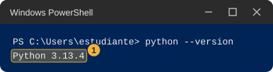<figcaption class="figure-caption">Salida de ejemplo de python --version, con la versión de Python marcada con el número uno</figcaption></figure>

:::

3. Si en lugar de eso aparece que `python` no se reconoce como comando, o se abre la tienda de Microsoft, prueba con este otro comando.

   ```text
   py --version
   ```

4. Si `py --version` sí muestra una versión, usa `py` en lugar de `python` en todos los comandos de la guía. La documentación de Python indica que `py` es un lanzador que busca la versión instalada. Si ninguno de los dos funciona, avisa al docente, porque esta guía necesita Python y sin él no puedes hacer las estaciones.

### Cómo crear tu carpeta de trabajo

Todos los archivos de la guía viven en una sola carpeta, para no regarlos por el computador.

1. Escribe `cd ~` y pulsa Enter. El comando `cd` significa cambiar de carpeta, y `~` es la abreviatura de tu carpeta personal. El prompt pasa a mostrar `PS C:\Users\` seguido de tu usuario.
2. Escribe `mkdir u3` y pulsa Enter. `mkdir` crea una carpeta nueva y `u3` es su nombre. PowerShell imprime una pequeña tabla con la carpeta recién creada.
3. Escribe `cd u3` y pulsa Enter. El prompt ahora termina en `\u3>`. Esa es tu carpeta de trabajo.
4. Para ver qué hay en una carpeta se escribe `dir`. Por ahora está vacía y PowerShell no imprime nada.

Si más adelante abres una consola nueva, escribe `cd ~\u3` para volver a esta carpeta antes de seguir.

### Cómo guardar un archivo de Python con el Bloc de notas

Varias estaciones te piden crear un archivo con código. El procedimiento es siempre el mismo.

1. En la consola, dentro de la carpeta `u3`, escribe `notepad` y el nombre del archivo, por ejemplo `notepad bits.py`, y pulsa Enter.
2. Si el Bloc de notas pregunta si quieres crear el archivo, responde que sí.
3. Copia el código del bloque de la guía, con el botón de copiar que aparece sobre cada bloque, y pégalo en el Bloc de notas. Respeta los espacios del comienzo de las líneas, porque en Python tienen significado.
4. Pulsa Ctrl+S para guardar y cierra el Bloc de notas.
5. De vuelta en la consola, escribe `dir` y comprueba que el archivo se llama exactamente como indica la guía. Si aparece `bits.py.txt`, el Bloc de notas le puso una extensión de más. Corrígelo con el siguiente comando, cambiando los nombres por los del archivo que tengas.

   ```text
   Rename-Item bits.py.txt bits.py
   ```

6. Para ejecutar un archivo escribes `python` y su nombre, por ejemplo `python bits.py`. Para corregir un error, vuelve a abrirlo con `notepad` y el mismo nombre.

### Cómo detener un programa que se queda esperando

Algunos programas de esta guía no devuelven el prompt: se quedan esperando. Eso es lo normal mientras funcionan. Para detenerlos haz clic dentro de su ventana y pulsa Ctrl+C. El prompt vuelve a aparecer. Si no reacciona, pulsa Ctrl+C otra vez, y si sigue sin reaccionar cierra la ventana con la X, que es seguro.

### Cómo abrir una segunda consola

Las estaciones 1 y 6 usan dos consolas a la vez. Repite los pasos de "Cómo abrir la consola" para abrir una ventana nueva, déjala al lado de la primera y escribe `cd ~\u3` en ella. Cada ventana es independiente: lo que ejecutas en una no se ve en la otra.

### Qué hace el firewall

El firewall de Windows es el guardia que decide qué conexiones pueden entrar a tu computador. Según la documentación de Microsoft, por defecto bloquea todo el tráfico entrante que nadie solicitó o que no coincide con una regla, y deja salir el tráfico saliente. Las reglas pueden depender del programa, de las direcciones y hasta del tipo de mensaje de prueba que se use. Windows también clasifica cada red como de dominio, privada o pública, y aplica reglas distintas según la clasificación. Una red que Windows no logra identificar se trata como pública.

En la Parte 1 de cada estación los programas atienden únicamente a tu propio equipo, así que no debería aparecer ningún aviso. Si aparece, cancela y anota el texto completo.

En la Parte 2 los programas atienden a todo el laboratorio. La primera vez que un programa nuevo lo hace, Windows puede mostrar una ventana de seguridad que menciona el firewall y el nombre del programa (Python). Si la ves, haz lo siguiente.

1. Lee el texto de la ventana y anótalo en tu tabla de registro, porque es un dato del experimento.
2. Marca solo la casilla de redes privadas. Nunca marques la de redes públicas.
3. Pulsa el botón de permitir el acceso.
4. Si Windows pide el usuario y la contraseña de un administrador, pulsa Cancelar. No intentes obtenerlos. Anota que pidió credenciales y sigue con la estación.

Cancelar o no tener permiso no es un fallo tuyo. Solo significa que en esa Parte 2 es posible que tu compañero no logre entrar a tu programa, y eso también se anota.

### Hoja de pareja

Antes de la primera estación, cada uno de los dos saca de su propio equipo los datos de esta hoja y se los pasa al otro, por ejemplo leyéndolos en voz alta o escribiéndolos en el papel del compañero. Es lo único que necesita saber de ti tu pareja.

1. En la consola escribe `ipconfig` y pulsa Enter. `ipconfig` es un comando de Windows que muestra la configuración de red de tu equipo y no cambia nada.
2. Busca el bloque que empieza con "Adaptador de Ethernet", que es el del cable. Si hay varios, usa el que tenga una línea "Puerta de enlace predeterminada" con números. Ignora los que dicen VMware, VirtualBox, vEthernet o WSL y los que dicen "medios desconectados".
3. Copia en la hoja los tres datos que muestra la imagen: la dirección IPv4, la máscara de subred y la puerta de enlace predeterminada. No hace falta entenderlos todavía.
4. Escribe `ipconfig /all` y pulsa Enter. La opción `/all` pide la configuración completa. Busca en el mismo bloque la línea "Dirección física" y copia su valor, que son seis pares de letras y números separados por guiones.

::: {.tabla-ancha}

<figure class="figure">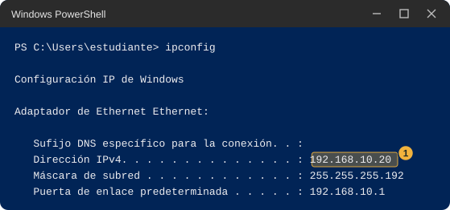<figcaption class="figure-caption">Salida de ejemplo de ipconfig, recortada, con la línea Dirección IPv4 marcada con el número uno</figcaption></figure>

:::

::: {.tabla-ancha}

| Dato | Estudiante A | Estudiante B |
|---|---|---|
| Dirección IPv4 | | |
| Máscara de subred | | |
| Puerta de enlace predeterminada | | |
| Dirección física | | |

:::

Sin pareja, usa `192.168.10.45` como dirección del compañero en la estación 2. Las demás Partes 2 se saltan.

### Mapa de la práctica

Cada estación usa una herramienta distinta y cada una deja una pregunta para la clase.

::: {.diagrama}

<svg viewBox="0 0 760 388" xmlns="http://www.w3.org/2000/svg" role="img" aria-label="Mapa de las siete estaciones: 1 servidor propio en parejas con python -m http.server; 2 las direcciones como números con ipaddress y format; 3 quién es vecino de quién con ping y arp -a; 4 repartir 256 direcciones con ipaddress; 5 por dónde salgo con route print -4 y tracert -d; 6 dos programas hablando con socket y Test-NetConnection; 7 mi plan, opcional, con un verificador en Python" font-family="Segoe UI, Inter, system-ui, sans-serif">
<text x="380" y="18" font-size="14" font-weight="700" fill="#12324f" text-anchor="middle">Las siete estaciones y la herramienta de cada una</text>
<rect x="20" y="32" width="720" height="40" rx="8" fill="#ece6fa" stroke="#bfb0e8"/>
<circle cx="46" cy="52" r="13" fill="#ffffff" stroke="#bfb0e8"/>
<text x="46" y="57" font-size="13" font-weight="700" fill="#12324f" text-anchor="middle">1</text>
<text x="72" y="57" font-size="13.5" font-weight="700" fill="#12324f" text-anchor="start">Servidor propio en parejas</text>
<text x="724" y="57" font-size="12.5" font-weight="400" fill="#5b6876" text-anchor="end" font-family="Consolas, Courier New, monospace">python -m http.server</text>
<rect x="20" y="82" width="720" height="40" rx="8" fill="#dcebf9" stroke="#9fc2e6"/>
<circle cx="46" cy="102" r="13" fill="#ffffff" stroke="#9fc2e6"/>
<text x="46" y="107" font-size="13" font-weight="700" fill="#12324f" text-anchor="middle">2</text>
<text x="72" y="107" font-size="13.5" font-weight="700" fill="#12324f" text-anchor="start">Las direcciones como números</text>
<text x="724" y="107" font-size="12.5" font-weight="400" fill="#5b6876" text-anchor="end" font-family="Consolas, Courier New, monospace">ipaddress y format()</text>
<rect x="20" y="132" width="720" height="40" rx="8" fill="#dcebf9" stroke="#9fc2e6"/>
<circle cx="46" cy="152" r="13" fill="#ffffff" stroke="#9fc2e6"/>
<text x="46" y="157" font-size="13" font-weight="700" fill="#12324f" text-anchor="middle">3</text>
<text x="72" y="157" font-size="13.5" font-weight="700" fill="#12324f" text-anchor="start">¿Quién es vecino de quién?</text>
<text x="724" y="157" font-size="12.5" font-weight="400" fill="#5b6876" text-anchor="end" font-family="Consolas, Courier New, monospace">ping y arp -a</text>
<rect x="20" y="182" width="720" height="40" rx="8" fill="#dcebf9" stroke="#9fc2e6"/>
<circle cx="46" cy="202" r="13" fill="#ffffff" stroke="#9fc2e6"/>
<text x="46" y="207" font-size="13" font-weight="700" fill="#12324f" text-anchor="middle">4</text>
<text x="72" y="207" font-size="13.5" font-weight="700" fill="#12324f" text-anchor="start">Repartir 256 direcciones</text>
<text x="724" y="207" font-size="12.5" font-weight="400" fill="#5b6876" text-anchor="end" font-family="Consolas, Courier New, monospace">ipaddress</text>
<rect x="20" y="232" width="720" height="40" rx="8" fill="#dcebf9" stroke="#9fc2e6"/>
<circle cx="46" cy="252" r="13" fill="#ffffff" stroke="#9fc2e6"/>
<text x="46" y="257" font-size="13" font-weight="700" fill="#12324f" text-anchor="middle">5</text>
<text x="72" y="257" font-size="13.5" font-weight="700" fill="#12324f" text-anchor="start">Por dónde salgo</text>
<text x="724" y="257" font-size="12.5" font-weight="400" fill="#5b6876" text-anchor="end" font-family="Consolas, Courier New, monospace">route print -4 y tracert -d</text>
<rect x="20" y="282" width="720" height="40" rx="8" fill="#fdf0cf" stroke="#ebc866"/>
<circle cx="46" cy="302" r="13" fill="#ffffff" stroke="#ebc866"/>
<text x="46" y="307" font-size="13" font-weight="700" fill="#12324f" text-anchor="middle">6</text>
<text x="72" y="307" font-size="13.5" font-weight="700" fill="#12324f" text-anchor="start">Dos programas hablando</text>
<text x="724" y="307" font-size="12.5" font-weight="400" fill="#5b6876" text-anchor="end" font-family="Consolas, Courier New, monospace">socket y Test-NetConnection</text>
<rect x="20" y="332" width="720" height="40" rx="8" fill="#dcebf9" stroke="#9fc2e6"/>
<circle cx="46" cy="352" r="13" fill="#ffffff" stroke="#9fc2e6"/>
<text x="46" y="357" font-size="13" font-weight="700" fill="#12324f" text-anchor="middle">7</text>
<text x="72" y="357" font-size="13.5" font-weight="700" fill="#12324f" text-anchor="start">Mi plan (opcional)</text>
<text x="724" y="357" font-size="12.5" font-weight="400" fill="#5b6876" text-anchor="end" font-family="Consolas, Courier New, monospace">verificador en Python</text>
</svg>

:::

### Tus tablas de registro

Cada estación trae su propia tabla de registro. Cópiala donde prefieras y llénala a medida que avanzas. Las columnas son siempre las mismas.

- **Mi predicción.** Lo que escribes antes de ejecutar nada.
- **Parte 1 (mi equipo).** Lo que viste en tu propio computador.
- **Parte 2 (con mi pareja).** Lo que viste con la dirección de tu compañero, o la palabra "no funcionó" con el mensaje exacto y las causas que crees posibles.
- **Qué me llamó la atención.** Lo que te sorprendió o no esperabas.

### Palabras de la práctica

Estas palabras se usan sin más explicación. Las demás se explican donde aparecen, o se explican en la clase.

::: {.tabla-ancha}

| Palabra | En esta guía |
|---|---|
| Consola | La ventana azul de PowerShell donde escribes comandos. |
| Comando | El nombre de un programa que escribes para que el computador haga algo. |
| Opción | Una palabra que va después del comando y cambia lo que hace, como `/all` o `--version`. |
| Salida | El texto que imprime un comando después de ejecutarse. |
| Prompt | La línea de la consola donde escribes, que termina en `>`. |
| El número después de los dos puntos | En `127.0.0.1:8000`, el 8000 acompaña a la dirección e indica a qué programa del equipo va dirigida la llamada. Algunos programas lo llaman puerto en sus mensajes; en clase se explica. |
| Aviso del firewall | La ventana de seguridad de Windows que puede aparecer cuando un programa quiere recibir llamadas. |

:::

## Estación 1. Un servidor propio en parejas

En esta estación conviertes tu computador en un lugar al que otros pueden entrar con el navegador, y descubres qué hace cada lado de la conversación. Python trae un programa llamado `http.server` que muestra por la red los archivos de una carpeta.

### Predice

Antes de abrir nada, escribe en la columna "Mi predicción" de esta tabla qué crees que va a pasar en cada fila.

::: {.tabla-ancha}

| Qué miro | Mi predicción | Parte 1 (mi equipo) | Parte 2 (con mi pareja) | Qué me llamó la atención |
|---|---|---|---|---|
| Qué ve el navegador mientras el programa está encendido | | | | |
| Qué escribe la consola cada vez que el navegador entra | | | | |
| Qué ve el navegador después de apagar el programa y recargar | | | | |
| Qué dirección aparece en la consola cuando entra mi compañero | | (no aplica) | | |

:::

### Haz. Parte 1, en tu equipo

1. Abre PowerShell como se explicó en "Cómo abrir la consola".
2. Escribe `cd ~\u3` y pulsa Enter. El prompt debe terminar en `\u3>`. Si dice que no encuentra la carpeta, vuelve a "Cómo crear tu carpeta de trabajo".
3. Escribe `mkdir sitio` y pulsa Enter. Crea la carpeta que el programa va a mostrar. PowerShell imprime una tabla pequeña con una fila que dice `sitio`.
4. Escribe `cd sitio` y pulsa Enter. El prompt debe terminar en `\u3\sitio>`.
5. Escribe el siguiente comando y pulsa Enter. No imprime nada si salió bien.

   ```text
   Set-Content saludo.txt "hola desde mi equipo"
   ```

6. Escribe el siguiente comando y pulsa Enter. Tampoco imprime nada.

   ```text
   Set-Content lectura.txt "temperatura=24.5"
   ```

   | Pieza | Qué hace |
   |---|---|
   | `Set-Content` | Escribe un texto dentro de un archivo, y lo crea si no existe. |
   | `saludo.txt` | El nombre del archivo que se crea en la carpeta actual. |
   | `"hola desde mi equipo"` | El texto que se guarda, entre comillas. |

7. Escribe `dir` y pulsa Enter. Deben aparecer dos filas, `lectura.txt` con longitud 18 y `saludo.txt` con longitud 22. Si falta alguna, repite el paso 5 o el 6.
8. Escribe el siguiente comando y pulsa Enter. Es el programa que espera.

   ```text
   python -m http.server 8000 --bind 127.0.0.1
   ```

   | Pieza | Qué hace |
   |---|---|
   | `python` | Abre el intérprete de Python. |
   | `-m` | Le pide que ejecute un módulo que ya trae, en lugar de un archivo tuyo. |
   | `http.server` | El módulo que muestra por la red los archivos de la carpeta actual. |
   | `8000` | El número que acompaña a la dirección. El navegador tendrá que usar el mismo. |
   | `--bind 127.0.0.1` | Hace que el programa atienda solo a tu propio equipo. Sin esta opción atendería a todo el laboratorio. |

9. Debe aparecer la primera línea de la imagen, la que empieza con `Serving HTTP on`, y el prompt no vuelve. Eso es lo correcto: el programa está esperando. Si aparece una línea que empieza con `OSError` y habla de "un uso de cada dirección", otro programa de tu equipo ya ocupa ese número. Pulsa Ctrl+C si hace falta, cambia el 8000 por 8001 en este comando y en la dirección del paso 10, y usa 8001 en toda la estación.
10. Abre el navegador, haz clic en la barra de direcciones, escribe `http://127.0.0.1:8000` y pulsa Enter. Escribe `127.0.0.1` y no `localhost`, para que no se cuele otra forma de la dirección. Debe aparecer una página que dice "Directory listing for /" con los dos archivos como enlaces.

::: {.tabla-ancha}

<figure class="figure">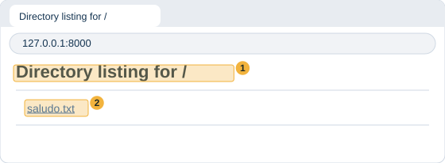<figcaption class="figure-caption">Ventana de navegador en 127.0.0.1:8000 con el título Directory listing for barra marcado con el número uno y el enlace lectura.txt marcado con el número dos</figcaption></figure>

:::

11. Si el navegador dice que no pudo conectarse, vuelve a la consola y comprueba que el programa sigue esperando, y que escribiste la dirección exactamente como en el paso 10.
12. Vuelve a la ventana de la consola, sin cerrar el navegador. El programa escribió una línea por cada cosa que el navegador pidió.

::: {.tabla-ancha}

<figure class="figure">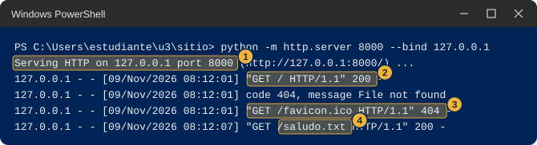<figcaption class="figure-caption">Consola con el programa de http.server escuchando solo en 127.0.0.1: la línea de arranque marcada con el número uno, la petición GET barra con 200 marcada con el número dos, la petición favicon.ico con 404 marcada con el número tres y la petición saludo.txt marcada con el número cuatro</figcaption></figure>

:::

13. Lee cada línea de registro de la imagen. La tabla que sigue explica cada parte.

::: {.tabla-ancha}

| N | Parte de la línea | Qué es |
|---|---|---|
| 1 | `Serving HTTP on 127.0.0.1 port 8000` | El programa avisa que quedó esperando llamadas en esa dirección y con ese número. Aparece una sola vez, al arrancar. |
| 2 | `127.0.0.1 - - [fecha y hora]` | Quién llamó y cuándo. La documentación de Python indica que la dirección de quien llama y la fecha se escriben al comienzo de cada línea. |
| 2 | `"GET / HTTP/1.1"` | Lo que el navegador pidió. `GET` significa "dame" y la barra `/` es la página de inicio de la carpeta. |
| 2 | `200` | Un número que significa "todo bien, aquí está lo que pediste". Según el RFC 9110 es el código de éxito. |
| 3 | `GET /favicon.ico ... 404` | Algunos navegadores piden por su cuenta el ícono de la pestaña; si no ves esta línea, no pasa nada. Esta carpeta no lo tiene y el programa contesta `404`, que según el RFC 9110 significa que no encontró lo pedido. |
| 4 | `GET /saludo.txt` | Aparece cuando haces clic en ese enlace en el paso siguiente. |

:::

14. En el navegador haz clic en `saludo.txt`. Debe aparecer el texto "hola desde mi equipo" y, en la consola, una línea nueva con `GET /saludo.txt` y `200`.
15. En el navegador escribe `http://127.0.0.1:8000/no-existe.txt` y pulsa Enter. Debe aparecer una página de error con el código 404, y la consola debe escribir una línea con `code 404`.
16. Anota en la columna "Parte 1" de la tabla lo que viste en las tres primeras filas.
17. Para cerrar el programa, haz clic dentro de la consola y pulsa Ctrl+C. Debe aparecer `Keyboard interrupt received, exiting.` y el prompt vuelve.
18. En el navegador pulsa F5 para recargar la página. Debe aparecer una página de error que dice que no se pudo conectar. Anota su texto en la fila tres.

::: {.callout-warning}
## Si no te sale la Parte 1

- La consola dice que `python` no se reconoce. Vuelve a "Cómo comprobar que tienes Python".
- El navegador no carga nada. Comprueba que la consola muestra `Serving HTTP on` y que no la cerraste.
- La página sale vacía, sin los dos archivos. Estás en otra carpeta. Detén el programa con Ctrl+C, escribe `cd ~\u3\sitio` y arráncalo de nuevo.
:::

### Haz. Parte 2, con tu pareja

Esta parte necesita que el firewall de quien enciende el programa deje pasar la llamada. Puede fallar. Si falla, anota el resultado y sigue. Primero lo hace el estudiante A: A enciende y B entra.

1. Estudiante A. Si el programa de la Parte 1 sigue encendido, ciérralo con Ctrl+C. Asegúrate de que el prompt termina en `\u3\sitio>`.
2. Estudiante A. Escribe el siguiente comando y pulsa Enter. Es el mismo de antes, sin la opción `--bind`, así que ahora atiende a todo el laboratorio.

   ```text
   python -m http.server 8000
   ```

3. Estudiante A. Si aparece el aviso del firewall, sigue los pasos de "Qué hace el firewall": solo redes privadas, y si pide administrador, cancelar y anotar el mensaje.
4. Estudiante A. Debe aparecer la línea de arranque que muestra la imagen. En ella `::` significa cualquier entrada de tu equipo. En clase se explica por qué.
5. Estudiante A. Dile a B tu dirección IPv4, la de la Hoja de pareja.
6. Estudiante B. Abre el navegador y escribe `http://` seguido de la dirección IPv4 de A, dos puntos y `8000`. Por ejemplo `http://192.168.10.20:8000`. Pulsa Enter.
7. Estudiante B. Si funciona, aparece "Directory listing for /" con los dos archivos de A, y B puede abrir `saludo.txt`.

::: {.tabla-ancha}

<figure class="figure">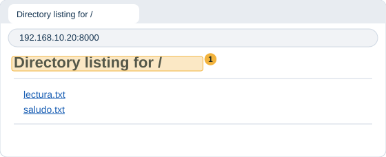<figcaption class="figure-caption">Ventana de navegador en 192.168.10.20:8000, la dirección de A, con la misma lista de archivos vista desde el equipo de B, y el título Directory listing for barra marcado con el número uno</figcaption></figure>

:::

8. Estudiante A. Mira tu consola. Debe aparecer una línea por cada cosa que B pidió. La dirección del comienzo no es la tuya: es la de B. A veces viene precedida de `::ffff:`, que es una marca con la que Python escribe una dirección de cuatro números. Lo que importa son los cuatro números del final. El RFC 4291 describe ese formato.

::: {.tabla-ancha}

<figure class="figure">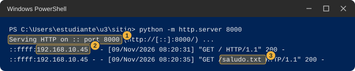<figcaption class="figure-caption">Consola con python -m http.server 8000 sin la opción bind: la línea de arranque que dice Serving HTTP on dos puntos dos puntos marcada con el número uno, y dos líneas de registro con la dirección del compañero marcadas con los números dos y tres</figcaption></figure>

:::

9. Estudiante A. Anota en "Parte 2" la dirección que apareció en el registro.
10. Estudiante A. Cierra el programa con Ctrl+C. Estudiante B: recarga la página y anota qué cambió.
11. Cambien de rol y repitan: ahora B enciende y A entra.

::: {.callout-warning}
## Si no te sale la Parte 2

No afirmes cuál es la causa. Anota el resultado, el mensaje exacto del navegador y marca en tu hoja cuáles de estas posibilidades crees que pudieron ser.

- El navegador dice que la página tardó demasiado en responder, o que no se pudo acceder al sitio. El firewall del equipo de A pudo haber bloqueado la llamada, ya sea porque se cancelaron los avisos o porque se permitió solo en un tipo de red que no es el de la sala.
- Windows pidió credenciales de administrador y cancelaste. Entonces es posible que el programa de A no pueda recibir llamadas de otros equipos.
- La dirección está mal copiada o falta el `:8000`. Revísala letra por letra en la Hoja de pareja.
- A dejó encendido el programa de la Parte 1, el que tiene `--bind 127.0.0.1`. Ese solo atiende a su propio equipo. Ciérralo y arranca el de esta parte.
- La red de la sala no deja pasar este tipo de tráfico entre equipos, o los dos equipos están en redes distintas. Esto se estudia en la estación 3.
- El navegador de B abrió `https://` en lugar de `http://`. Escribe la dirección completa con `http://`.
:::

### Anota y observa

Llena las filas que faltan de la tabla y responde en una frase cada pregunta.

- ¿Cuál de las dos partes tuvo que estar encendida antes para que la otra funcionara?
- ¿Qué hizo la consola cada vez que el navegador pidió algo? ¿Y qué hizo mientras el navegador no pedía nada?
- ¿Qué número iba al lado de cada petición? ¿Cambió cuando pediste un archivo que no existe?

::: {.callout-note collapse="true"}
## Qué deberías haber visto

La consola con `http.server` estuvo todo el tiempo esperando y solo reaccionó cuando el navegador la llamó. El navegador fue quien tomó la iniciativa de pedir y recibió la respuesta. Por eso antes de abrir el navegador el programa tenía que estar encendido, y por eso después de apagarlo el navegador no encontró a nadie. Cada petición dejó una línea con el número 200 cuando todo fue bien y 404 cuando el archivo no existía.

::: {.diagrama}

<svg viewBox="0 0 760 172" xmlns="http://www.w3.org/2000/svg" role="img" aria-label="Quién espera y quién pide. A la izquierda la consola con python -m http.server espera y no hace nada hasta que la llaman. A la derecha el navegador pide GET barra, y la consola responde con el código 200 y la lista de archivos" font-family="Segoe UI, Inter, system-ui, sans-serif">
<defs><marker id="pf3" viewBox="0 0 10 10" refX="10" refY="5" markerWidth="8" markerHeight="8" orient="auto"><path d="M0,0 L10,5 L0,10 z" fill="#5b6876"/></marker></defs>
<rect x="30" y="40" width="230" height="90" rx="8" fill="#ece6fa" stroke="#bfb0e8"/>
<text x="145.0" y="80.5" font-size="13" font-weight="400" fill="#12324f" text-anchor="middle">Consola con</text>
<text x="145.0" y="98.5" font-size="13" font-weight="700" fill="#12324f" text-anchor="middle" font-family="Consolas, Courier New, monospace">python -m http.server</text>
<rect x="500" y="40" width="230" height="90" rx="8" fill="#ece6fa" stroke="#bfb0e8"/>
<text x="615.0" y="80.5" font-size="13" font-weight="700" fill="#12324f" text-anchor="middle">Navegador</text>
<text x="615.0" y="98.5" font-size="13" font-weight="400" fill="#12324f" text-anchor="middle" font-family="Consolas, Courier New, monospace">http://127.0.0.1:8000</text>
<path d="M500,72 L260,72" fill="none" stroke="#5b6876" stroke-width="1.8" marker-end="url(#pf3)"/>
<path d="M260,100 L500,100" fill="none" stroke="#5b6876" stroke-width="1.8" marker-end="url(#pf3)"/>
<text x="380" y="64" font-size="12.5" font-weight="700" fill="#12324f" text-anchor="middle">pide: GET /</text>
<text x="380" y="120" font-size="12.5" font-weight="700" fill="#12324f" text-anchor="middle">responde: 200 y la lista</text>
<text x="145" y="156" font-size="12" font-weight="400" fill="#5b6876" text-anchor="middle">Espera. No hace nada hasta que lo llaman.</text>
<text x="615" y="156" font-size="12" font-weight="400" fill="#5b6876" text-anchor="middle">Pide. Toma la iniciativa.</text>
<text x="380" y="20" font-size="14" font-weight="700" fill="#12324f" text-anchor="middle">Quién espera y quién pide</text>
</svg>

:::
:::

::: {.callout-tip}
## En clase

Esta estación abre el tema de la arquitectura cliente-servidor: quién pide, quién responde, y qué cambia cuando hay un intermediario. La pregunta que queda es qué hace falta para que un equipo pueda atender a muchos otros a la vez.
:::

## Estación 2. Las direcciones como números

En esta estación miras por dentro la dirección de tu computador. Con unas pocas líneas de Python la conviertes en un número y en ceros y unos, y descubres qué parte de la dirección cambia cuando tú cambias un número.

### Predice

Escribe en la tabla qué crees antes de ejecutar nada.

::: {.tabla-ancha}

| Qué miro | Mi predicción | Parte 1 (mi equipo) | Parte 2 (con mi pareja) | Qué me llamó la atención |
|---|---|---|---|---|
| Mi dirección como un solo número: ¿pequeño o enorme? | | | (no aplica) | |
| Cuántos de los 32 ceros y unos cambian al sumar 1 al último número | | | (no aplica) | |
| Cuántos cambian al sumar 1 al tercer número | | | (no aplica) | |
| Cuántos ceros y unos, contados desde la izquierda, comparten mi dirección y la de mi compañero | | (no aplica) | | |

:::

### Haz. Parte 1, en tu equipo

1. En la consola, dentro de tu carpeta `u3`, escribe `cd ~\u3` y pulsa Enter.
2. Escribe `notepad bits.py` y pulsa Enter. Sigue "Cómo guardar un archivo de Python con el Bloc de notas" y pega este código.

   ```python
   import ipaddress


   def pedir(mensaje):
       while True:
           texto = input(mensaje).strip()
           if texto == "":
               return None
           try:
               return ipaddress.IPv4Address(texto)
           except ValueError:
               print("Eso no es una direccion de cuatro numeros. Prueba otra vez.")


   def en_bits(direccion):
       bits = format(int(direccion), "032b")
       return ".".join(bits[i:i + 8] for i in range(0, 32, 8))


   mia = pedir("Tu direccion: ")
   if mia is not None:
       print("Como numero:  ", int(mia))
       print("En bits:     ", en_bits(mia))
       while True:
           otra = pedir("Otra direccion (Enter para terminar): ")
           if otra is None:
               break
           print("Como numero:  ", int(otra))
           print("En bits:     ", en_bits(otra))
           print("Cambian:     ", "".join(" " if a == b else "^" for a, b in zip(en_bits(mia), en_bits(otra))))
           print("Iguales desde la izquierda:", 32 - (int(mia) ^ int(otra)).bit_length())
   ```

3. Lo que hace cada línea importante se explica en la tabla que sigue, en palabras comunes.

::: {.tabla-ancha}

| Línea | Qué hace |
|---|---|
| `import ipaddress` | Trae un módulo que Python ya incluye para trabajar con direcciones. |
| `ipaddress.IPv4Address(texto)` | Convierte el texto que escribes en una dirección. Si no son cuatro números entre 0 y 255, falla, y el programa avisa y vuelve a preguntar. |
| `int(direccion)` | La dirección vista como un solo número entero. |
| `format(numero, "032b")` | Ese número escrito en ceros y unos. La `b` pide ceros y unos y el `032` pide 32 cifras, rellenando con ceros a la izquierda. |
| `".".join(bits[i:i + 8] ...)` | Parte las 32 cifras en grupos de 8 y pone un punto entre grupos, para que se lean mejor. |
| La línea `Cambian` | Compara las dos direcciones cifra por cifra y escribe `^` debajo de las que son distintas. |
| La línea `Iguales desde la izquierda` | Cuenta cuántas cifras seguidas, empezando por la izquierda, son iguales en las dos direcciones. |

:::

4. Guarda con Ctrl+S, cierra el Bloc de notas y comprueba con `dir` que el archivo se llama `bits.py`.
5. Escribe `python bits.py` y pulsa Enter. El programa pregunta `Tu direccion:`.
6. Escribe tu dirección IPv4 de la Hoja de pareja y pulsa Enter. Debe imprimir dos líneas, `Como numero:` con un número entero largo y `En bits:` con cuatro grupos de ocho cifras separados por puntos. Si en lugar de eso dice que no es una dirección de cuatro números, revisa que la escribiste sin espacios y con tres puntos. Anota cuántas cifras tiene el número.
7. En la pregunta `Otra direccion` escribe tu misma dirección con el último número aumentado en 1. Si el último es 255, réstale 1. Aparecen las dos direcciones en bits y una línea `Cambian` con uno o más signos `^`. Anota cuántos `^` hay y en qué grupo caen.
8. Escribe ahora tu dirección con el tercer número aumentado en 1. Si el tercero es 255, réstale 1. Anota en qué grupo caen los `^`.
9. Escribe tu dirección con el último número en 0 y después en 255, y mira cómo se ve el último grupo en cada caso.
10. Escribe una dirección con un número mayor que 255 en alguno de los cuatro lugares, como `192.168.10.256`. Debe aparecer el aviso de que no es una dirección de cuatro números. Pregúntate por qué 255 es el límite.
11. Pulsa Enter sin escribir nada para terminar. El prompt vuelve.

::: {.tabla-ancha}

<figure class="figure">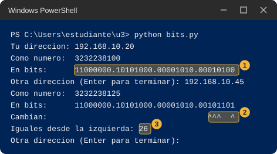<figcaption class="figure-caption">Salida de ejemplo de bits.py con dos direcciones: la fila En bits de la primera dirección marcada con el número uno y la fila Cambian marcada con el número dos, donde cada signo ^ está debajo de una cifra que es distinta</figcaption></figure>

:::

::: {.diagrama}

<svg viewBox="0 0 760 178" xmlns="http://www.w3.org/2000/svg" role="img" aria-label="Cuatro números de la dirección 192.168.10.20 y debajo cada uno escrito con ocho cifras de ceros y unos: 11000000, 10101000, 00001010 y 00010100" font-family="Segoe UI, Inter, system-ui, sans-serif">
<defs><marker id="pf4" viewBox="0 0 10 10" refX="10" refY="5" markerWidth="8" markerHeight="8" orient="auto"><path d="M0,0 L10,5 L0,10 z" fill="#5b6876"/></marker></defs>
<text x="380" y="20" font-size="14" font-weight="700" fill="#12324f" text-anchor="middle">192.168.10.20 escrito en bits</text>
<rect x="30" y="40" width="160" height="36" rx="8" fill="#dcebf9" stroke="#9fc2e6"/>
<text x="110.0" y="63.2" font-size="15" font-weight="700" fill="#12324f" text-anchor="middle" font-family="Consolas, Courier New, monospace">192</text>
<path d="M110,76 L110,104" fill="none" stroke="#5b6876" stroke-width="1.8" marker-end="url(#pf4)"/>
<rect x="30" y="104" width="160" height="36" rx="8" fill="#ffffff" stroke="#cfd8e3"/>
<text x="110.0" y="127.2" font-size="15" font-weight="400" fill="#12324f" text-anchor="middle" font-family="Consolas, Courier New, monospace">11000000</text>
<rect x="210" y="40" width="160" height="36" rx="8" fill="#dcebf9" stroke="#9fc2e6"/>
<text x="290.0" y="63.2" font-size="15" font-weight="700" fill="#12324f" text-anchor="middle" font-family="Consolas, Courier New, monospace">168</text>
<path d="M290,76 L290,104" fill="none" stroke="#5b6876" stroke-width="1.8" marker-end="url(#pf4)"/>
<rect x="210" y="104" width="160" height="36" rx="8" fill="#ffffff" stroke="#cfd8e3"/>
<text x="290.0" y="127.2" font-size="15" font-weight="400" fill="#12324f" text-anchor="middle" font-family="Consolas, Courier New, monospace">10101000</text>
<rect x="390" y="40" width="160" height="36" rx="8" fill="#dcebf9" stroke="#9fc2e6"/>
<text x="470.0" y="63.2" font-size="15" font-weight="700" fill="#12324f" text-anchor="middle" font-family="Consolas, Courier New, monospace">10</text>
<path d="M470,76 L470,104" fill="none" stroke="#5b6876" stroke-width="1.8" marker-end="url(#pf4)"/>
<rect x="390" y="104" width="160" height="36" rx="8" fill="#ffffff" stroke="#cfd8e3"/>
<text x="470.0" y="127.2" font-size="15" font-weight="400" fill="#12324f" text-anchor="middle" font-family="Consolas, Courier New, monospace">00001010</text>
<rect x="570" y="40" width="160" height="36" rx="8" fill="#dcebf9" stroke="#9fc2e6"/>
<text x="650.0" y="63.2" font-size="15" font-weight="700" fill="#12324f" text-anchor="middle" font-family="Consolas, Courier New, monospace">20</text>
<path d="M650,76 L650,104" fill="none" stroke="#5b6876" stroke-width="1.8" marker-end="url(#pf4)"/>
<rect x="570" y="104" width="160" height="36" rx="8" fill="#ffffff" stroke="#cfd8e3"/>
<text x="650.0" y="127.2" font-size="15" font-weight="400" fill="#12324f" text-anchor="middle" font-family="Consolas, Courier New, monospace">00010100</text>
<text x="380" y="166" font-size="12.5" font-weight="400" fill="#5b6876" text-anchor="middle">Cuatro grupos de ocho cifras, 32 cifras en total, cada una cero o uno.</text>
</svg>

:::

::: {.callout-warning}
## Si no te sale la Parte 1

- Python dice `SyntaxError` o `IndentationError`. Al pegar se perdieron los espacios del comienzo de línea. Vuelve a abrir el archivo con `notepad bits.py`, bórralo todo y pega de nuevo el bloque completo.
- Dice `can't open file` o `No such file`. No estás en la carpeta `u3`, o el archivo se llama `bits.py.txt`. Escribe `cd ~\u3` y revisa con `dir`.
- Se ven letras raras en lugar de los acentos del prompt. Es normal: el programa se escribió sin acentos a propósito.
:::

### Haz. Parte 2, con tu pareja

Esta parte no usa la red: solo necesitas la dirección de tu compañero, que ya tienes en la Hoja de pareja. Por eso no puede fallar por culpa del firewall.

1. Escribe `python bits.py` y pulsa Enter.
2. En `Tu direccion:` escribe tu dirección IPv4. En `Otra direccion` escribe la de tu compañero.
3. Mira la línea `Iguales desde la izquierda` y anota su número. No cuentes los puntos. Compara el tuyo con el de tu compañero.
4. Si el número que contaste no coincide con el de tu pareja, revisen que los dos escribieron las direcciones sin errores.
5. Pulsa Enter sin escribir nada para terminar.

### Anota y observa

Completa la tabla. Después responde.

- ¿Qué tan grande es el número en que se convierte una dirección?
- Cuando cambiaste el último número, ¿los cambios cayeron en el mismo lugar que cuando cambiaste el tercero? ¿Por qué crees que fue así?
- ¿Qué tienen en común, cifra por cifra, tu dirección y la de tu compañero? ¿Dónde empiezan a diferir?

::: {.callout-note collapse="true"}
## Qué deberías haber visto

La dirección es un número de 32 cifras escrito en ceros y unos, y los cuatro números que ves son esa cadena partida en grupos de 8. Un cambio en el último número solo mueve cifras del último grupo, y un cambio en el tercero mueve cifras del tercer grupo, así que no todas las cifras pesan lo mismo al comparar dos direcciones. Dos equipos del mismo laboratorio suelen compartir las primeras cifras y diferir hacia el final. Cuántas comparten es justo lo que decide la clase de la estación 3.
:::

::: {.callout-tip}
## En clase

Esta estación abre el tema de la dirección IPv4 en bits, la máscara y el prefijo. La pregunta que queda es cuántas de las 32 cifras sirven para saber si dos equipos están juntos.
:::

## Estación 3. ¿Quién es vecino de quién?

Dos equipos conectados a la misma red no siempre se hablan de manera directa. En esta estación deduces en papel una regla a partir de datos de un laboratorio de ejemplo, y después compruebas qué pasa entre tu equipo y el de tu compañero.

### Predice

Estos son ocho pares de equipos de un laboratorio de ejemplo, dibujado para esta guía, con el resultado de intentar que se hablen directamente, es decir, que el mensaje llegue de uno al otro sin pasar por un equipo intermedio. No son los datos de tu sala.

::: {.tabla-ancha}

| Par | Equipo 1 | Equipo 2 | ¿Se comunican directamente? |
|---|---|---|---|
| 1 | 192.168.10.20 | 192.168.10.45 | Sí |
| 2 | 192.168.10.20 | 192.168.10.62 | Sí |
| 3 | 192.168.10.62 | 192.168.10.65 | No |
| 4 | 192.168.10.70 | 192.168.10.71 | Sí |
| 5 | 192.168.10.65 | 192.168.10.94 | Sí |
| 6 | 192.168.10.94 | 192.168.10.97 | No |
| 7 | 192.168.10.97 | 192.168.10.110 | Sí |
| 8 | 192.168.10.110 | 192.168.10.113 | No |

:::

En papel, antes de tocar el computador.

1. Dibuja una línea recta y márcale desde 0 hasta 127, con una marca cada 16. Solo importa el último número de cada dirección, porque los tres primeros son iguales en todos los pares.
2. Pon un punto en la línea por cada último número de la tabla (20, 45, 62, 65, 70, 71, 94, 97, 110 y 113) y une cada par con un trazo. Usa verde para los que sí se comunican y rojo para los que no.
3. Dibuja con lápiz dónde crees que están los cortes que separan un grupo de otro.
4. Escribe en una frase, con tus palabras, la regla que decide si dos equipos se comunican directamente.
5. Responde: ¿te alcanzan estos datos para saber el lugar exacto de cada corte? ¿Qué par agregarías para saberlo?

Después, mira las dos direcciones de la Hoja de pareja y escribe tu predicción sobre tu compañero.

::: {.diagrama}

<svg viewBox="0 0 760 226" xmlns="http://www.w3.org/2000/svg" role="img" aria-label="Dos posibilidades de conexión. En la primera tu equipo y el del compañero están unidos al mismo equipo de red. En la segunda hay dos equipos de red con un equipo intermedio entre ellos" font-family="Segoe UI, Inter, system-ui, sans-serif">
<text x="380" y="18" font-size="14" font-weight="700" fill="#12324f" text-anchor="middle">Dos formas en que pueden estar conectados tú y tu compañero</text>
<text x="20" y="50" font-size="13" font-weight="700" fill="#12324f" text-anchor="start">Posibilidad 1</text>
<rect x="60" y="62" width="120" height="46" rx="8" fill="#eef4fa" stroke="#c7d6e6"/>
<text x="120.0" y="89.5" font-size="13" font-weight="400" fill="#12324f" text-anchor="middle">Tu equipo</text>
<rect x="320" y="62" width="120" height="46" rx="8" fill="#dff1e6" stroke="#9bcfb0"/>
<text x="380.0" y="89.5" font-size="13" font-weight="400" fill="#12324f" text-anchor="middle">Equipo de red</text>
<rect x="580" y="62" width="120" height="46" rx="8" fill="#eef4fa" stroke="#c7d6e6"/>
<text x="640.0" y="80.5" font-size="13" font-weight="400" fill="#12324f" text-anchor="middle">Equipo del</text>
<text x="640.0" y="98.5" font-size="13" font-weight="400" fill="#12324f" text-anchor="middle">compañero</text>
<path d="M180,85 L320,85" stroke="#8fb3d1" stroke-width="2" fill="none"/>
<path d="M440,85 L580,85" stroke="#8fb3d1" stroke-width="2" fill="none"/>
<text x="20" y="150" font-size="13" font-weight="700" fill="#12324f" text-anchor="start">Posibilidad 2</text>
<rect x="30" y="164" width="110" height="46" rx="8" fill="#eef4fa" stroke="#c7d6e6"/>
<text x="85.0" y="191.6" font-size="13" font-weight="400" fill="#12324f" text-anchor="middle">Tu equipo</text>
<rect x="180" y="164" width="90" height="46" rx="8" fill="#dff1e6" stroke="#9bcfb0"/>
<text x="225.0" y="182.6" font-size="13" font-weight="400" fill="#12324f" text-anchor="middle">Equipo</text>
<text x="225.0" y="200.6" font-size="13" font-weight="400" fill="#12324f" text-anchor="middle">de red</text>
<rect x="310" y="164" width="140" height="46" rx="8" fill="#dcebf9" stroke="#9fc2e6"/>
<text x="380.0" y="182.6" font-size="13" font-weight="400" fill="#12324f" text-anchor="middle">Equipo</text>
<text x="380.0" y="200.6" font-size="13" font-weight="400" fill="#12324f" text-anchor="middle">intermedio</text>
<rect x="490" y="164" width="90" height="46" rx="8" fill="#dff1e6" stroke="#9bcfb0"/>
<text x="535.0" y="182.6" font-size="13" font-weight="400" fill="#12324f" text-anchor="middle">Equipo</text>
<text x="535.0" y="200.6" font-size="13" font-weight="400" fill="#12324f" text-anchor="middle">de red</text>
<rect x="620" y="164" width="110" height="46" rx="8" fill="#eef4fa" stroke="#c7d6e6"/>
<text x="675.0" y="182.6" font-size="13" font-weight="400" fill="#12324f" text-anchor="middle">Equipo del</text>
<text x="675.0" y="200.6" font-size="13" font-weight="400" fill="#12324f" text-anchor="middle">compañero</text>
<path d="M140,187 L180,187" stroke="#8fb3d1" stroke-width="2" fill="none"/>
<path d="M270,187 L310,187" stroke="#8fb3d1" stroke-width="2" fill="none"/>
<path d="M450,187 L490,187" stroke="#8fb3d1" stroke-width="2" fill="none"/>
<path d="M580,187 L620,187" stroke="#8fb3d1" stroke-width="2" fill="none"/>
</svg>

:::

::: {.tabla-ancha}

| Qué miro | Mi predicción | Parte 1 (mi equipo) | Parte 2 (con mi pareja) | Qué me llamó la atención |
|---|---|---|---|---|
| La regla que deduzco del papel, en una frase | | | (no aplica) | |
| Respuesta del ping a 127.0.0.1 y a mi propia dirección | | | (no aplica) | |
| Cuántas filas "dinámico" tiene mi tabla de `arp -a` | | | (no aplica) | |
| Mi compañero y yo, ¿posibilidad 1 o posibilidad 2? | | (no aplica) | | |
| Respuesta del ping a mi compañero | | (no aplica) | | |
| Dirección física del compañero en `arp -a` | | (no aplica) | | |

:::

### Haz. Parte 1, en tu equipo

1. Abre PowerShell y escribe `cd ~\u3`. Pulsa Enter.
2. Escribe el siguiente comando y pulsa Enter. Prueba si tu computador responde cuando le hablas a su propia dirección de siempre.

   ```text
   ping 127.0.0.1
   ```

   | Pieza | Qué hace |
   |---|---|
   | `ping` | Envía unos mensajes de prueba a una dirección y espera que le contesten. Según la documentación de Microsoft envía mensajes de eco y muestra las respuestas con sus tiempos. |
   | `127.0.0.1` | La dirección con la que un equipo se habla a sí mismo. |

3. Debe aparecer algo como lo de la imagen: cuatro líneas que empiezan por `Respuesta desde` y un resumen con `recibidos = 4`. Eso significa que tu equipo contestó. Si en cambio aparece "Tiempo de espera agotado", anótalo y sigue: en tu propio equipo no debería pasar.

::: {.tabla-ancha}

<figure class="figure">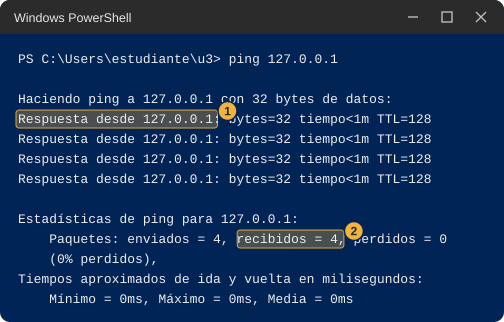<figcaption class="figure-caption">Salida de ejemplo de ping 127.0.0.1 con la línea Respuesta desde marcada con el número uno y los paquetes recibidos marcados con el número dos</figcaption></figure>

:::

4. Escribe `ping` seguido de un espacio y tu propia dirección IPv4 de la Hoja de pareja, por ejemplo `ping 192.168.10.20`, y pulsa Enter. También debe contestar tu propio equipo.
5. Escribe el siguiente comando y pulsa Enter.

   ```text
   arp -a
   ```

   | Pieza | Qué hace |
   |---|---|
   | `arp` | Muestra la libreta donde tu equipo apunta las direcciones físicas de los equipos con los que habló hace poco. |
   | `-a` | Pide que muestre todas las anotaciones. |

6. La salida está agrupada por bloques que empiezan con `Interfaz:` y una dirección. Busca el bloque cuya dirección es tu IPv4 y cuenta cuántas filas dicen `dinámico` en la última columna. Puede ser un número pequeño, incluso cero. Anótalo.
7. Anota en la columna "Parte 1" lo que viste en el ping y en el arp.

::: {.callout-warning}
## Si no te sale la Parte 1

- El ping dice que `ping` no se reconoce. Escribiste algo distinto: el comando es `ping` y después una dirección, con un espacio entre los dos.
- El ping a tu propia dirección da "Tiempo de espera agotado". Anótalo con el mensaje exacto y sigue.
- `arp -a` imprime pocas filas o ninguna del tipo `dinámico`. Es normal: la libreta solo guarda equipos con los que hablaste hace poco.
:::

### Haz. Parte 2, con tu pareja

Aquí puede pasar cualquier cosa y está bien: lo que importa es lo que veas. Los dos hacen los pasos a la vez, cada uno desde su equipo.

1. Escribe tu predicción de la tabla antes de ejecutar nada: ¿posibilidad 1 o posibilidad 2? ¿Contestará el ping?
2. Escribe `ping ` seguido de la dirección IPv4 de tu compañero de la Hoja de pareja y pulsa Enter. Espera a que termine: puede tardar varios segundos.
3. Fíjate en cuál de estos resultados te da.
   - Cuatro líneas `Respuesta desde` y `recibidos = 4`, como en la imagen del paso 3 de la Parte 1: el otro equipo contestó.
   - Cuatro líneas `Tiempo de espera agotado para esta solicitud.` y `recibidos = 0`, como en la imagen siguiente. Según la documentación de Microsoft, ese mensaje sale cuando no llegó una respuesta dentro del tiempo de espera, que por defecto es de 4 segundos.
   - Otro mensaje. Copia el texto exacto.

::: {.tabla-ancha}

<figure class="figure">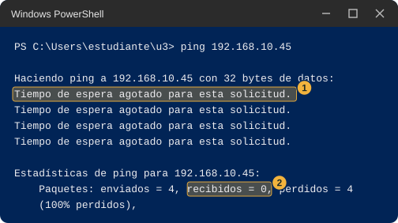<figcaption class="figure-caption">Salida de ejemplo de ping a un equipo que no contesta: las líneas de tiempo de espera agotado marcadas con el número uno y los paquetes recibidos en cero marcados con el número dos</figcaption></figure>

:::

4. Inmediatamente después, sin esperar, escribe `arp -a` y pulsa Enter.
5. Busca el bloque `Interfaz:` con tu dirección y revisa si hay una fila con la dirección IPv4 de tu compañero. Si la hay, copia su dirección física, que son seis pares con guiones y minúsculas, y compárala con la "Dirección física" que tu compañero anotó en la Hoja de pareja. Las letras pueden estar en mayúscula o minúscula.

::: {.tabla-ancha}

<figure class="figure">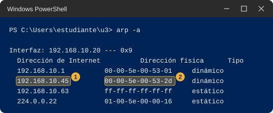<figcaption class="figure-caption">Salida de ejemplo de arp -a con la dirección IPv4 del compañero marcada con el número uno y su dirección física marcada con el número dos</figcaption></figure>

:::

6. Anota en la columna "Parte 2" los tres datos: resultado del ping, si apareció la fila de tu compañero, y si la dirección física coincide.

::: {.callout-warning}
## Si no te sale la Parte 2

No afirmes cuál es la causa. Anota lo que viste y marca las posibilidades que consideres razonables.

- El ping da "Tiempo de espera agotado" pero tu compañero está encendido y conectado. Su firewall pudo haber descartado el mensaje de prueba aunque su equipo funcione bien. La documentación de Microsoft indica que las reglas del firewall pueden depender del tipo de mensaje de eco, así que un equipo puede estar configurado para no contestar al ping.
- El ping da "Tiempo de espera agotado" y en `arp -a` no aparece tu compañero. Los dos equipos pueden estar en redes distintas, o la dirección está mal copiada. Revisa la Hoja de pareja.
- En `arp -a` aparece tu compañero con su dirección física, pero el ping no contestó. Esa combinación sugiere que tu equipo sí llegó a preguntar por él, y que lo que no contestó fue el mensaje de prueba. Es una pista, no una prueba.
- En `arp -a` no aparece ninguna fila nueva. Las anotaciones duran poco tiempo. Repite el ping y escribe `arp -a` enseguida.
- Les salen cosas distintas a los dos. Es posible: cada equipo tiene su propio firewall. Anoten los dos resultados.
:::

### Anota y observa

Completa la tabla. Después responde.

- ¿Tu predicción sobre tu compañero fue acertada? ¿En qué te basaste?
- ¿Coincide la regla que escribiste en papel con lo que viste entre tu equipo y el de tu compañero?
- Si el ping no contestó, ¿qué otro dato de la salida te dice que sí hay conexión entre ustedes?

::: {.callout-note collapse="true"}
## Qué deberías haber visto en el papel

Los equipos que se comunican directamente son los que caen dentro del mismo tramo de la recta. Los tramos de este laboratorio de ejemplo cortan en 64, 96 y 112: de 0 a 63, de 64 a 95, de 96 a 111 y de 112 en adelante. Con estos ocho pares no se puede saber el lugar exacto de cada corte, porque hay un hueco entre 62 y 65, entre 94 y 97 y entre 110 y 113. Para saberlo habría que agregar pares con números intermedios. La estación 4 muestra de dónde salen esos cortes.

::: {.diagrama}

<svg viewBox="0 0 760 226" xmlns="http://www.w3.org/2000/svg" role="img" aria-label="Recta de números del 0 al 127 con los ocho pares de la tabla. Los pares 1, 2, 4, 5 y 7 se comunican directamente y quedan entre cortes; los pares 3, 6 y 8 no, porque cruzan un corte. Los cortes caen en 64, 96 y 112" font-family="Segoe UI, Inter, system-ui, sans-serif">
<text x="380" y="18" font-size="14" font-weight="700" fill="#12324f" text-anchor="middle">Los ocho pares sobre la recta de números del último grupo</text>
<path d="M40.0,170 L725.8000000000001,170" stroke="#5b6876" stroke-width="2" fill="none"/>
<path d="M40.0,166 L40.0,174" stroke="#5b6876" stroke-width="1.5" fill="none"/>
<text x="40.0" y="190" font-size="11" font-weight="400" fill="#5b6876" text-anchor="middle">0</text>
<path d="M126.4,166 L126.4,174" stroke="#5b6876" stroke-width="1.5" fill="none"/>
<text x="126.4" y="190" font-size="11" font-weight="400" fill="#5b6876" text-anchor="middle">16</text>
<path d="M212.8,166 L212.8,174" stroke="#5b6876" stroke-width="1.5" fill="none"/>
<text x="212.8" y="190" font-size="11" font-weight="400" fill="#5b6876" text-anchor="middle">32</text>
<path d="M299.20000000000005,166 L299.20000000000005,174" stroke="#5b6876" stroke-width="1.5" fill="none"/>
<text x="299.20000000000005" y="190" font-size="11" font-weight="400" fill="#5b6876" text-anchor="middle">48</text>
<path d="M385.6,166 L385.6,174" stroke="#5b6876" stroke-width="1.5" fill="none"/>
<text x="385.6" y="190" font-size="11" font-weight="400" fill="#5b6876" text-anchor="middle">64</text>
<path d="M472.0,166 L472.0,174" stroke="#5b6876" stroke-width="1.5" fill="none"/>
<text x="472.0" y="190" font-size="11" font-weight="400" fill="#5b6876" text-anchor="middle">80</text>
<path d="M558.4000000000001,166 L558.4000000000001,174" stroke="#5b6876" stroke-width="1.5" fill="none"/>
<text x="558.4000000000001" y="190" font-size="11" font-weight="400" fill="#5b6876" text-anchor="middle">96</text>
<path d="M644.8000000000001,166 L644.8000000000001,174" stroke="#5b6876" stroke-width="1.5" fill="none"/>
<text x="644.8000000000001" y="190" font-size="11" font-weight="400" fill="#5b6876" text-anchor="middle">112</text>
<path d="M385.6,40 L385.6,174" stroke="#c0392b" stroke-width="1.4" fill="none" stroke-dasharray="5 4"/>
<path d="M558.4000000000001,40 L558.4000000000001,174" stroke="#c0392b" stroke-width="1.4" fill="none" stroke-dasharray="5 4"/>
<path d="M644.8000000000001,40 L644.8000000000001,174" stroke="#c0392b" stroke-width="1.4" fill="none" stroke-dasharray="5 4"/>
<path d="M148.0,170 V138 H283.0 V170" fill="none" stroke="#2e8b57" stroke-width="2"/>
<text stroke="#ffffff" stroke-width="4" paint-order="stroke" x="215.5" y="133" font-size="11" font-weight="700" fill="#2e8b57" text-anchor="middle">1</text>
<path d="M148.0,170 V112 H373.3 V170" fill="none" stroke="#2e8b57" stroke-width="2"/>
<text stroke="#ffffff" stroke-width="4" paint-order="stroke" x="261.4" y="107" font-size="11" font-weight="700" fill="#2e8b57" text-anchor="middle">2</text>
<path d="M376.3,170 V138 H391.0 V170" fill="none" stroke="#c0392b" stroke-width="2"/>
<text stroke="#ffffff" stroke-width="4" paint-order="stroke" x="382.9" y="133" font-size="11" font-weight="700" fill="#c0392b" text-anchor="middle">3</text>
<path d="M418.0,170 V138 H423.4 V170" fill="none" stroke="#2e8b57" stroke-width="2"/>
<text stroke="#ffffff" stroke-width="4" paint-order="stroke" x="420.7" y="133" font-size="11" font-weight="700" fill="#2e8b57" text-anchor="middle">4</text>
<path d="M391.0,170 V112 H547.6 V170" fill="none" stroke="#2e8b57" stroke-width="2"/>
<text stroke="#ffffff" stroke-width="4" paint-order="stroke" x="469.3" y="107" font-size="11" font-weight="700" fill="#2e8b57" text-anchor="middle">5</text>
<path d="M547.6,170 V138 H563.8 V170" fill="none" stroke="#c0392b" stroke-width="2"/>
<text stroke="#ffffff" stroke-width="4" paint-order="stroke" x="555.7" y="133" font-size="11" font-weight="700" fill="#c0392b" text-anchor="middle">6</text>
<path d="M563.8,170 V112 H634.0 V170" fill="none" stroke="#2e8b57" stroke-width="2"/>
<text stroke="#ffffff" stroke-width="4" paint-order="stroke" x="598.9" y="107" font-size="11" font-weight="700" fill="#2e8b57" text-anchor="middle">7</text>
<path d="M634.0,170 V138 H650.2 V170" fill="none" stroke="#c0392b" stroke-width="2"/>
<text stroke="#ffffff" stroke-width="4" paint-order="stroke" x="642.1" y="133" font-size="11" font-weight="700" fill="#c0392b" text-anchor="middle">8</text>
<text x="385.6" y="36" font-size="11" font-weight="700" fill="#c0392b" text-anchor="middle">64</text>
<text x="558.4000000000001" y="36" font-size="11" font-weight="700" fill="#c0392b" text-anchor="middle">96</text>
<text x="644.8000000000001" y="36" font-size="11" font-weight="700" fill="#c0392b" text-anchor="middle">112</text>
<rect x="40" y="206" width="14" height="4" fill="#2e8b57"/>
<text x="60" y="212" font-size="11.5" font-weight="400" fill="#5b6876" text-anchor="start">se comunican directamente</text>
<rect x="250" y="206" width="14" height="4" fill="#c0392b"/>
<text x="270" y="212" font-size="11.5" font-weight="400" fill="#5b6876" text-anchor="start">no se comunican directamente</text>
<path d="M500,208 L520,208" stroke="#c0392b" stroke-width="1.4" fill="none" stroke-dasharray="5 4"/>
<text x="526" y="212" font-size="11.5" font-weight="400" fill="#5b6876" text-anchor="start">cortes que separan los grupos</text>
</svg>

:::
:::

::: {.callout-tip}
## En clase

Esta estación abre el tema de la dirección de red, la máscara de subred y la puerta de enlace, y de cómo ARP descubre la dirección física del vecino. La pregunta que queda es cómo decide tu equipo, antes de enviar un mensaje, si lo entrega directamente o se lo da a otro equipo.
:::

## Estación 4. Repartir 256 direcciones

Quien arma una red tiene que repartir las direcciones disponibles entre los grupos de equipos que la usan. En esta estación repartes un bloque de 256 direcciones, el que va de `192.168.10.0` a `192.168.10.255`, entre cuatro grupos, primero en papel con partes iguales y después con una herramienta de Python.

Los grupos son los del laboratorio de ejemplo: los sensores necesitan 60 direcciones, el grupo de administración necesita 25, los servidores necesitan 10 y un cable que une dos equipos de red necesita 2. En total son 97 equipos.

### Predice

::: {.diagrama}

<svg viewBox="0 0 760 262" xmlns="http://www.w3.org/2000/svg" role="img" aria-label="Tres barras de 256 direcciones: A partida en dos partes de 128, B en cuatro partes de 64 y C en ocho partes de 32" font-family="Segoe UI, Inter, system-ui, sans-serif">
<text x="380" y="18" font-size="14" font-weight="700" fill="#12324f" text-anchor="middle">Tres formas de partir el mismo bloque de 256 direcciones</text>
<text x="40" y="44" font-size="12.5" font-weight="700" fill="#12324f" text-anchor="start">A. Dos partes iguales</text>
<rect x="40.0" y="50" width="340.0" height="36" fill="#dcebf9" stroke="#9fc2e6"/>
<text x="210.0" y="72.5" font-size="12.5" font-weight="700" fill="#12324f" text-anchor="middle">128</text>
<rect x="380.0" y="50" width="340.0" height="36" fill="#dcebf9" stroke="#9fc2e6"/>
<text x="550.0" y="72.5" font-size="12.5" font-weight="700" fill="#12324f" text-anchor="middle">128</text>
<text x="40" y="106" font-size="12.5" font-weight="700" fill="#12324f" text-anchor="start">B. Cuatro partes iguales</text>
<rect x="40.0" y="112" width="170.0" height="36" fill="#dcebf9" stroke="#9fc2e6"/>
<text x="125.0" y="134.5" font-size="12.5" font-weight="700" fill="#12324f" text-anchor="middle">64</text>
<rect x="210.0" y="112" width="170.0" height="36" fill="#dcebf9" stroke="#9fc2e6"/>
<text x="295.0" y="134.5" font-size="12.5" font-weight="700" fill="#12324f" text-anchor="middle">64</text>
<rect x="380.0" y="112" width="170.0" height="36" fill="#dcebf9" stroke="#9fc2e6"/>
<text x="465.0" y="134.5" font-size="12.5" font-weight="700" fill="#12324f" text-anchor="middle">64</text>
<rect x="550.0" y="112" width="170.0" height="36" fill="#dcebf9" stroke="#9fc2e6"/>
<text x="635.0" y="134.5" font-size="12.5" font-weight="700" fill="#12324f" text-anchor="middle">64</text>
<text x="40" y="168" font-size="12.5" font-weight="700" fill="#12324f" text-anchor="start">C. Ocho partes iguales</text>
<rect x="40.0" y="174" width="85.0" height="36" fill="#dcebf9" stroke="#9fc2e6"/>
<text x="82.5" y="196.5" font-size="12.5" font-weight="700" fill="#12324f" text-anchor="middle">32</text>
<rect x="125.0" y="174" width="85.0" height="36" fill="#dcebf9" stroke="#9fc2e6"/>
<text x="167.5" y="196.5" font-size="12.5" font-weight="700" fill="#12324f" text-anchor="middle">32</text>
<rect x="210.0" y="174" width="85.0" height="36" fill="#dcebf9" stroke="#9fc2e6"/>
<text x="252.5" y="196.5" font-size="12.5" font-weight="700" fill="#12324f" text-anchor="middle">32</text>
<rect x="295.0" y="174" width="85.0" height="36" fill="#dcebf9" stroke="#9fc2e6"/>
<text x="337.5" y="196.5" font-size="12.5" font-weight="700" fill="#12324f" text-anchor="middle">32</text>
<rect x="380.0" y="174" width="85.0" height="36" fill="#dcebf9" stroke="#9fc2e6"/>
<text x="422.5" y="196.5" font-size="12.5" font-weight="700" fill="#12324f" text-anchor="middle">32</text>
<rect x="465.0" y="174" width="85.0" height="36" fill="#dcebf9" stroke="#9fc2e6"/>
<text x="507.5" y="196.5" font-size="12.5" font-weight="700" fill="#12324f" text-anchor="middle">32</text>
<rect x="550.0" y="174" width="85.0" height="36" fill="#dcebf9" stroke="#9fc2e6"/>
<text x="592.5" y="196.5" font-size="12.5" font-weight="700" fill="#12324f" text-anchor="middle">32</text>
<rect x="635.0" y="174" width="85.0" height="36" fill="#dcebf9" stroke="#9fc2e6"/>
<text x="677.5" y="196.5" font-size="12.5" font-weight="700" fill="#12324f" text-anchor="middle">32</text>
<text x="380" y="250" font-size="12" font-weight="400" fill="#5b6876" text-anchor="middle">Cada barra es el bloque completo, desde 192.168.10.0 hasta 192.168.10.255.</text>
</svg>

:::

En papel, para cada una de las tres formas de partir el bloque de la imagen, responde sin herramientas.

1. A. Dos partes iguales de 128. ¿Alcanzan las partes para los cuatro grupos?
2. B. Cuatro partes iguales de 64. ¿Cabe cada grupo en una parte? ¿Cuántas direcciones sobran en total, restando los 97 equipos de las 256? Después de usar la herramienta, recalcula este número con los equipos que de verdad caben.
3. C. Ocho partes iguales de 32. ¿Cabe el grupo de los sensores en una sola parte?
4. En un bloque de 64 direcciones, ¿cuántos equipos crees que caben?

::: {.tabla-ancha}

| Qué miro | Mi predicción | Parte 1 (mi equipo) | Parte 2 (con mi pareja) | Qué me llamó la atención |
|---|---|---|---|---|
| A, dos partes de 128: ¿alcanza? | | | | |
| B, cuatro partes de 64: ¿cabe? ¿cuántos lugares sobran? | | | | |
| C, ocho partes de 32: ¿cabe el grupo de 60? | | | | |
| Equipos que caben en un bloque de 64 direcciones | | | | |
| Tamaños que elijo para los cuatro grupos y cuántas direcciones sobran en total | | | | |

:::

### Haz. Parte 1, en tu equipo

1. Abre PowerShell y escribe `cd ~\u3`. Pulsa Enter.
2. Escribe `notepad bloques.py` y pulsa Enter. Sigue "Cómo guardar un archivo de Python con el Bloc de notas" y pega este código.

   ```python
   import ipaddress

   while True:
       texto = input("Numero tras la barra, de 24 a 30 (Enter para terminar): ").strip()
       if texto == "":
           break
       if not texto.isdigit() or not 24 <= int(texto) <= 30:
           print("Escribe un numero entero entre 24 y 30.")
           continue
       bloque = ipaddress.ip_network("192.168.10.0/" + texto)
       print("  direcciones del bloque:", bloque.num_addresses)
       print("  primera y ultima:      ", bloque[0], "y", bloque[-1])
       print("  equipos que caben:     ", len(list(bloque.hosts())))
   ```

3. Guarda con Ctrl+S, cierra el Bloc de notas y comprueba con `dir` que el archivo se llama `bloques.py`.

   | Línea | Qué hace |
   |---|---|
   | `"192.168.10.0/" + texto` | Escribe el bloque que empieza en `192.168.10.0`. El número que escribes después de la barra decide qué tan grande es. |
   | `bloque.num_addresses` | Cuántas direcciones tiene el bloque, contando todas. |
   | `bloque[0]` y `bloque[-1]` | La primera y la última dirección del bloque. |
   | `bloque.hosts()` | La lista de direcciones que la documentación de Python llama utilizables, que no incluye la primera ni la última. |

4. Escribe `python bloques.py` y pulsa Enter. El programa pregunta `Numero tras la barra, de 24 a 30`.
5. Escribe `24` y pulsa Enter. Deben aparecer tres líneas: `direcciones del bloque: 256`, `primera y ultima:` con `192.168.10.0 y 192.168.10.255` y `equipos que caben: 254`. Si escribes un número fuera de 24 a 30, el programa avisa y vuelve a preguntar.
6. Repite con 25, 26, 27, 28, 29 y 30, uno por uno, y copia en esta tabla los dos números que cambian.

   | Número tras la barra | Direcciones del bloque | Equipos que caben |
   |---|---|---|
   | 24 | 256 | 254 |
   | 25 | | |
   | 26 | | |
   | 27 | | |
   | 28 | | |
   | 29 | | |
   | 30 | | |

7. Mira tu tabla y responde: cada vez que el número de la barra sube en 1, ¿qué pasa con las direcciones del bloque? ¿Qué relación hay entre las direcciones y los equipos que caben?

::: {.tabla-ancha}

<figure class="figure">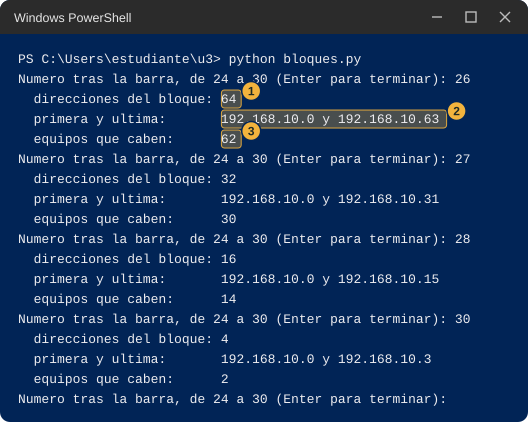<figcaption class="figure-caption">Salida de ejemplo de bloques.py con los números 24, 26 y 30: para cada uno las direcciones del bloque, la primera y la última y los equipos que caben. Las filas del bloque con barra 26 están marcadas con los números uno, dos y tres</figcaption></figure>

:::

8. Ahora elige, para cada grupo, el bloque más pequeño en el que caben todos sus equipos, y copia esta tabla en papel para llenarla con ayuda de la tuya.

   | Grupo | Necesita | Número tras la barra | Direcciones del bloque | Equipos que caben | Lugares que sobran |
   |---|---|---|---|---|---|
   | Sensores | 60 | | | | |
   | Administración | 25 | | | | |
   | Servidores | 10 | | | | |
   | Enlace | 2 | | | | |

9. Suma las direcciones de los cuatro bloques que elegiste y réstalas de 256. Suma los lugares que sobran de la última columna. Recalcula la forma B con los equipos que caben (62 por bloque) y compárala con tus bloques. Pulsa Enter sin escribir nada para cerrar el programa.

::: {.callout-warning}
## Si no te sale la Parte 1

- Dice `can't open file` o `No such file`. Estás en otra carpeta o el archivo se llama `bloques.py.txt`. Escribe `cd ~\u3` y revisa con `dir`.
- Dice `IndentationError`. Al pegar se perdieron los espacios del comienzo de línea. Vuelve a abrir el archivo y pega el bloque completo.
- Los números no te cuadran con los de la imagen. La imagen usa los mismos números para 24, 26 y 30. Si los tuyos son distintos, revisa que el bloque empieza en `192.168.10.0`.
:::

### Haz. Parte 2, con tu pareja

Esta parte no usa la red, solo la conversación, así que siempre se puede completar.

1. Intercambien las tablas del paso 8 y comparen, fila por fila, los números que eligió cada uno.
2. Si en alguna fila eligieron números distintos, cada uno escribe el número del otro en `bloques.py` y mira si el bloque alcanza.
3. Entre los dos escriban en una frase la regla que usaron para elegir el tamaño de cada bloque.
4. Discutan si hay una sola forma de repartir los 256 y por qué.

### Anota y observa

Completa la tabla de registro con tus números y los de tu pareja. Después responde.

- Con partes iguales, ¿sobra o falta? ¿Qué pasa con el grupo más grande y con el más pequeño?
- ¿Qué números de direcciones puede tener un bloque, según la tabla que llenaste?
- Con tamaños distintos, ¿cuántas direcciones quedan sin repartir?

::: {.callout-note collapse="true"}
## Qué deberías haber visto

Con dos partes iguales no alcanzan las partes para los cuatro grupos. Con cuatro partes de 64 cabe cada grupo, pero se pierden 151 lugares de equipo (248 caben contra 97 que se necesitan) y no queda nada libre. Con ocho partes de 32 el grupo de los sensores no cabe en una sola parte. Un bloque solo puede tener 256, 128, 64, 32, 16, 8 o 4 direcciones en la herramienta, y siempre caben dos equipos menos que direcciones tiene el bloque. Con tamaños distintos queda así: 64 direcciones para los sensores (caben 62), 32 para administración (caben 30), 16 para los servidores (caben 14) y 4 para el enlace (caben 2). Suman 116, así que quedan 140 direcciones sin repartir, y sobran 11 lugares de equipo dentro de los bloques elegidos.

::: {.diagrama}

<svg viewBox="0 0 760 232" xmlns="http://www.w3.org/2000/svg" role="img" aria-label="El mismo bloque de 256 direcciones repartido con un tamaño distinto para cada grupo: 64 direcciones para los sensores, 32 para administración, 16 para servidores, 4 para el enlace y 140 libres" font-family="Segoe UI, Inter, system-ui, sans-serif">
<text x="380" y="18" font-size="14" font-weight="700" fill="#12324f" text-anchor="middle">Un tamaño distinto para cada grupo</text>
<rect x="40.0" y="40" width="170.0" height="40" fill="#dcebf9" stroke="#9fc2e6"/>
<text x="125.0" y="65" font-size="12.5" font-weight="700" fill="#12324f" text-anchor="middle">64</text>
<rect x="210.0" y="40" width="85.0" height="40" fill="#dcebf9" stroke="#9fc2e6"/>
<text x="252.5" y="65" font-size="12.5" font-weight="700" fill="#12324f" text-anchor="middle">32</text>
<rect x="295.0" y="40" width="42.5" height="40" fill="#dcebf9" stroke="#9fc2e6"/>
<text x="316.2" y="65" font-size="12.5" font-weight="700" fill="#12324f" text-anchor="middle">16</text>
<rect x="337.5" y="40" width="10.6" height="40" fill="#dcebf9" stroke="#9fc2e6"/>
<rect x="348.1" y="40" width="371.9" height="40" fill="#f5f7fa" stroke="#cfd8e3"/>
<text x="534.1" y="65" font-size="12.5" font-weight="700" fill="#12324f" text-anchor="middle">140 libres</text>
<path d="M342.8,80 L342.8,96" stroke="#5b6876" stroke-width="1" fill="none"/>
<text x="342.8" y="108" font-size="12.5" font-weight="700" fill="#12324f" text-anchor="middle">4</text>
<text x="80" y="136" font-size="12.5" font-weight="700" fill="#12324f" text-anchor="start">sensores</text>
<text x="250" y="136" font-size="12.5" font-weight="400" fill="#12324f" text-anchor="start">64 direcciones</text>
<text x="400" y="136" font-size="12.5" font-weight="400" fill="#12324f" text-anchor="start">caben 62</text>
<text x="520" y="136" font-size="12.5" font-weight="400" fill="#12324f" text-anchor="start">necesitan 60</text>
<text x="80" y="156" font-size="12.5" font-weight="700" fill="#12324f" text-anchor="start">administración</text>
<text x="250" y="156" font-size="12.5" font-weight="400" fill="#12324f" text-anchor="start">32 direcciones</text>
<text x="400" y="156" font-size="12.5" font-weight="400" fill="#12324f" text-anchor="start">caben 30</text>
<text x="520" y="156" font-size="12.5" font-weight="400" fill="#12324f" text-anchor="start">necesitan 25</text>
<text x="80" y="176" font-size="12.5" font-weight="700" fill="#12324f" text-anchor="start">servidores</text>
<text x="250" y="176" font-size="12.5" font-weight="400" fill="#12324f" text-anchor="start">16 direcciones</text>
<text x="400" y="176" font-size="12.5" font-weight="400" fill="#12324f" text-anchor="start">caben 14</text>
<text x="520" y="176" font-size="12.5" font-weight="400" fill="#12324f" text-anchor="start">necesitan 10</text>
<text x="80" y="196" font-size="12.5" font-weight="700" fill="#12324f" text-anchor="start">enlace</text>
<text x="250" y="196" font-size="12.5" font-weight="400" fill="#12324f" text-anchor="start">4 direcciones</text>
<text x="400" y="196" font-size="12.5" font-weight="400" fill="#12324f" text-anchor="start">caben 2</text>
<text x="520" y="196" font-size="12.5" font-weight="400" fill="#12324f" text-anchor="start">necesitan 2</text>
</svg>

:::
:::

::: {.callout-tip}
## En clase

Esta estación abre el tema de VLSM, CIDR y el prefijo, y del cálculo del desperdicio. Las preguntas que quedan son por qué siempre caben dos equipos menos que direcciones tiene el bloque y por qué los tamaños son potencias de 2.
:::

## Estación 5. Por dónde salgo

Cuando tu computador envía un mensaje a otro equipo, alguien tiene que decidir por dónde sale. En esta estación miras dos herramientas de Windows que muestran esa decisión: una lista las salidas que conoce tu equipo y la otra sigue el camino real de un mensaje.

### Predice

::: {.diagrama}

<svg viewBox="0 0 760 170" xmlns="http://www.w3.org/2000/svg" role="img" aria-label="Tu equipo y dos destinos: el equipo de tu compañero y la dirección 8.8.8.8. Para cada destino te preguntas cuántos saltos hay en el camino" font-family="Segoe UI, Inter, system-ui, sans-serif">
<defs><marker id="pf6" viewBox="0 0 10 10" refX="10" refY="5" markerWidth="8" markerHeight="8" orient="auto"><path d="M0,0 L10,5 L0,10 z" fill="#5b6876"/></marker></defs>
<rect x="30" y="60" width="130" height="50" rx="8" fill="#eef4fa" stroke="#c7d6e6"/>
<text x="95.0" y="89.5" font-size="13" font-weight="700" fill="#12324f" text-anchor="middle">Tu equipo</text>
<rect x="600" y="18" width="130" height="46" rx="8" fill="#eef4fa" stroke="#c7d6e6"/>
<text x="665.0" y="36.5" font-size="13" font-weight="400" fill="#12324f" text-anchor="middle">Equipo del</text>
<text x="665.0" y="54.5" font-size="13" font-weight="400" fill="#12324f" text-anchor="middle">compañero</text>
<rect x="600" y="106" width="130" height="46" rx="8" fill="#eef4fa" stroke="#c7d6e6"/>
<text x="665.0" y="133.6" font-size="13" font-weight="700" fill="#12324f" text-anchor="middle" font-family="Consolas, Courier New, monospace">8.8.8.8</text>
<path d="M160,85 H380 V41 H600" fill="none" stroke="#5b6876" stroke-width="1.8" marker-end="url(#pf6)"/>
<path d="M160,85 H380 V129 H600" fill="none" stroke="#5b6876" stroke-width="1.8" marker-end="url(#pf6)"/>
<text x="490" y="34" font-size="12.5" font-weight="700" fill="#12324f" text-anchor="middle">¿cuántos saltos?</text>
<text x="490" y="122" font-size="12.5" font-weight="700" fill="#12324f" text-anchor="middle">¿cuántos saltos?</text>
</svg>

:::

Escribe en la tabla qué crees que va a pasar antes de ejecutar nada. Un salto es cada equipo intermedio por el que pasa el mensaje antes de llegar a su destino.

::: {.tabla-ancha}

| Qué miro | Mi predicción | Parte 1 (mi equipo) | Parte 2 (con mi pareja) | Qué me llamó la atención |
|---|---|---|---|---|
| Cuántos saltos hay hasta 8.8.8.8 | | | (no aplica) | |
| Cuántos saltos hay hasta mi compañero | | (no aplica) | | |
| La "Puerta de enlace" de la fila que empieza con 0.0.0.0, comparada con la de `ipconfig` | | | (no aplica) | |
| La primera dirección de `tracert` hacia 8.8.8.8: ¿es igual en mi equipo y en el de mi compañero? | | | | |

:::

### Haz. Parte 1, en tu equipo

1. Abre PowerShell y escribe `cd ~\u3`. Pulsa Enter.
2. Escribe el siguiente comando y pulsa Enter.

   ```text
   route print -4
   ```

   | Pieza | Qué hace |
   |---|---|
   | `route` | Muestra y administra la lista de salidas que conoce tu equipo. La documentación de Microsoft la llama tabla de enrutamiento. |
   | `print` | Le pide que solo la muestre. Otras palabras, como `add` o `delete`, la modifican y no se usan en esta guía. |
   | `-4` | Que muestre solo las direcciones de cuatro números. Esta opción la acepta el comando en Windows 11 aunque la página de Microsoft no la menciona. |

3. Debe aparecer algo como la imagen, que es una versión recortada. Hay una lista de interfaces arriba y, debajo de `Rutas activas:`, una tabla de cinco columnas con encabezados `Destino de red`, `Máscara de red`, `Puerta de enlace`, `Interfaz` y `Métrica`. Tu tabla tendrá otros números y quizá más filas. No intentes entender todas las columnas; solo busca lo que pide el paso siguiente.

::: {.tabla-ancha}

<figure class="figure">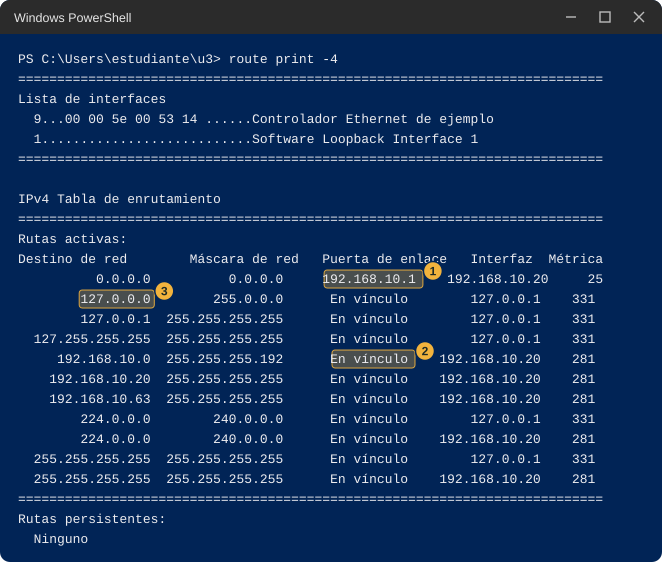<figcaption class="figure-caption">Salida de ejemplo de route print -4, recortada: la fila que empieza con 0.0.0.0 está marcada con el número uno, una fila que dice En vínculo con el número dos y la fila del propio equipo con el número tres</figcaption></figure>

:::

4. Busca la fila que empieza con `0.0.0.0` en las dos primeras columnas (marcada con el 1 en la imagen). Anota el valor de su columna `Puerta de enlace` y el de su columna `Interfaz`. Compáralos con la "Puerta de enlace predeterminada" y la "Dirección IPv4" de tu Hoja de pareja.
5. Busca una fila cuya columna `Puerta de enlace` diga `En vínculo` y cuyo primer número se parezca a tu dirección (marcada con el 2 en la imagen). Cuenta cuántas filas dicen `En vínculo`.
6. Escribe el siguiente comando y pulsa Enter. Sale a Internet y puede tardar; en el peor caso, unos 24 segundos. Espera sin tocar nada. Si tu sala no tiene salida a Internet, este paso puede salir con `*`. Anótalo y sigue: el paso 9 sirve sin red.

   ```text
   tracert -d -h 8 -w 1000 8.8.8.8
   ```

   | Pieza | Qué hace |
   |---|---|
   | `tracert` | Sigue el camino de un mensaje, equipo por equipo. Según la documentación de Microsoft lo hace enviando mensajes de prueba que sobreviven un equipo más cada vez. |
   | `-d` | No intentes averiguar los nombres de los equipos del camino, solo muestra sus direcciones. Así es más rápido. |
   | `-h 8` | Como máximo ocho saltos. Si no se indica, el máximo es 30. |
   | `-w 1000` | Espera como máximo 1000 milésimas de segundo, es decir 1 segundo, la respuesta de cada equipo. Si no se indica, según la documentación de Microsoft, espera 4 segundos. |
   | `8.8.8.8` | Una dirección fuera del laboratorio, que sirve de destino de prueba. |

7. Debe aparecer algo como la imagen, con una línea por salto: el número del salto, tres tiempos en milisegundos y la dirección del equipo que contestó. Una línea con `*` y "Tiempo de espera agotado para esta solicitud." significa que ese equipo no contestó dentro del tiempo de espera, que con `-w 1000` es de 1 segundo. Al final dice "Traza completa.", incluso si el último salto no llegó a 8.8.8.8.

::: {.tabla-ancha}

<figure class="figure">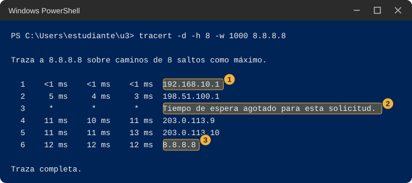<figcaption class="figure-caption">Salida de ejemplo de tracert -d -h 8 -w 1000 8.8.8.8: la primera dirección está marcada con el número uno, una línea de tiempo de espera agotado con el número dos y la llegada a 8.8.8.8 con el número tres</figcaption></figure>

:::

8. Anota la dirección del primer salto y cuántos saltos hubo hasta que apareció 8.8.8.8, o si no apareció dentro de los 8.
9. Escribe `tracert -d 127.0.0.1` y pulsa Enter. Anota cuántas líneas aparecen.

::: {.callout-warning}
## Si no te sale la Parte 1

- `tracert` sigue tardando. Cada intento sin respuesta espera 1 segundo. Ciérralo con Ctrl+C y anota hasta qué salto llegó.
- Todas las líneas son `*`. La sala puede no dejar salir este tipo de mensajes de prueba. Anota si al menos el primer salto contestó.
- `route print -4` imprime errores de uso. Escribe el comando exactamente como en el paso 2, con un espacio antes del `-4`.
:::

### Haz. Parte 2, con tu pareja

1. Escribe `tracert -d -h 8 -w 1000 ` seguido de la dirección IPv4 de tu compañero de la Hoja de pareja, y pulsa Enter. Espera a que termine.
2. Cuenta cuántas líneas con número de salto aparecen. Si aparece una sola con la dirección de tu compañero, el mensaje llegó sin pasar por un equipo intermedio.
3. Comparen con su pareja la primera dirección de su `tracert` hacia 8.8.8.8: ¿es la misma en los dos equipos?
4. Anota ambos datos en la columna "Parte 2".

::: {.callout-warning}
## Si no te sale la Parte 2

No afirmes cuál es la causa. Anota el resultado y marca las posibilidades que veas razonables.

- Todas las líneas hacia tu compañero son `*`. Su firewall pudo haber descartado los mensajes de prueba, o están en redes distintas, o la dirección está mal copiada.
- Aparece primero una dirección que no es la de tu compañero. Eso significa que el mensaje salió por otro equipo antes de llegar. Compara esa dirección con tu "Puerta de enlace predeterminada".
- Sus primeras direcciones hacia 8.8.8.8 son distintas. Es una posibilidad: pueden estar en redes distintas dentro de la sala.
:::

### Anota y observa

- ¿La "Puerta de enlace" de la fila `0.0.0.0` es la misma que la "Puerta de enlace predeterminada" de `ipconfig`? ¿Y es la primera dirección de `tracert`?
- ¿Cuántos saltos hubo hasta tu compañero, y cuántos hasta 8.8.8.8?
- Según lo que viste, ¿cuándo sale tu mensaje por esa primera dirección y cuándo no?

::: {.callout-note collapse="true"}
## Qué deberías haber visto

En una prueba en Windows 11, la fila `0.0.0.0` de `route print -4` tenía la misma puerta de enlace que `ipconfig` y que el primer salto de `tracert` hacia 8.8.8.8. Es la salida que tu equipo usa cuando ninguna otra fila de la tabla describe el destino. Las filas `En vínculo` describen lo que tu equipo alcanza sin ayuda. Hacia un destino que eres tú mismo, `tracert` muestra una sola línea. Hacia un compañero que esté en tu mismo grupo se espera una sola línea con su dirección, y hacia uno que esté en otro se espera que aparezca primero la salida. Esto último no se pudo probar con dos equipos antes de la clase, así que dependerá de cómo esté armada tu sala.
:::

::: {.callout-tip}
## En clase

Esta estación abre el tema de la tabla de rutas, la ruta por defecto y el router. La pregunta que queda es cómo elige tu equipo una fila cuando varias describen el mismo destino, y por qué dos grupos de equipos necesitan un router para hablarse.
:::

## Estación 6. Dos programas hablando

En esta estación escribes dos programas que se hablan por la red de tu computador, descubres qué pasa cuando el otro no está, y mides cuánto tarda en llegar una mala noticia. Hay dos tipos de programa. Los nombres de sus archivos dicen TCP y UDP, y en clase se explica qué los diferencia.

### Predice

Antes de ejecutar nada, escribe qué crees que va a pasar en cada situación.

::: {.tabla-ancha}

| Qué miro | Mi predicción | Parte 1 (mi equipo) | Parte 2 (con mi pareja) | Qué me llamó la atención |
|---|---|---|---|---|
| El programa que llama, cuando el que espera está encendido | | | | |
| TCP: el programa que llama cuando nadie espera. ¿Qué dice y cuánto tarda? | | | | |
| UDP: el programa que llama cuando nadie espera en mi mismo equipo. ¿Qué dice y cuánto tarda? | | | (no aplica) | |
| UDP: el programa que llama a una dirección que no existe. ¿Qué dice y cuánto tarda? | | | (no aplica) | |
| Test-NetConnection: segundos con alguien esperando | | | | |
| Test-NetConnection: segundos con nadie esperando en mi equipo | | | | |
| Test-NetConnection: segundos hacia una dirección que no existe | | | (no aplica) | |

:::

::: {.diagrama}

<svg viewBox="0 0 760 170" xmlns="http://www.w3.org/2000/svg" role="img" aria-label="Dos consolas: la consola 1 ejecuta el programa que espera y la consola 2 el que llama. La consola 2 llama y la consola 1 responde" font-family="Segoe UI, Inter, system-ui, sans-serif">
<defs><marker id="pf7" viewBox="0 0 10 10" refX="10" refY="5" markerWidth="8" markerHeight="8" orient="auto"><path d="M0,0 L10,5 L0,10 z" fill="#5b6876"/></marker></defs>
<rect x="40" y="30" width="300" height="100" rx="8" fill="#fdf0cf" stroke="#ebc866"/>
<text x="190.0" y="66.5" font-size="13" font-weight="700" fill="#12324f" text-anchor="middle">Consola 1</text>
<text x="190.0" y="84.5" font-size="13" font-weight="400" fill="#12324f" text-anchor="middle" font-family="Consolas, Courier New, monospace">python servidor_tcp.py</text>
<text x="190.0" y="102.5" font-size="13" font-weight="400" fill="#5b6876" text-anchor="middle">el programa que espera</text>
<rect x="420" y="30" width="300" height="100" rx="8" fill="#fdf0cf" stroke="#ebc866"/>
<text x="570.0" y="66.5" font-size="13" font-weight="700" fill="#12324f" text-anchor="middle">Consola 2</text>
<text x="570.0" y="84.5" font-size="13" font-weight="400" fill="#12324f" text-anchor="middle" font-family="Consolas, Courier New, monospace">python cliente_tcp.py</text>
<text x="570.0" y="102.5" font-size="13" font-weight="400" fill="#5b6876" text-anchor="middle">el programa que llama</text>
<path d="M420,68 L340,68" fill="none" stroke="#5b6876" stroke-width="1.8" marker-end="url(#pf7)"/>
<path d="M340,100 L420,100" fill="none" stroke="#5b6876" stroke-width="1.8" marker-end="url(#pf7)"/>
<text x="380" y="60" font-size="12.5" font-weight="700" fill="#12324f" text-anchor="middle">llama</text>
<text x="380" y="118" font-size="12.5" font-weight="700" fill="#12324f" text-anchor="middle">responde</text>
<text x="380" y="156" font-size="12" font-weight="400" fill="#5b6876" text-anchor="middle">Parte 1: las dos consolas están en tu equipo. Parte 2: la consola 2 está en el equipo de tu compañero.</text>
</svg>

:::

### Haz. Parte 1, en tu equipo

Necesitas dos consolas. Ábrelas como se explicó en "Cómo abrir una segunda consola" y ponlas una al lado de la otra. En esta guía se llaman consola 1, la que espera, y consola 2, la que llama.

**Los programas de TCP**

1. En la consola 1 escribe `cd ~\u3`. En la consola 2 escribe también `cd ~\u3`.
2. En la consola 1 escribe `notepad servidor_tcp.py`, pulsa Enter y pega este código. Guarda con Ctrl+S y cierra el Bloc de notas.

   ```python
   import socket

   servidor = socket.socket(socket.AF_INET, socket.SOCK_STREAM)
   servidor.bind(("127.0.0.1", 5000))
   servidor.listen()
   print("Escuchando en el puerto 5000")
   conexion, origen = servidor.accept()
   print("Conecto", origen)
   datos = conexion.recv(1024)
   conexion.sendall(datos)
   conexion.close()
   servidor.close()
   ```

3. En la consola 1 escribe `notepad cliente_tcp.py`, pulsa Enter y pega este otro código. Guarda y cierra.

   ```python
   import socket

   cliente = socket.socket(socket.AF_INET, socket.SOCK_STREAM)
   cliente.connect(("127.0.0.1", 5000))
   cliente.sendall(b"temperatura=24.5")
   print(cliente.recv(1024))
   cliente.close()
   ```

4. Lo que hace cada programa se explica en la tabla que sigue, en palabras comunes. Dos líneas son las únicas que cambian entre la Parte 1 y la Parte 2: la que trae `127.0.0.1` en cada programa.

::: {.tabla-ancha}

| Programa | Qué hace |
|---|---|
| `servidor_tcp.py` | Abre una entrada con el número 5000 en tu equipo, escribe "Escuchando en el puerto 5000" y espera una llamada. Cuando llega, escribe quién llamó, lee lo que le mandaron, lo devuelve igual y se cierra. Solo atiende una llamada. |
| `cliente_tcp.py` | Llama a la dirección y al número que trae escritos, manda el texto `temperatura=24.5`, escribe lo que le contestan y se cierra. |

:::

5. Comprueba con `dir` en la consola 1 que existen los dos archivos con esos nombres exactos.
6. En la consola 1 escribe `python servidor_tcp.py` y pulsa Enter. Debe aparecer `Escuchando en el puerto 5000` y el prompt no vuelve. El programa está esperando. Si aparece un error que habla de "un uso de cada dirección", otro programa ya usa el 5000: cambia el 5000 por 5001 en todos los archivos de esta estación y en el comando `medir`, y úsalo en toda la estación.
7. En la consola 2 escribe `python cliente_tcp.py` y pulsa Enter. Debe aparecer `b'temperatura=24.5'` y el prompt vuelve. La `b` delante de las comillas indica que Python imprimió bytes, el mensaje tal como viaja.
8. Mira la consola 1. Debe haber escrito `Conecto ('127.0.0.1', ...)` seguido de un número, y su prompt volvió porque el programa terminó. Ese número lo eligió tu equipo para esa llamada.

::: {.tabla-ancha}

<figure class="figure">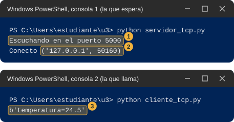<figcaption class="figure-caption">Dos consolas con los programas de TCP: en la primera el texto Escuchando en el puerto 5000 marcado con el número uno y la línea Conecto con la dirección de quien llamó marcada con el número dos, y en la segunda la respuesta recibida marcada con el número tres</figcaption></figure>

:::

9. Repite los pasos 6 y 7. Anota si el número de la línea `Conecto` es el mismo que la primera vez.
10. Ahora la consola 1 está sin programa esperando. En la consola 2 escribe otra vez `python cliente_tcp.py` y cuenta mentalmente cuánto tarda en aparecer algo. Debe aparecer un error que termina con `ConnectionRefusedError: [WinError 10061]`. Anota el texto y el tiempo.

::: {.tabla-ancha}

<figure class="figure">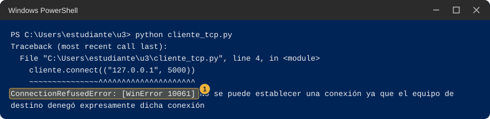<figcaption class="figure-caption">Salida de ejemplo de cliente_tcp.py cuando nadie espera: la línea del error ConnectionRefusedError con el código 10061 está marcada con el número uno</figcaption></figure>

:::

**Los programas de UDP**

11. En la consola 1 crea `servidor_udp.py` con `notepad servidor_udp.py`, pega este código, guarda y cierra.

    ```python
    import socket

    servidor = socket.socket(socket.AF_INET, socket.SOCK_DGRAM)
    servidor.bind(("127.0.0.1", 5000))
    print("Escuchando en el puerto 5000")
    datos, origen = servidor.recvfrom(1024)
    print("Llego", datos, "desde", origen)
    servidor.sendto(datos, origen)
    servidor.close()
    ```

12. En la consola 1 crea `cliente_udp.py` con `notepad cliente_udp.py`, pega este código, guarda y cierra.

    ```python
    import socket

    cliente = socket.socket(socket.AF_INET, socket.SOCK_DGRAM)
    cliente.settimeout(3)
    cliente.sendto(b"temperatura=24.5", ("127.0.0.1", 5000))
    try:
        print(cliente.recvfrom(1024)[0])
    except socket.timeout:
        print("Sin respuesta")
    ```

13. En la consola 1 escribe `python servidor_udp.py` y pulsa Enter. Debe escribir `Escuchando en el puerto 5000` y esperar.
14. En la consola 2 escribe `python cliente_udp.py` y pulsa Enter. Debe aparecer `b'temperatura=24.5'`. En la consola 1 debe aparecer `Llego b'temperatura=24.5' desde ...` con la dirección y un número, y el prompt vuelve.

::: {.tabla-ancha}

<figure class="figure">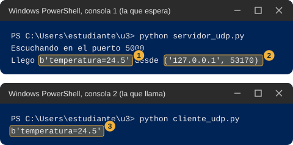<figcaption class="figure-caption">Dos consolas con los programas de UDP: en la primera el mensaje recibido y quién lo envió, marcados con los números uno y dos, y en la segunda la respuesta marcada con el número tres</figcaption></figure>

:::

15. Con la consola 1 sin programa esperando, escribe en la consola 2 `python cliente_udp.py` otra vez. Anota qué aparece y cuánto tarda. En Windows y contra tu propio equipo debe aparecer un error que termina con `ConnectionResetError: [WinError 10054]`.

::: {.tabla-ancha}

<figure class="figure">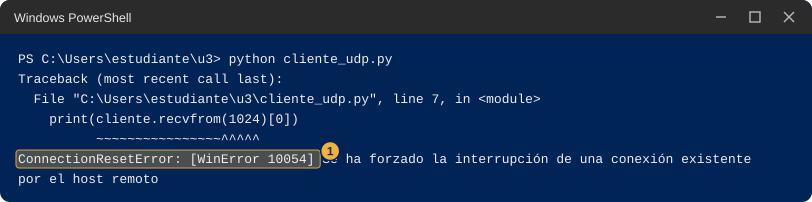<figcaption class="figure-caption">Salida de ejemplo de cliente_udp.py cuando nadie espera en el mismo equipo: la línea del error ConnectionResetError con el código 10054 está marcada con el número uno</figcaption></figure>

:::

16. Abre `cliente_udp.py` con `notepad cliente_udp.py` y cambia `127.0.0.1` por `192.0.2.99`. El RFC 5737 reserva ese bloque de direcciones para ejemplos en documentación, así que no debería existir ningún equipo con esa dirección. Guarda y cierra.
17. En la consola 2 escribe `python cliente_udp.py` y pulsa Enter. Espera sin tocar nada: pasan unos tres segundos y aparece `Sin respuesta`. Anota qué aparece y cuánto tarda.
18. Vuelve a cambiar en `cliente_udp.py` la dirección `192.0.2.99` por `127.0.0.1` y guarda. Así queda lista para la Parte 2.

::: {.tabla-ancha}

<figure class="figure">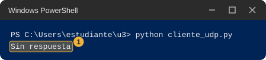<figcaption class="figure-caption">Salida de ejemplo de cliente_udp.py hacia una dirección que no existe: la palabra Sin respuesta está marcada con el número uno</figcaption></figure>

:::

**La herramienta de Windows**

19. En la consola 2 pega este comando de una sola línea y pulsa Enter. No imprime nada: define una pequeña herramienta llamada `medir`.

    ```text
    function medir($ip, $numero) { $t = Get-Date; Test-NetConnection -ComputerName $ip -Port $numero -InformationLevel Quiet; [math]::Round(((Get-Date) - $t).TotalSeconds, 1) }
    ```

    | Pieza | Qué hace |
    |---|---|
    | `function medir($ip, $numero) { ... }` | Crea un comando nuevo llamado `medir`, que recibe una dirección y un número. |
    | `$t = Get-Date` | Guarda la hora actual. |
    | `Test-NetConnection -ComputerName $ip -Port $numero` | Intenta llamar a esa dirección y a ese número, como lo haría un programa. |
    | `-InformationLevel Quiet` | Que imprima solo `True` si lo logró o `False` si no. La documentación de Microsoft explica que `Quiet` devuelve la información básica. |
    | `[math]::Round(((Get-Date) - $t).TotalSeconds, 1)` | Calcula cuántos segundos pasaron desde la hora guardada, con un decimal. |

20. En la consola 1 escribe `python servidor_tcp.py` para que quede esperando. En la consola 2 escribe `medir 127.0.0.1 5000` y pulsa Enter. Debe aparecer `True` y el tiempo en segundos, con coma decimal. La consola 1 escribe `Conecto` y su prompt vuelve.
21. Con la consola 1 sin programa esperando, escribe en la consola 2 `medir 127.0.0.1 5000`. Debe aparecer una línea en inglés, `ADVERTENCIA: TCP connect to (127.0.0.1 : 5000) failed`, después `False` y el tiempo, que está entre 2 y 3 segundos.
22. Escribe en la consola 2 `medir 192.0.2.99 5000` y pulsa Enter. Tarda mucho más: espera sin cerrar nada hasta que aparezca `ADVERTENCIA: TCP connect to (192.0.2.99 : 5000) failed`, `False` y el tiempo. Anota los tres tiempos.

::: {.tabla-ancha}

<figure class="figure">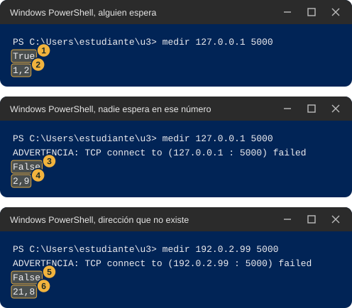<figcaption class="figure-caption">Tres medidas con la herramienta medir: con alguien esperando, True y 1,2 segundos; con nadie esperando en el mismo equipo, False y 2,9 segundos; hacia una dirección que no existe, False y 21,8 segundos. Los valores True, False y los tiempos están marcados con números</figcaption></figure>

:::

23. Opcional. Con la consola 1 sin programa esperando, escribe `Test-NetConnection -ComputerName 127.0.0.1 -Port 5000` para ver la salida completa. Tarda unos 9 segundos; espera. Busca la línea `TcpTestSucceeded`: dice `True` si logró la llamada y `False` si no.

::: {.tabla-ancha}

<figure class="figure">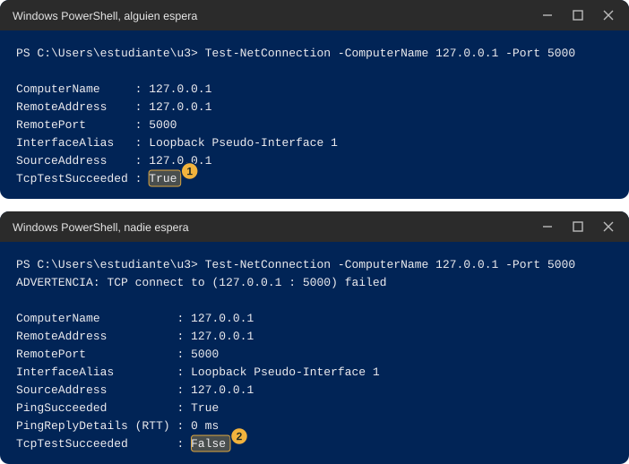<figcaption class="figure-caption">Dos salidas completas de Test-NetConnection con el número 5000: una con TcpTestSucceeded en True y otra con TcpTestSucceeded en False</figcaption></figure>

:::

::: {.callout-warning}
## Si no te sale la Parte 1

- `python` dice `SyntaxError` o `IndentationError`. Al pegar se perdieron los espacios del comienzo de línea. Abre el archivo con `notepad` y pega el bloque completo otra vez.
- La consola 1 dice `OSError` y "un uso de cada dirección". Otro programa usa el 5000. Cambia el número en todos los archivos de esta estación y en el comando `medir`.
- El cliente dice `ConnectionRefusedError` y creías que el servidor estaba encendido. Los programas de TCP atienden una sola llamada y terminan. Vuelve a encender el servidor antes de cada cliente.
- `medir` no se reconoce. Abriste una consola nueva, o la definición no se pegó. Repite el paso 19 en la consola donde lo necesitas.
- `cliente_udp.py` o `medir` hacia 192.0.2.99 terminan al instante con un error en vez de esperar. Tu red devolvió un aviso de que no hay camino. Anota el mensaje exacto y el tiempo: es un dato y la clase lo usa.
- La definición de `medir` falla con "no se puede ejecutar scripts". No debería pasar con una sola línea pegada en la consola. Si pasa, anota el mensaje exacto y sigue sin esa parte.
:::

### Haz. Parte 2, con tu pareja

Esta parte puede fallar por muchas razones ajenas a ti. Sigue los pasos, anota lo que ocurra y pasa a la siguiente estación aunque no haya funcionado. El estudiante A enciende el programa que espera y el B llama.

1. Estudiante A. Abre `servidor_tcp.py` con `notepad servidor_tcp.py`. En la línea `servidor.bind(("127.0.0.1", 5000))` cambia `127.0.0.1` por `0.0.0.0`. Guarda y cierra. Esa dirección significa "cualquier entrada de este equipo", y con ella tu compañero puede llamarte.
2. Estudiante A. En la consola escribe `python servidor_tcp.py` y pulsa Enter. Si aparece el aviso del firewall, sigue "Qué hace el firewall": solo redes privadas, y si pide administrador, cancelar y anotar el mensaje. Debe aparecer `Escuchando en el puerto 5000`.
3. Estudiante A. Dile a B tu dirección IPv4.
4. Estudiante B. Abre `cliente_tcp.py` con `notepad cliente_tcp.py` y cambia `127.0.0.1` por la dirección IPv4 de A. Guarda y cierra.
5. Estudiante B. En la consola escribe `python cliente_tcp.py` y pulsa Enter. Si funcionó, aparece `b'temperatura=24.5'`. Si aparece un error, anótalo completo y mira cuánto tardó.
6. Estudiante A. Si funcionó, tu consola escribió `Conecto` con la dirección de B, no la tuya.
7. Repitan los pasos 1 a 6 con UDP: A cambia `127.0.0.1` por `0.0.0.0` en `servidor_udp.py` y B cambia la dirección en `cliente_udp.py`. Con UDP el cliente espera tres segundos y escribe `Sin respuesta` si no llega nada.
8. Estudiante A. Vuelve a encender el servidor (con `0.0.0.0` todavía puesto) y espera. Cada `medir` gasta una llamada: para repetir, A lo enciende otra vez.
9. Estudiante B. Con el programa de A encendido, escribe `medir ` seguido de la dirección de A y `5000`, por ejemplo `medir 192.168.10.20 5000`. Anota `True` o `False` y el tiempo.
10. Estudiante B. Cuando el programa de A ya terminó (el `medir` anterior gastó su llamada), repite el mismo `medir`. Anota si dio `False` y cuánto tardó. Compara con los tiempos de la Parte 1.
11. Cambien de rol y repitan todo.

::: {.callout-warning}
## Si no te sale la Parte 2

No afirmes cuál es la causa real. Los tiempos son pistas, no certezas. Anota el resultado y marca las posibilidades razonables.

- `ConnectionRefusedError` en pocos segundos. Hubo una respuesta de la otra parte diciendo que nadie espera en ese número. Posibles causas: A no encendió su programa, A dejó el de la Parte 1 con `127.0.0.1`, o se escribió otro número.
- `TimeoutError: [WinError 10060]` después de más de veinte segundos. Nadie contestó. Posibles causas: el firewall de A descartó la llamada, están en redes distintas, la dirección está mal copiada, o el equipo de A está apagado o desconectado.
- `Sin respuesta` en UDP. No distingue entre un mensaje que no llegó, uno que llegó y nadie atendió, o una respuesta que se perdió.
- Windows pidió credenciales de administrador a A y se canceló. Es posible que el programa de A no pueda recibir llamadas de otros equipos.
- `medir` da `False` en entre 2 y 3 segundos cuando el programa de A ya terminó, y `False` en más de veinte segundos cuando el programa de A está encendido. Compara las dos situaciones: si la primera es corta y la segunda es larga, el equipo de A respondió "nadie espera" cuando no había programa y no respondió nada cuando lo había. Es una observación, no una explicación.
:::

### Anota y observa

Llena todas las filas. Después responde.

- ¿Cuánto tardó en aparecer el error de TCP cuando nadie esperaba? ¿Y cuánto cuando la dirección no existía?
- ¿Qué hizo UDP en las mismas dos situaciones? ¿Fue igual a TCP?
- ¿Es lo mismo que nadie espere en un número que nadie conteste? Escribe en una frase por qué crees que sí o que no.

::: {.callout-note collapse="true"}
## Qué deberías haber visto

Con alguien esperando, la llamada funcionó y el programa que llama recibió lo mismo que mandó. Cuando nadie esperaba en tu propio equipo, TCP falló con un rechazo claro (`ConnectionRefusedError`) en unos dos segundos. Cuando la dirección no existía, TCP no recibió nada de nadie y falló mucho después, con `TimeoutError`, tras algo más de veinte segundos. UDP, con la dirección de tu propio equipo y nadie esperando, también terminó con un error, el 10054, pero no porque UDP avise: la documentación de Microsoft sobre la función `recvfrom` explica que, en UDP, ese error indica que un envío anterior provocó un aviso del otro lado diciendo que nadie atendía en ese número. Lo envía el sistema del otro lado, no el programa. Cuando la dirección no existía, UDP no recibió ningún aviso y el programa solo esperó sus tres segundos y escribió `Sin respuesta`. Entonces "cerrado" y "sin respuesta" se ven distintos por el tiempo que tardan en dar el mismo `False`. En clase se estudia qué los produce.

::: {.diagrama}

<svg viewBox="0 0 760 258" xmlns="http://www.w3.org/2000/svg" role="img" aria-label="Barras con el tiempo medido en tres casos: alguien espera, 1,2 segundos con True; nadie espera en ese número, 2,9 segundos con False; dirección que no existe, 21,8 segundos con False" font-family="Segoe UI, Inter, system-ui, sans-serif">
<text x="380" y="18" font-size="14" font-weight="700" fill="#12324f" text-anchor="middle">Cuánto tarda en llegar el False</text>
<text x="60" y="40" font-size="12.5" font-weight="700" fill="#12324f" text-anchor="start">Alguien espera: True</text>
<rect x="60" y="46" width="33.6" height="22" fill="#dff1e6" stroke="#9bcfb0"/>
<text x="101.6" y="62" font-size="12.5" font-weight="700" fill="#12324f" text-anchor="start">1,2 s</text>
<text x="60" y="92" font-size="12.5" font-weight="700" fill="#12324f" text-anchor="start">Nadie espera en ese número</text>
<rect x="60" y="98" width="81.2" height="22" fill="#fbe3df" stroke="#e3a198"/>
<text x="149.2" y="114" font-size="12.5" font-weight="700" fill="#12324f" text-anchor="start">2,9 s</text>
<text x="60" y="144" font-size="12.5" font-weight="700" fill="#12324f" text-anchor="start">Dirección que no existe</text>
<rect x="60" y="150" width="610.4" height="22" fill="#fbe3df" stroke="#e3a198"/>
<text x="678.4" y="166" font-size="12.5" font-weight="700" fill="#12324f" text-anchor="start">21,8 s</text>
<path d="M60,204 L676.0,204" stroke="#5b6876" stroke-width="1.5" fill="none"/>
<path d="M60.0,201 L60.0,207" stroke="#5b6876" stroke-width="1.5" fill="none"/>
<text x="60.0" y="221" font-size="11" font-weight="400" fill="#5b6876" text-anchor="middle">0 s</text>
<path d="M200.0,201 L200.0,207" stroke="#5b6876" stroke-width="1.5" fill="none"/>
<text x="200.0" y="221" font-size="11" font-weight="400" fill="#5b6876" text-anchor="middle">5 s</text>
<path d="M340.0,201 L340.0,207" stroke="#5b6876" stroke-width="1.5" fill="none"/>
<text x="340.0" y="221" font-size="11" font-weight="400" fill="#5b6876" text-anchor="middle">10 s</text>
<path d="M480.0,201 L480.0,207" stroke="#5b6876" stroke-width="1.5" fill="none"/>
<text x="480.0" y="221" font-size="11" font-weight="400" fill="#5b6876" text-anchor="middle">15 s</text>
<path d="M620.0,201 L620.0,207" stroke="#5b6876" stroke-width="1.5" fill="none"/>
<text x="620.0" y="221" font-size="11" font-weight="400" fill="#5b6876" text-anchor="middle">20 s</text>
<text x="380" y="246" font-size="12" font-weight="400" fill="#5b6876" text-anchor="middle">Medidas en un equipo de pruebas. En el tuyo los números cambian, pero el orden de magnitud se parece.</text>
</svg>

:::
:::

::: {.callout-tip}
## En clase

Esta estación abre el tema de los sockets, los puertos, TCP y UDP, el firewall y el aviso de ICMP. Las preguntas que quedan son qué es lo que ocurre dentro del programa en cada línea de `servidor_tcp.py`, y por qué un puerto cerrado responde en dos segundos mientras que un equipo que no contesta tarda veinte.
:::

## Estación 7. Mi plan (opcional)

Con lo que descubriste en las estaciones 3 y 4, diseña cómo repartir las 256 direcciones del laboratorio entre los cuatro grupos. Un programa te dice si tu plan "cabe" o "no cabe", pero no te da la respuesta.

### Predice

::: {.diagrama}

<svg viewBox="0 0 760 202" xmlns="http://www.w3.org/2000/svg" role="img" aria-label="Cuatro grupos que necesitan 60, 25, 10 y 2 equipos, y una barra vacía de 256 direcciones con marcas en .0, .64, .128, .192 y .255" font-family="Segoe UI, Inter, system-ui, sans-serif">
<text x="380" y="18" font-size="14" font-weight="700" fill="#12324f" text-anchor="middle">Cuatro grupos y 256 direcciones</text>
<rect x="40" y="34" width="164" height="44" rx="8" fill="#eef4fa" stroke="#c7d6e6"/>
<text x="122.0" y="51.6" font-size="12.5" font-weight="700" fill="#12324f" text-anchor="middle">sensores</text>
<text x="122.0" y="69.1" font-size="12.5" font-weight="400" fill="#5b6876" text-anchor="middle">60 equipos</text>
<rect x="212" y="34" width="164" height="44" rx="8" fill="#eef4fa" stroke="#c7d6e6"/>
<text x="294.0" y="51.6" font-size="12.5" font-weight="700" fill="#12324f" text-anchor="middle">administración</text>
<text x="294.0" y="69.1" font-size="12.5" font-weight="400" fill="#5b6876" text-anchor="middle">25 equipos</text>
<rect x="384" y="34" width="164" height="44" rx="8" fill="#eef4fa" stroke="#c7d6e6"/>
<text x="466.0" y="51.6" font-size="12.5" font-weight="700" fill="#12324f" text-anchor="middle">servidores</text>
<text x="466.0" y="69.1" font-size="12.5" font-weight="400" fill="#5b6876" text-anchor="middle">10 equipos</text>
<rect x="556" y="34" width="164" height="44" rx="8" fill="#eef4fa" stroke="#c7d6e6"/>
<text x="638.0" y="51.6" font-size="12.5" font-weight="700" fill="#12324f" text-anchor="middle">enlace</text>
<text x="638.0" y="69.1" font-size="12.5" font-weight="400" fill="#5b6876" text-anchor="middle">2 equipos</text>
<rect x="40" y="100" width="680" height="40" fill="#ffffff" stroke="#cfd8e3"/>
<path d="M40.0,140 L40.0,148" stroke="#5b6876" stroke-width="1.5" fill="none"/>
<text x="40.0" y="164" font-size="11.5" font-weight="400" fill="#5b6876" text-anchor="middle">.0</text>
<path d="M210.0,140 L210.0,148" stroke="#5b6876" stroke-width="1.5" fill="none"/>
<text x="210.0" y="164" font-size="11.5" font-weight="400" fill="#5b6876" text-anchor="middle">.64</text>
<path d="M380.0,140 L380.0,148" stroke="#5b6876" stroke-width="1.5" fill="none"/>
<text x="380.0" y="164" font-size="11.5" font-weight="400" fill="#5b6876" text-anchor="middle">.128</text>
<path d="M550.0,140 L550.0,148" stroke="#5b6876" stroke-width="1.5" fill="none"/>
<text x="550.0" y="164" font-size="11.5" font-weight="400" fill="#5b6876" text-anchor="middle">.192</text>
<path d="M720,140 L720,148" stroke="#5b6876" stroke-width="1.5" fill="none"/>
<text x="720" y="164" font-size="11.5" font-weight="400" fill="#5b6876" text-anchor="middle">.255</text>
<text x="380" y="190" font-size="12" font-weight="400" fill="#5b6876" text-anchor="middle">Escribe en papel dónde empieza y dónde termina cada grupo.</text>
</svg>

:::

En papel, antes de tocar el computador, escribe tu primer plan: para cada grupo, cuántas direcciones le vas a dar, en qué dirección empieza y en qué dirección termina. Los bloques no pueden pisarse entre sí.

::: {.tabla-ancha}

| Qué miro | Mi predicción | Parte 1 (mi equipo) | Parte 2 (con mi pareja) | Qué me llamó la atención |
|---|---|---|---|---|
| Mi primer plan, grupo por grupo | | | | |
| Qué grupos dijo el verificador que no cabían | | | | |
| Mi plan final, con la dirección donde empieza cada bloque | | | | |
| Direcciones del laboratorio sin usar en mi plan final | | | | |
| Lugares de equipo que sobran dentro de mis bloques | | | | |

:::

### Haz. Parte 1, en tu equipo

1. Abre PowerShell y escribe `cd ~\u3`. Pulsa Enter.
2. Escribe `notepad verificador.py` y pulsa Enter. Pega este código y guarda.

   ```python
   import ipaddress

   LABORATORIO = ipaddress.ip_network("192.168.10.0/24")
   NECESITA = {"sensores": 60, "administracion": 25, "servidores": 10, "enlace": 2}

   # Escribe cada bloque entre comillas, con la forma "192.168.10.128/25".
   # Deja "" en el grupo que todavia no hayas resuelto.
   mi_plan = {
       "sensores": "",
       "administracion": "",
       "servidores": "",
       "enlace": "",
   }

   bloques = {}
   todo_bien = True
   for grupo, equipos in NECESITA.items():
       texto = mi_plan[grupo].strip()
       if texto == "":
           print(grupo, "-> sin llenar")
           todo_bien = False
           continue
       try:
           bloque = ipaddress.ip_network(texto)
       except ValueError:
           print(grupo, "-> no cabe: esta mal escrito o no puede empezar un bloque de ese tamano en esa direccion")
           todo_bien = False
           continue
       if bloque.prefixlen > 30:
           print(grupo, "-> no cabe: esta herramienta solo acepta bloques de 4 direcciones o mas")
           todo_bien = False
           continue
       if not bloque.subnet_of(LABORATORIO):
           print(grupo, "-> no cabe: queda fuera de 192.168.10.0/24")
           todo_bien = False
       elif len(list(bloque.hosts())) < equipos:
           print(grupo, "-> no cabe: tiene lugar para", len(list(bloque.hosts())), "equipos y necesita", equipos)
           todo_bien = False
       else:
           choques = [otro for otro, b in bloques.items() if b.overlaps(bloque)]
           if choques:
               print(grupo, "-> no cabe: se pisa con", choques[0])
               todo_bien = False
           else:
               print(grupo, "-> cabe")
               bloques[grupo] = bloque

   usadas = sum(b.num_addresses for b in bloques.values())
   sobran = sum(len(list(b.hosts())) - NECESITA[g] for g, b in bloques.items())
   print("Direcciones del laboratorio sin usar:", LABORATORIO.num_addresses - usadas)
   print("Lugares de equipo que sobran dentro de tus bloques:", sobran)
   print("Plan completo:", "cabe" if todo_bien else "todavia no cabe")
   ```

3. Lo que escribe el programa, línea por línea.

   | Línea del resultado | Qué significa |
   |---|---|
   | `grupo -> cabe` | El bloque que escribiste para ese grupo está bien escrito, queda dentro del laboratorio, tiene lugar para todos sus equipos y no se pisa con otro. |
   | `grupo -> no cabe: ...` | Algo de lo anterior falla, y el mensaje dice cuál. No dice qué escribir en cambio. |
   | `grupo -> sin llenar` | Todavía dejaste vacío el grupo. |
   | `Direcciones del laboratorio sin usar` | Cuántas de las 256 no quedaron en ningún bloque. |
   | `Lugares de equipo que sobran dentro de tus bloques` | Cuántos equipos más caben en tus bloques de los que se necesitan. |
   | `Plan completo` | Dice `cabe` solo si los cuatro grupos cabrían a la vez. |

4. Sin cambiar nada, escribe `python verificador.py`. Los cuatro grupos deben decir `sin llenar`, las direcciones sin usar deben ser 256 y debe terminar en `Plan completo: todavia no cabe`.
5. Abre el archivo con `notepad verificador.py` y busca el bloque `mi_plan`. Escribe entre las comillas de cada grupo el bloque de tu plan de papel, con la forma de la dirección donde empieza, una barra y el número que ya usaste en la estación 4. Un ejemplo de la forma, que no es respuesta de ningún grupo, es `"192.168.10.128/25"`. Guarda.
6. Escribe `python verificador.py` y lee el resultado. Corrige solo las líneas que dicen `no cabe`, guarda y vuelve a ejecutar. Repite hasta que `Plan completo` diga `cabe`.
7. Cuando tu plan quepa, prueba otro: pon los cuatro grupos en bloques iguales de 64 direcciones, uno tras otro. Mira cuántos lugares sobran, y compara con el de tu plan.
8. Anota tu plan final y los dos números de la tabla.

::: {.tabla-ancha}

<figure class="figure">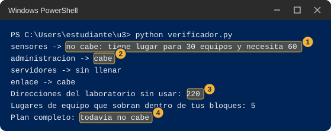<figcaption class="figure-caption">Salida de ejemplo de verificador.py con un plan a medias: el grupo sensores que no cabe y su motivo marcado con el número uno, el grupo administración que sí cabe con el número dos, las direcciones sin usar con el número tres y la conclusión con el número cuatro</figcaption></figure>

:::

::: {.callout-note collapse="true"}
## Pistas, de la más ligera a la más pesada

1. Elige primero cuántas direcciones necesita cada grupo, usando la tabla que llenaste en la estación 4.
2. Coloca primero el grupo más grande y deja los más pequeños para después.
3. Cuando el verificador dice que un bloque está mal escrito aunque lo hayas copiado bien, mira dónde termina el bloque anterior y cuenta cuántas direcciones ocupa. Un bloque de 32 direcciones solo puede empezar en .0, .32, .64, .96 y así sucesivamente, y uno de 16 solo en .0, .16, .32 y así sucesivamente.
:::

::: {.callout-warning}
## Si no te sale la Parte 1

- Python dice `KeyError` o `SyntaxError`. Cambiaste el nombre de un grupo o borraste una comilla o una coma al editar `mi_plan`. Revisa que cada línea tenga la forma `"sensores": "192.168.10.0/26",`.
- Dice `no cabe: esta mal escrito` en un bloque que crees bien. Mira la tercera pista.
- Dice `can't open file`. Estás en otra carpeta: escribe `cd ~\u3`.
:::

### Haz. Parte 2, con tu pareja

Esta parte no usa la red, así que siempre se puede completar.

1. Intercambien sus planes finales escritos en papel.
2. Cada uno escribe el plan del otro en su `verificador.py`, lo ejecuta y anota si cabe.
3. Comparen: si los dos planes caben y son distintos, ¿puede haber más de una repartición correcta? ¿Cuál tiene menos lugares sobrantes?

### Anota y observa

- ¿Qué grupo fue el más difícil de colocar? ¿Por qué?
- ¿Qué cambió entre el plan de papel y el plan final?
- ¿Cuántas direcciones quedan sin usar en el plan con tamaños distintos, y cuántas en el de bloques iguales?

::: {.callout-note collapse="true"}
## Un plan posible

Una repartición que cabe es 192.168.10.0/26 para los sensores, 192.168.10.64/27 para administración, 192.168.10.96/28 para los servidores y 192.168.10.112/30 para el enlace. Con él, el verificador dice que sobran 140 direcciones del laboratorio y 11 lugares de equipo. No es la única que cabe: los mismos tamaños se pueden colocar en otro orden, mientras cada bloque empiece donde puede empezar y ninguno se pise con otro. Con cuatro bloques iguales de 64 el verificador también dice que cabe, pero sobran 151 lugares y no queda ninguna dirección libre.

::: {.diagrama}

<svg viewBox="0 0 760 196" xmlns="http://www.w3.org/2000/svg" role="img" aria-label="Un plan posible: sensores en 192.168.10.0/26, administración en 192.168.10.64/27, servidores en 192.168.10.96/28, enlace en 192.168.10.112/30 y libres de .116 a .255" font-family="Segoe UI, Inter, system-ui, sans-serif">
<text x="380" y="18" font-size="14" font-weight="700" fill="#12324f" text-anchor="middle">Un plan posible</text>
<rect x="40.0" y="34" width="170.0" height="40" fill="#dcebf9" stroke="#9fc2e6"/>
<text x="125.0" y="59" font-size="12" font-weight="700" fill="#12324f" text-anchor="middle">sensores</text>
<rect x="210.0" y="34" width="85.0" height="40" fill="#dcebf9" stroke="#9fc2e6"/>
<text x="252.5" y="59" font-size="12" font-weight="700" fill="#12324f" text-anchor="middle">32</text>
<rect x="295.0" y="34" width="42.5" height="40" fill="#dcebf9" stroke="#9fc2e6"/>
<text x="316.2" y="59" font-size="12" font-weight="700" fill="#12324f" text-anchor="middle">16</text>
<rect x="337.5" y="34" width="10.6" height="40" fill="#dcebf9" stroke="#9fc2e6"/>
<rect x="348.1" y="34" width="371.9" height="40" fill="#f5f7fa" stroke="#cfd8e3"/>
<text x="534.1" y="59" font-size="12" font-weight="700" fill="#12324f" text-anchor="middle">libres: 116 a 255</text>
<text x="80" y="104" font-size="12.5" font-weight="700" fill="#12324f" text-anchor="start">sensores</text>
<text x="250" y="104" font-size="12.5" font-weight="400" fill="#12324f" text-anchor="start" font-family="Consolas, Courier New, monospace">192.168.10.0/26</text>
<text x="470" y="104" font-size="12.5" font-weight="400" fill="#5b6876" text-anchor="start" font-family="Consolas, Courier New, monospace">.0 a .63</text>
<text x="80" y="124" font-size="12.5" font-weight="700" fill="#12324f" text-anchor="start">administración</text>
<text x="250" y="124" font-size="12.5" font-weight="400" fill="#12324f" text-anchor="start" font-family="Consolas, Courier New, monospace">192.168.10.64/27</text>
<text x="470" y="124" font-size="12.5" font-weight="400" fill="#5b6876" text-anchor="start" font-family="Consolas, Courier New, monospace">.64 a .95</text>
<text x="80" y="144" font-size="12.5" font-weight="700" fill="#12324f" text-anchor="start">servidores</text>
<text x="250" y="144" font-size="12.5" font-weight="400" fill="#12324f" text-anchor="start" font-family="Consolas, Courier New, monospace">192.168.10.96/28</text>
<text x="470" y="144" font-size="12.5" font-weight="400" fill="#5b6876" text-anchor="start" font-family="Consolas, Courier New, monospace">.96 a .111</text>
<text x="80" y="164" font-size="12.5" font-weight="700" fill="#12324f" text-anchor="start">enlace</text>
<text x="250" y="164" font-size="12.5" font-weight="400" fill="#12324f" text-anchor="start" font-family="Consolas, Courier New, monospace">192.168.10.112/30</text>
<text x="470" y="164" font-size="12.5" font-weight="400" fill="#5b6876" text-anchor="start" font-family="Consolas, Courier New, monospace">.112 a .115</text>
</svg>

:::
:::

::: {.callout-tip}
## En clase

Esta estación abre el tema del plan de direccionamiento con VLSM. La pregunta que queda es cómo se escribe ese plan para que otras personas puedan usarlo: qué dirección usa la puerta de enlace de cada grupo, cuál es su rango y cuál su dirección de difusión.
:::

## Si algo no te sale

Esta tabla reúne los problemas que más se repiten en toda la guía. Cada estación tiene su propia lista de causas posibles para la Parte 2.

::: {.tabla-ancha}

| Qué ves | Qué probar |
|---|---|
| `python` no se reconoce o se abre la tienda de Microsoft | Prueba `py --version`. Si funciona, usa `py` en lugar de `python`. Si no, avisa al docente. |
| `can't open file ... No such file or directory` | Estás en otra carpeta o el archivo se llama distinto. Escribe `cd ~\u3` y revisa con `dir`. |
| El archivo termina en `.py.txt` | Cámbiale el nombre con `Rename-Item archivo.py.txt archivo.py`. |
| `SyntaxError` o `IndentationError` | Al pegar se perdieron los espacios del comienzo de línea. Borra el contenido del archivo y pega el bloque completo. |
| `OSError ... un uso de cada dirección` | Otro programa usa ese número. Cambia el número en todos los archivos y comandos de la estación. |
| Un programa no devuelve el prompt | Está esperando. Haz clic en su ventana y pulsa Ctrl+C. |
| `medir` no se reconoce | La consola es nueva. Pega otra vez la definición del paso 19 de la estación 6. |
| La Parte 2 no funciona | Anota el resultado y el mensaje exacto, marca las causas posibles, y sigue con la estación siguiente. La Parte 1 basta para completar la estación. |

:::

## Qué cifras no reproduce esta guía

Esta guía no afirma nada que no haya podido comprobarse. Lo siguiente queda fuera, o se dice con reserva.

- Los pasos de la Parte 2 de cada estación necesitan dos equipos y se probaron solo en un equipo, con la dirección 127.0.0.1. Los resultados dibujados de la Parte 2 son ejemplos, no capturas.
- No se probó el aviso del firewall: no se pudo observar la ventana que muestra Windows, así que la guía lo describe sin copiar su texto. Tampoco se probó qué clase de red (privada o pública) le asigna Windows a la red por cable de tu sala.
- No se probó el texto exacto que muestra el Bloc de notas al crear un archivo nuevo, ni el de la página de error del navegador cuando no logra conectar.
- Los tiempos (unos 2 segundos para un rechazo, unos 22 segundos sin respuesta, unos 3 segundos de espera de UDP) se midieron en un solo equipo. En el tuyo cambian, aunque el orden de magnitud se parece.
- El número 5000 figura en el registro de IANA a nombre de un servicio llamado `commplex-main`, y no se verificó en IANA el 8000. La guía los usa porque en un equipo corriente casi nadie los ocupa, no porque estén garantizados libres. Si en tu equipo están ocupados, la guía explica qué hacer.
- La opción `-4` de `route print` funciona en Windows 11, pero la página de Microsoft sobre `route` no la lista.
- Las direcciones de los saltos de `tracert` más allá de tu sala son ejemplos de rangos reservados para documentación, no recorridos reales.
- La regla de que en cada bloque caben dos equipos menos que direcciones tiene el bloque es una observación que hace la herramienta de Python, y la guía no la explica: se explica en clase.

## Recursos

- Microsoft. Referencia de comandos de Windows Server: [ping](https://learn.microsoft.com/en-us/windows-server/administration/windows-commands/ping), [tracert](https://learn.microsoft.com/en-us/windows-server/administration/windows-commands/tracert) y [route](https://learn.microsoft.com/en-us/windows-server/administration/windows-commands/route_ws2008). Microsoft Learn.
- Microsoft. "Test-NetConnection", módulo NetTCPIP. Microsoft Learn. [learn.microsoft.com, test-netconnection](https://learn.microsoft.com/en-us/powershell/module/nettcpip/test-netconnection)
- Microsoft. "Windows Firewall Overview". Microsoft Learn. [learn.microsoft.com, windows-firewall](https://learn.microsoft.com/en-us/windows/security/operating-system-security/network-security/windows-firewall/)
- Microsoft. "Windows Sockets Error Codes". Microsoft Learn, códigos WSAECONNREFUSED y WSAETIMEDOUT. [learn.microsoft.com, windows-sockets-error-codes-2](https://learn.microsoft.com/en-us/windows/win32/winsock/windows-sockets-error-codes-2)
- Microsoft. "recvfrom function (winsock.h)". Microsoft Learn, descripción del código WSAECONNRESET en sockets UDP. [learn.microsoft.com, nf-winsock-recvfrom](https://learn.microsoft.com/en-us/windows/win32/api/winsock/nf-winsock-recvfrom)
- Microsoft. "Starting Windows PowerShell". Microsoft Learn. [learn.microsoft.com, starting-windows-powershell](https://learn.microsoft.com/en-us/powershell/scripting/windows-powershell/starting-windows-powershell)
- Python Software Foundation. "http.server, HTTP servers", incluye la interfaz de línea de comandos y la advertencia de seguridad. [docs.python.org, http.server](https://docs.python.org/3/library/http.server.html)
- Python Software Foundation. "ipaddress, IPv4/IPv6 manipulation library". [docs.python.org, ipaddress](https://docs.python.org/3/library/ipaddress.html)
- Python Software Foundation. "socket, Low-level networking interface". [docs.python.org, socket](https://docs.python.org/3/library/socket.html)
- Python Software Foundation. "Format Specification Mini-Language". [docs.python.org, string.html#formatspec](https://docs.python.org/3/library/string.html#formatspec)
- Python Software Foundation. "Using Python on Windows", sobre el lanzador `py`. [docs.python.org, using/windows](https://docs.python.org/3/using/windows.html)
- Internet Engineering Task Force (IETF). RFC 1122, "Requirements for Internet Hosts, Communication Layers". Octubre de 1989, sección 3.2.1.3 sobre la red 127. [rfc-editor.org, rfc1122](https://www.rfc-editor.org/rfc/rfc1122)
- Internet Engineering Task Force (IETF). RFC 4291, "IP Version 6 Addressing Architecture". Febrero de 2006, sección 2.5.5.2 sobre direcciones IPv4 mapeadas. [rfc-editor.org, rfc4291](https://www.rfc-editor.org/rfc/rfc4291)
- Internet Engineering Task Force (IETF). RFC 5737, "IPv4 Address Blocks Reserved for Documentation". Enero de 2010. [rfc-editor.org, rfc5737](https://www.rfc-editor.org/rfc/rfc5737)
- Internet Engineering Task Force (IETF). RFC 9110, "HTTP Semantics". Junio de 2022, secciones 9.3.1, 15.3.1 y 15.5.5. [rfc-editor.org, rfc9110](https://www.rfc-editor.org/rfc/rfc9110)
- Internet Assigned Numbers Authority (IANA). Service Name and Transport Protocol Port Number Registry. [iana.org, service-names-port-numbers](https://www.iana.org/assignments/service-names-port-numbers/service-names-port-numbers.xhtml)

::: {.pie-doc}
Telemática para IoT (TPI01). Fundación Universitaria María Cano. Facultad de Ingeniería. Semestre 2026-02.

**Transparencia.** La redacción de esta guía contó con el apoyo de inteligencia artificial, con el modelo Claude de Anthropic. El código y los comandos de la Parte 1 se ejecutaron en un equipo con Windows 11 y Python 3.13, y los datos se contrastaron con documentación primaria de Microsoft, Python, la IETF y la IANA. Los pasos de la Parte 2 con pareja no se probaron con dos equipos, y las imágenes de esa parte son dibujos de ejemplo, no capturas.
:::
